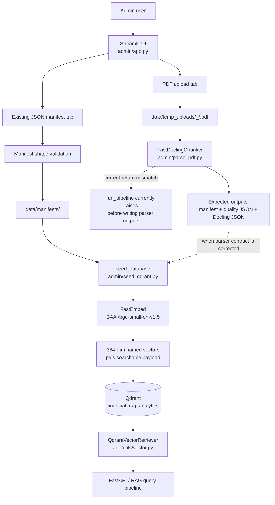
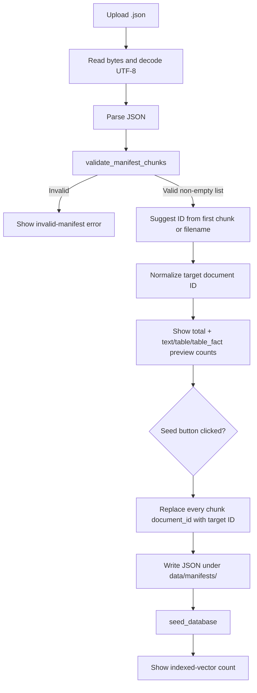

# Admin Ingestion — Implementation and Execution Report

## 1. Purpose, scope, and status

This report documents the current ingestion implementation under [`admin/`](../admin/): its Streamlit UI, PDF parsing and chunking code, manifest seeder, persisted data contracts, Qdrant integration, and the historical code retained beside the active implementation.

The admin subsystem prepares financial-filing content and stores vectors. It is not the chat API. The downstream FastAPI/RAG service reads the indexed Qdrant collection using the contract described in [`app/config.py`](../app/config.py) and [`app/utils/vector.py`](../app/utils/vector.py).

**Important current status:** direct upload of an existing manifest can reach the seeder. The PDF parse path has a return-value mismatch between `FastDoclingChunker.process_pdf()` and `run_pipeline()` (details in [Known implementation limitations](#12-known-implementation-limitations)). As written, that mismatch raises before the parser writes a manifest, so the PDF path is not end-to-end operational until the mismatch is corrected.

This report describes code behavior as it exists, and distinguishes that behavior from intended flow. It does not claim that a local Qdrant database, remote Qdrant service, OCR model, or external credentials are available at runtime.

## 2. Component inventory

| Path | Role | Active status |
|---|---|---|
| [`admin/app.py`](../admin/app.py) | Streamlit UI, upload handling, document-ID normalization, parser/seeder orchestration, session state, and Qdrant configuration controls. | Active UI entry point. |
| [`admin/parse_pdf.py`](../admin/parse_pdf.py) | Docling PDF conversion, OCR selection, text/table parsing, chunk construction, quality reporting, manifest persistence, and parser CLI. | Active parser imported by the UI; has the return-value issue noted above. |
| [`admin/seed_qdrant.py`](../admin/seed_qdrant.py) | Manifest validation, FastEmbed generation, Qdrant collection/index setup, point upsert, and document-scoped stale-point deletion. | Active seeder imported by the UI and runnable as a CLI. |
| [`admin/old_files/`](../admin/old_files/) | Archived parser and seeder implementations. | Not imported by the current UI. |
| [`admin/Untitled16.ipynb`](../admin/Untitled16.ipynb) | Notebook containing an earlier, largely duplicated parsing/chunking implementation and a sample Nike filing run. | Exploratory/legacy; not called by the Streamlit app. |

Generated `__pycache__` files are runtime artifacts, not implementation entry points.

## 3. High-level architecture



### Boundaries

- The admin layer creates embeddings and writes Qdrant points; it does not answer questions.
- The retrieval layer expects the collection and named vector configured by the service: `financial_rag_analytics` and `fastembed-BAAI/bge-small-en-v1.5`.
- Admin and API must target the same Qdrant instance. If `QDRANT_URL` is set, both use remote Qdrant; otherwise, both must resolve to the same local storage directory.
- The default admin local directory and the service default both resolve to the project’s `data/qdrant_storage/`.

## 4. End-to-end execution flows

### 4.1 UI startup and configuration

1. `admin/app.py` loads environment variables with `load_dotenv()`.
2. Logfire is configured with service name `financial-rag-engine`; remote Logfire sending is enabled only when `LOGFIRE_TOKEN` is truthy. Pydantic instrumentation is enabled for the UI process.
3. On Windows, the app installs an asyncio exception handler that suppresses only `ConnectionResetError` with WinError `10054`; other errors are delegated to the loop’s default handler.
4. The app adds its own directory to `sys.path`, then imports `run_pipeline` from `parse_pdf.py` and `seed_database` / `validate_manifest_chunks` from `seed_qdrant.py`.
5. The project root is derived from the location of `admin/app.py`. The UI uses:
   - `data/manifests/` for parser and uploaded-manifest files;
   - `data/temp_uploads/` for uploaded PDFs;
   - `data/qdrant_storage/` as the default local Qdrant path.
   The manifest and temporary-upload directories are created at startup.
6. The sidebar accepts an editable local Qdrant storage path. `QDRANT_URL` from the environment takes precedence over that local path; `QDRANT_API_KEY` is passed to the remote Qdrant client by the seeder.
7. Collection recreation is guarded by two UI controls: the user must select the recreate option and separately confirm deletion. The UI warns that this deletes the entire collection, not only the current document.
8. The app exposes two tabs: PDF upload/parse/index, and pre-parsed manifest upload/index.

### 4.2 PDF upload tab — UI-level flow

```mermaid
flowchart TD
    A[Select one or more PDFs] --> B[Read upload bytes]
    B --> C[SHA-256 of bytes]
    C --> D[Upload key = first 16 hex chars + upload index]
    C --> E[Default document ID = sanitized filename stem + hash prefix]
    D --> F[Persist under data/temp_uploads/<upload key>/<basename>]
    E --> G[User may edit document ID]
    G --> H[Normalize to letters, digits, underscore, hyphen]
    H --> I{User action}
    I -->|Parse| J[run_pipeline(pdf_path, doc_id, data/manifests)]
    J --> K[Store parsed summary in Streamlit session state]
    I -->|Index| L{Matching parse state and manifest exist?}
    L -->|No| M[Show validation error]
    L -->|Yes| N{Collection deletion requested?}
    N -->|Yes, not confirmed| O[Show confirmation error]
    N -->|No / confirmed| P[seed_database(manifest, path, recreate)]
    P --> Q[Show indexed-vector count]
```

Detailed behavior:

- Multiple uploaded PDFs are handled independently in a loop.
- The upload’s full bytes are hashed with SHA-256. The UI key is `<first 16 hash chars>_<index in current upload list>`; the default document ID is a sanitized filename stem plus the same 16-character hash prefix.
- The default ID stem replaces every run outside `[A-Za-z0-9_-]` with `_`, strips leading/trailing `_` and `-`, and falls back to `document` if the stem becomes empty.
- A user-edited PDF document ID is normalized with the same allowed-character replacement. If it normalizes to empty, the default generated ID is used.
- PDF bytes are written only if the corresponding temporary file does not already exist. The stored path is `data/temp_uploads/<upload key>/<original basename>`.
- Parsing is initiated only by the **Parse Document via Docling** button. On success, the UI expects a list of chunk objects and stores the document ID, manifest path, total chunks, table-block count, table-fact count, and text-block count in session state.
- The state key is tied to the content hash and upload index. Before indexing, the UI checks that parse state exists, the parsed document ID matches the currently normalized ID, and the saved manifest path exists. Changing the ID after parsing therefore requires another parse.
- The **Index into Qdrant** action passes the manifest path, sidebar storage path, and effective collection-recreation flag to the seeder. It does not itself run the PDF parser.
- The UI displays the parsed summary when the session-state document ID still matches the currently selected ID.

### 4.3 Existing-manifest tab — UI-level flow



Detailed behavior:

- The uploader accepts JSON. Bytes must decode as UTF-8 and parse as a JSON value accepted by the seeder validator.
- The suggested ID is the first chunk’s `document_id`; if it is absent, the filename stem with `_manifest` substrings removed is used. The input is then normalized to letters, digits, `_`, and `-`.
- The preview counts chunk types exactly equal to `text`, `table`, and `table_fact`. Other/missing chunk types are included in the total but not those three subtotals.
- The upload is actionable only when the validated list is non-empty and the normalized target ID is non-empty.
- Before saving, the UI copies each chunk object and overwrites its top-level `document_id` with the selected target ID. It does not rewrite nested metadata or regenerate chunk IDs itself.
- The uploaded basename is saved in `data/manifests/`; an upload with the same basename can replace the prior file at that path.
- The same collection-deletion confirmation required by the PDF tab applies here.

## 5. PDF conversion and chunking internals

The implementation is in [`admin/parse_pdf.py`](../admin/parse_pdf.py). The core class is `FastDoclingChunker`; it uses Docling for PDF structure and a Hugging Face tokenizer compatible with the embedding model.

### 5.1 Initialization and embedding token budget

- Embedding model/tokenizer default: `BAAI/bge-small-en-v1.5`.
- `MAX_EMBEDDING_TOKENS` is `500`, leaving headroom below the model’s 512-token sequence ceiling.
- The tokenizer’s model maximum is raised internally so the implementation can count and split text itself rather than silently relying on tokenizer truncation.
- The Docling `HybridChunker` receives a `HuggingFaceTokenizer` with a reduced budget. The reduction reserves space for the document/page/section prefix added to the embedding input.
- The prefix can contain `Document:`, `Page:`, and `Section:` values. Prefix growth is capped at one third of the 500-token budget by dropping trailing words.
- `_split_to_budget()` attempts loss-preserving splits by line, sentence punctuation, and whitespace; if none can divide the text, it slices tokenizer IDs into bounded pieces.
- `_pieces()` reserves the prefix budget and an additional small margin before splitting content.
- Parser defaults are `device="auto"`, `num_threads=4`, and `ocr_mode="auto"`. Supported device strings are `auto`, `cpu`, `cuda`, and `mps`; OCR modes are `auto`, `on`, and `off`.

### 5.2 PDF conversion and OCR decision

1. In `ocr_mode="on"`, the parser converts once with OCR enabled.
2. In `ocr_mode="off"`, it converts without OCR.
3. In `ocr_mode="auto"`:
   - first convert without OCR;
   - determine pages with text or table provenance;
   - compare the number of pages without such content to total pages;
   - retry with OCR if the missing-page ratio is greater than `0.20`;
   - if the OCR retry raises, log a warning and keep the original non-OCR document.
4. The PDF converter enables table structure extraction, sets TableFormer to `ACCURATE`, and enables PDF cell matching.
5. Converter instances are cached per OCR setting within the chunker.

`_pages_with_content()` uses page provenance from Docling text and table elements. The OCR ratio is therefore based on extracted text/table provenance, not on a separate visual quality score.

### 5.3 Text chunk processing

- The parser iterates Docling `HybridChunker` output in document order and reads each chunk’s document items, page provenance, and headings.
- Empty text is ignored.
- Text consisting only of configured checkbox/currency glyphs is excluded and counted as glyph noise.
- Boilerplate matching excludes phone-number-only text and text matching the configured IRS-employer-identification or principal-executive-offices phrases.
- Fragments shorter than 35 characters **or** six words are buffered rather than immediately dropped. Adjacent fragments are merged only when page and headings match; buffers flush when context changes or the merged buffer exceeds half of the 500-token budget.
- Larger text chunks flush any buffered fragments and are split against the remaining token budget.
- Each emitted text chunk stores `content`, prefix-enriched `embedding_text`, `document_id`, source filename, page number, headings, page-number lists, empty columns/row-label arrays, a false financial-table flag, and merged-fragment count.
- A text chunk ID is the first 16 hex characters of SHA-256 over the document ID, HybridChunker index, piece index, and piece text.
- Short/merged text suitable for a nearby table may be retained as lead-in context for that table. The code clips this lead-in to at most 48 tokenizer tokens and uses it only when its page matches the table page or either page is unknown.

### 5.4 Structured table parsing

`parse_docling_table()` works with Docling’s structured table grid rather than depending only on flattened table text:

1. `_cell_matrix()` expands row and column spans into a dense cell grid.
2. Header rows are detected from `column_header` flags at the top. If flags are absent, row zero is treated as a header unless its cells look like real numeric data rather than bare years.
3. Header labels combine text from multiple header rows, avoiding repeated cells caused by spans.
4. Columns containing only currency, parentheses, percent, or similar symbols are separated and merged into neighboring numeric cells.
5. Row-label columns are inferred from `row_header` flags; if no row-header flags are reliable, the first candidate column is used.
6. Headerless, mostly textual columns can be treated as wrapped row-label continuation columns instead of value columns.
7. The parser retains section/group rows and carries the current group into subsequent metric rows.
8. Rows with values but no label are retained with a synthesized label and flagged as unlabeled; up to five examples are collected per parsed table.
9. A table is considered unusable when it lacks a usable grid or value columns. Unstructured/non-financial layout tables can also fall back to Markdown when there is no header flag and fewer than 10% of values look numeric.

For table elements, `FastDoclingChunker`:

- builds a map of Docling table references and handles each surfaced table only once;
- includes caption, page, headings, and eligible preceding text in the embedding prefix;
- exports unusable structured tables to Markdown and emits `table` chunks marked `structured: false` when Markdown is available;
- emits structured tables as bounded row blocks. Each block repeats the table header, preserves group rows, and stores its block index, columns, and row labels;
- emits a `table_fact` for each data row, preserving column/value pairs and financial metric/year context. Very wide rows can be divided into fact parts to stay within the embedding budget;
- creates IDs for table blocks from the document ID, table reference, block/piece indexes, and piece text. Fact IDs are derived from document ID, table reference, row index/label, and part index;
- records table/fact fields including page numbers, headings, caption, metric, group, fiscal years, values-by-column, parent table reference, and fact-part indexes;
- makes a second pass over Docling’s table list to process tables the HybridChunker did not surface. A heading map is built from document-order title/section headings for these missed tables.

### 5.5 Parser quality report

`FastDoclingChunker.last_report` contains:

- document ID and source filename;
- total pages and pages without text/table provenance;
- whether OCR was used;
- total chunks and counts by chunk type;
- maximum measured embedding-text token count, configured token budget, and IDs measured over budget;
- fallback-table pages, tables missed by the chunker and their pages, and up to 20 unlabeled-row samples;
- sorted extraction counters, including text chunks, merged fragments, dropped glyph/boilerplate text, table totals/structured/fallback counts, parsed rows, unlabeled rows, and table facts.

An over-budget list is logged as an error; the report records it rather than silently claiming that all inputs passed the quality check.

## 6. Manifest and chunk data contract

### 6.1 Parser-produced chunk

The active parser serializes each `DocumentChunk` dataclass as JSON:

```json
{
  "chunk_id": "stable-content-derived-id",
  "document_id": "document-id",
  "content": "retrievable chunk text",
  "embedding_text": "context-enriched embedding input",
  "chunk_type": "text | table | table_fact",
  "page_number": 1,
  "headings": ["section"],
  "table_caption": "optional table title",
  "source_file": "source.pdf",
  "metadata": {}
}
```

The chunk model defaults `chunk_type` to `text`, headings to an empty list, and metadata to an empty object. Page number, table caption, and source filename may be absent/`null`. Metadata varies by chunk:

- text: page numbers, empty columns/row labels, `is_financial_table: false`, and merged-fragment count;
- structured table: page numbers, columns, row labels, `is_financial_table: true`, table reference, `structured: true`, and table-block index;
- Markdown fallback table: page numbers, empty columns/row labels, table reference, and `structured: false`;
- table fact: page numbers, columns for the fact part, row label, financial-table/fact flags, metric, group, fiscal-year value(s), value-by-column map, parent table reference, unlabeled-row flag, and fact-part indexes.

The parser recognizes years in column labels with a `19xx`, `20xx`, or `21xx`-style four-digit pattern, but only years found in columns are used for parser-generated table-fact year metadata.

### 6.2 Files the parser intends to persist

When the parser contract is functioning, `run_pipeline()` is intended to write under its `out_dir`:

- `<doc_id>_manifest.json`: array of chunk objects;
- `<doc_id>_quality.json`: extraction/quality report;
- `<doc_id>_docling.json`: lossless Docling document JSON, with a warning logged if this optional save fails.

The UI passes `data/manifests/` as the output directory. The code that would write `<doc_id>_document.md` is commented out; that Markdown file is not an active parser output.

## 7. Manifest validation and Qdrant indexing

The active implementation is [`admin/seed_qdrant.py`](../admin/seed_qdrant.py). Both UI tabs call `seed_database()`.

### 7.1 Manifest validation and eligible chunks

`validate_manifest_chunks()` requires:

- the JSON root to be an array;
- every array element to be an object;
- if present, `content`, `embedding_text`, `document_id`, and `chunk_id` to be strings;
- if present, `document_id` and `chunk_id` not to be empty strings;
- if present, `metadata` to be an object.

It does not require every listed field to be present. During seeding, only chunks with a non-empty string `content` are eligible. Empty or missing content is skipped. If no eligible chunks remain, `seed_database()` returns `0` before connecting to Qdrant.

### 7.2 Seeder low-level execution

```mermaid
flowchart TD
    A[seed_database(manifest_path, storage_path, recreate)] --> B[Check file exists]
    B --> C[JSON load + validate array/objects/field types]
    C --> D[Keep chunks with non-empty string content]
    D --> E{Any eligible chunks?}
    E -->|No| Z[Return 0; no Qdrant connection]
    E -->|Yes| F{QDRANT_URL set?}
    F -->|Yes| G[QdrantClient URL + optional API key]
    F -->|No| H[Create local path + QdrantClient(path)]
    G --> I{recreate requested and collection exists?}
    H --> I
    I -->|Yes| J[Delete entire collection]
    I -->|No| K[Ensure collection exists]
    J --> K
    K --> L[Create/ensure payload indexes]
    L --> M[FastEmbed BAAI/bge-small-en-v1.5, batches of 32]
    M --> N[Build deterministic point IDs and payloads]
    N --> O[Upsert points]
    O --> P[Delete stale points for affected document IDs]
    P --> Q[Close client; log count; return point count]
```

Detailed sequence:

1. Convert `manifest_path` to a `Path`; raise `FileNotFoundError` if absent.
2. Load UTF-8 JSON and validate it. Invalid JSON, invalid root types, invalid chunk types, and invalid metadata types raise instead of being indexed.
3. Filter to chunks whose `content` is a string with non-whitespace content. A manifest containing no such chunks returns zero without creating or deleting a collection.
4. Read `QDRANT_URL` and `QDRANT_API_KEY` from the environment:
   - remote URL set: `QdrantClient(url=..., api_key=...)`;
   - no remote URL: create the selected storage directory and use `QdrantClient(path=...)`.
5. If collection recreation was explicitly requested and the collection exists, delete the whole collection.
6. Create the collection if absent, with one named vector:
   - collection: `financial_rag_analytics`;
   - vector: `fastembed-BAAI/bge-small-en-v1.5`;
   - size: `384`;
   - distance: cosine.
7. Create payload indexes for `document_id` (keyword), `chunk_type` (keyword), `company` (keyword), `fiscal_year` (integer), and `fiscal_years` (integer). The current code catches any exception during each index-creation call and ignores it, with a comment that the index may already exist or be handled gracefully.
8. Instantiate `TextEmbedding(model_name="BAAI/bge-small-en-v1.5")`. Embed each chunk’s stripped `embedding_text` when truthy; otherwise embed stripped `content`. Embedding calls use batch size 32.
9. For each eligible chunk:
   - use top-level `document_id`, defaulting to `doc_default` if absent;
   - use top-level `chunk_id`, defaulting to `chunk_<index>` if absent;
   - derive a deterministic UUID v5 from `<document_id>:<chunk_id>` using a fixed namespace;
   - derive company from top-level or metadata `company`, or infer only `Nike` / `Duolingo` when the document ID contains those names;
   - derive fiscal year(s) from top-level or metadata. If both are absent, infer the first `20xx` year found in document ID plus source filename;
   - create a payload with chunk/document IDs, source, content, embedding text, page, fiscal year(s), headings, type, columns, row labels, financial metric, row group, original metadata, and company.
10. Upsert all points into the collection.
11. For each document ID represented by eligible chunks, delete points whose `document_id` matches but whose point IDs are not in the newly upserted set. This synchronizes re-indexed documents without deleting other document IDs.
12. Close the Qdrant client, log the indexed count, and return the number of upserted points.

Because empty-content chunks are filtered before document grouping, a document represented only by empty chunks does not enter the stale-point cleanup pass. Deterministic IDs make an identical document/chunk pair address the same Qdrant point on subsequent indexing.

### 7.3 Payload contract consumed by retrieval

The service’s [`QdrantVectorRetriever`](../app/utils/vector.py) queries the same collection using the configured named vector, and reads content, document, source, page, type, headings, metadata, company, and fiscal-year fields. The seeder’s payload indexes support the service’s document/company/year filtering. The seeder adds top-level metadata fields as well as the full `metadata` object so retrieval can use commonly filtered/displayed fields without unpacking every nested value.

The admin local storage default is derived from the repository root in `seed_qdrant.py`; the service setting defaults to `data/qdrant_storage`. The admin UI sidebar can override its local path. These paths must refer to the same Qdrant data if local mode is used.

## 8. Operational entry points

### Streamlit UI

Run the app from the repository root using the project’s installed environment:

```powershell
streamlit run admin/app.py
```

The UI does not expose parser OCR/device settings; it uses `run_pipeline()` defaults (`device="auto"`, `ocr_mode="auto"`).

### Parser CLI

`admin/parse_pdf.py` supports:

```powershell
python admin/parse_pdf.py --pdf <path> --doc-id <id> --out-dir data/manifests --device auto --ocr auto
```

`--pdf` and `--doc-id` are required. `--device` choices: `auto`, `cpu`, `cuda`, `mps`. `--ocr` choices: `auto`, `on`, `off`. This CLI calls the same `run_pipeline()` function as the UI and is affected by the same return-value mismatch.

### Seeder CLI

`admin/seed_qdrant.py` supports:

```powershell
python admin/seed_qdrant.py --manifest data/manifests/<file>.json
python admin/seed_qdrant.py --all
python admin/seed_qdrant.py --all --recreate
```

- `--manifest` indexes one specified file.
- `--all` indexes JSON files under `data/manifests/`.
- `--recreate` opts into deleting/recreating the collection before the initial manifest in an all-manifest run.
- If neither `--manifest` nor `--all` is supplied, the CLI defaults to all active manifests.
- The all-manifest scan is sorted and excludes names beginning `old_`, containing `_old` or `cache`, ending `.bak`, and ending `_quality.json` or `_docling.json`.
- The CLI does not expose a storage-path argument; it uses the seeder’s default or remote connection environment variables.

## 9. Logging, environment, and side effects

- The UI and seeder both load `.env` and configure Logfire; remote Logfire sending is conditional on `LOGFIRE_TOKEN`.
- The UI adds spans around PDF parse and both indexing actions. The parser records conversion, chunk processing, fallback, and quality events. The seeder records manifest loading, Qdrant connection, embedding, point building, upsert, and completion spans.
- Local filesystem writes include PDF temp files and uploaded JSON manifests. Parser outputs are intended to be written under `data/manifests/`, but the current return-value mismatch prevents those writes in `run_pipeline()`. Uploaded-manifest basename collisions can overwrite a previous file.
- Qdrant side effects include collection creation, payload-index creation attempts, point upserts, stale-point deletions for re-indexed document IDs, and optional whole-collection deletion.
- Whole-collection recreation is destructive and affects every document in that collection. The UI requires explicit confirmation; CLI recreation requires `--recreate`.
- Remote Qdrant settings are environment-driven. When `QDRANT_URL` is configured, it takes precedence over the UI’s local storage-path control.

## 10. Historical and non-active code

- [`admin/old_files/parse_pdf_old.py`](../admin/old_files/parse_pdf_old.py) is an earlier parser based on parsing flattened/serialized table text and building multi-year facts from that representation.
- [`admin/old_files/parse_pdf_new.py`](../admin/old_files/parse_pdf_new.py) is an earlier structured-Docling parser. It shares much of the current table-grid and chunk-generation approach but is not the module imported by the UI.
- [`admin/old_files/seed_qdrant_old.py`](../admin/old_files/seed_qdrant_old.py) is an archived seeder. The current UI imports `admin/seed_qdrant.py`, not this archived file.
- [`admin/Untitled16.ipynb`](../admin/Untitled16.ipynb) contains setup/install cells, a duplicated earlier parsing implementation, and a sample run for `data/raw/Nike-Inc-2026-10K.pdf`. It reports text/table/table-fact distributions and prints sample facts. It is not used by the app and should not be treated as the canonical parser implementation.

## 11. Cross-component integration contract

For newly indexed content to appear in financial RAG queries, all of these conditions must hold:

1. The manifest contains chunk objects whose `content` is non-empty.
2. The seeder can generate embeddings using `BAAI/bge-small-en-v1.5`.
3. The collection exists with a 384-dimensional cosine named vector `fastembed-BAAI/bge-small-en-v1.5`.
4. The admin seeder and API retriever connect to the same Qdrant collection and deployment.
5. Payload values use the expected field names (`document_id`, `company`, `fiscal_year`, `fiscal_years`, `chunk_type`, `source_file`, `page_number`, `headings`, and `metadata`).
6. Document IDs used for filtering agree with those stored in point payloads. In the uploaded-manifest UI workflow, the selected target ID overwrites each chunk’s top-level `document_id` before seeding.

The retrieval implementation performs dense query embedding with the configured model and uses the named vector when querying Qdrant. The admin writes vectors and payloads; it does not update a separate chat-side manifest index itself.

## 12. Known implementation limitations

### 12.1 PDF parse return-value mismatch (blocks PDF ingestion)

`FastDoclingChunker.process_pdf()` returns two values: `(chunks, doc.export_to_markdown())`. However, `run_pipeline()` assigns that pair to one variable:

```python
chunks = chunker.process_pdf(pdf_path, doc_id)
```

It then treats `chunks` as a list of `DocumentChunk` objects when calling `asdict(c)`. The first element is actually the entire chunk list, so `asdict()` receives a list rather than a dataclass and raises before the manifest, quality JSON, or Docling JSON can be written. The UI also expects `run_pipeline()` to return a chunk list and manifest path. Consequently, the PDF upload/parse workflow currently fails; its intended parse summary and subsequent PDF indexing cannot be reached through this implementation as written. The parser CLI has the same underlying issue.

This is documented as an implementation defect, not as intended behavior. The manifest upload tab does not invoke `run_pipeline()` and is not affected by this specific mismatch.

### 12.2 Other behavior to account for

- The seeder’s payload-index creation catches every exception and suppresses it; a failure other than “already exists” would not be surfaced there.
- `seed_database()` returns zero before connecting to Qdrant when no non-empty content chunks remain. In that case it also performs no stale-point cleanup.
- The UI’s manifest preview validates the chunk objects before offering its action, but the seeder remains the authoritative validation at indexing time.
- Collection recreation is collection-wide. It is not a document-scoped replacement.
- The parser quality gate logs and records over-budget chunk IDs; it does not make the returned chunk list conditional on that report.

## 13. Source map

- Streamlit orchestration and upload controls: [`admin/app.py`](../admin/app.py)
- Active Docling parser/chunker and parser CLI: [`admin/parse_pdf.py`](../admin/parse_pdf.py)
- Active manifest validation, embedding, Qdrant write, and seeder CLI: [`admin/seed_qdrant.py`](../admin/seed_qdrant.py)
- Archived parser/seeder code: [`admin/old_files/`](../admin/old_files/)
- Legacy notebook: [`admin/Untitled16.ipynb`](../admin/Untitled16.ipynb)
- Service Qdrant/model settings: [`app/config.py`](../app/config.py)
- Service-side Qdrant retrieval and payload reads: [`app/utils/vector.py`](../app/utils/vector.py)
- Example generated manifest: [`data/manifests/Nike-Inc-2026-10K_manifest.json`](../data/manifests/Nike-Inc-2026-10K_manifest.json)
