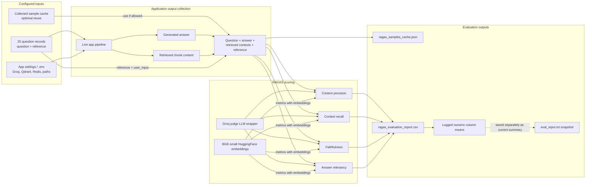

# Financial RAG Evaluation — System Design and Execution Guide

## 1. Purpose, scope, and evidence boundary

This document describes the active evaluation workflow implemented by
[`evaluation/ragas4.py`](../evaluation/ragas4.py): its dataset contract,
collection of live RAG outputs, sample cache, judge configuration, RAGAS metric
execution, CSV report, command-line behavior, and reproducibility caveats.

The evaluator measures the behavior of the application in
[`app/pipeline.py`](../app/pipeline.py) using a fixed question/reference
dataset. It is an offline evaluation script, not part of the serving API.

### Included in scope

- The active RAGAS runner: [`evaluation/ragas4.py`](../evaluation/ragas4.py).
- The exact dataset path configured in that runner:
  [`evaluation/dataset/ragas_dataset_cleaned_all.json`](../evaluation/dataset/ragas_dataset_cleaned_all.json).
- The active collected-sample cache path:
  [`evaluation/ragas_samples_cache.json`](../evaluation/ragas_samples_cache.json).
- The active per-question score output:
  [`evaluation/report/ragas_evaluation_report.csv`](../evaluation/report/ragas_evaluation_report.csv).
- The checked-in/current summary text:
  [`evaluation/report/eval_repor.txt`](../evaluation/report/eval_repor.txt).
- The recorded command in [`evaluation/cmd.txt`](../evaluation/cmd.txt).

### Explicitly excluded

This report does not use or describe `evaluation/old_eval/`, old or backup
datasets, earlier report CSVs, unrelated evaluation utilities, or separate
evaluation approaches. The other cleaned dataset subsets are not inputs to the
active runner because `DATASET_PATH` points only to the consolidated
`ragas_dataset_cleaned_all.json`.

The implementation details below describe the current source, not a guarantee
that external services, API credentials, model names, or the recorded scores
will work or reproduce identically in a new environment.

## 2. Executive overview

The active evaluation consists of two sequential phases:

1. **Collect evaluation samples:** For each answerable dataset row, call the
   application's asynchronous RAG pipeline with the question, collect its
   generated answer and up to five retrieved chunk contents, and pair those
   outputs with the dataset reference. Optionally reuse a JSON cache instead
   of rerunning the application.
2. **Score samples:** Configure four RAGAS metrics with a Groq-backed judge and
   BGE-small embeddings, evaluate each sample/metric, and write one CSV row per
   evaluated question.

```mermaid
flowchart TD
    CMD[python -m evaluation.ragas4<br/>optional --refresh] --> MAIN[main()]
    MAIN --> CACHE{Collected-sample cache exists<br/>and refresh not requested?}
    CACHE -->|Yes| LOADCACHE[Load and validate cached samples]
    LOADCACHE -->|valid non-empty| SAMPLES[Evaluation samples]
    LOADCACHE -->|missing, invalid, empty, load error| DATA[Load consolidated JSON dataset]
    CACHE -->|No / --refresh| DATA

    DATA --> FILTER[Per-row answerable check<br/>and required fields]
    FILTER --> LIMIT[Semaphore: max 2 pipeline items]
    LIMIT --> APP[run_rag_pipeline_async(ChatRequest)]
    APP --> OUTPUT[Generated answer + retrieved chunks]
    OUTPUT --> TRIM[Keep up to 5 contexts<br/>truncate each to 1500 chars]
    TRIM --> VALID{Non-empty answer and<br/>at least one context?}
    VALID -->|No / exception| PROBLEM[Record item issue]
    VALID -->|Yes| COLLECT[Collected sample:<br/>question, contexts, response, reference]
    COLLECT --> CACHEWRITE[Write sample cache JSON]
    CACHEWRITE --> SAMPLES

    SAMPLES --> JUDGE[Build Groq judge wrapper<br/>and HuggingFace embeddings]
    JUDGE --> METRICS[Configure RAGAS metrics]
    METRICS --> LOOP[For each sample, score metrics sequentially]
    LOOP --> M1[context_precision]
    M1 --> M2[context_recall]
    M2 --> M3[faithfulness]
    M3 --> M4[answer_relevancy]
    M4 --> ERROR{Metric exception?}
    ERROR -->|Yes| NAN[Log and record NaN]
    ERROR -->|No| SCORE[Record score]
    NAN --> ROW[Append one result row]
    SCORE --> ROW
    ROW --> MORE{More samples?}
    MORE -->|Yes| LOOP
    MORE -->|No| CSV[Write report CSV]
    CSV --> SUMMARY[Log column means]
    SUMMARY --> DONE[Exit]
    PROBLEM --> CACHEWRITE
```

### Key interpretation

- This runner does **not** evaluate the `response` or
  `retrieved_contexts` already present in the input dataset as the application
  output. It calls the live application pipeline to generate a fresh answer
  and evidence, then uses the dataset’s `user_input` and `reference`.
- Cached samples represent previously collected live pipeline outputs. Unless
  `--refresh` is used, evaluation may score those cached outputs rather than
  the current application behavior.
- The CSV is an output artifact, not proof that the current evaluator source
  can successfully regenerate the same results.

## 3. Active files and responsibilities

| File | Role in active workflow |
|---|---|
| [`evaluation/ragas4.py`](../evaluation/ragas4.py) | Main and only active runner described here: loads data/cache, invokes the app pipeline, configures judge/embeddings, runs RAGAS metrics, and writes the CSV. |
| [`evaluation/dataset/ragas_dataset_cleaned_all.json`](../evaluation/dataset/ragas_dataset_cleaned_all.json) | Configured 25-item question/reference dataset. |
| [`evaluation/ragas_samples_cache.json`](../evaluation/ragas_samples_cache.json) | Cached pipeline outputs used when present and `--refresh` is absent. |
| [`evaluation/report/ragas_evaluation_report.csv`](../evaluation/report/ragas_evaluation_report.csv) | Per-question metric output written by `evaluate_samples_robust()`. |
| [`evaluation/report/eval_repor.txt`](../evaluation/report/eval_repor.txt) | Existing text summary of mean metric scores. |
| [`evaluation/cmd.txt`](../evaluation/cmd.txt) | Recorded invocation, including the `--refresh` option. |
| [`app/pipeline.py`](../app/pipeline.py) | Application request pipeline called directly by the evaluation runner. |
| [`app/schemas.py`](../app/schemas.py) | `ChatRequest` and response types imported by the runner through the pipeline module. |
| [`app/config.py`](../app/config.py) | Application settings consumed by the pipeline and judge setup. |

`ragas4.py` also imports RAGAS, LangChain OpenAI-compatible client wrappers,
Hugging Face embeddings, pandas, httpx, and Hugging Face dataset modules. The
`datasets.arrow_dataset.generate_fingerprint` function is overwritten at
module import with a constant-returning lambda; this is a process-wide
side effect of importing the evaluation module.

## 4. Evaluation architecture



The app pipeline itself has its own intent routing, guardrails, cache,
retrieval, reranking, and answer generation. Calling `run_rag_pipeline_async()`
directly does not go through FastAPI’s `/v1/chat` endpoint, HTTP timeout, or
lifespan readiness check. The evaluator inherits the pipeline behavior and
dependencies, but not the HTTP service lifecycle.

## 5. Dataset contract and current contents

### 5.1 Configured dataset

`DATASET_PATH` is a relative path:

```text
evaluation/dataset/ragas_dataset_cleaned_all.json
```

It is loaded relative to the process working directory. Running from a
different directory can therefore make the configured dataset path unresolved.

The current file is a JSON array with 25 records, IDs `q001` through `q025`.
Each record has:

- `id`
- `user_input`
- `reference`
- `response`
- `retrieved_contexts`
- `question_type`
- `source_page`
- `source_reference`

The current question-type breakdown is:

- numerical: 7
- comparison: 5
- multi-year: 5
- table-based: 5
- definition: 2
- multi-hop: 1

The active file does not contain an `answerable` field on these 25 rows. The
runner uses `item.get("answerable", True)`, so every current row is treated as
answerable by default.

### 5.2 Which dataset fields are actually used

For collection, `process_single_item()` uses:

- `id` for sample identification and `session_id`;
- `user_input` as the application query;
- `reference` as the reference answer.

The dataset’s pre-existing `response`, `retrieved_contexts`, `question_type`,
`source_page`, and `source_reference` are not copied into the collected
RAGAS sample or passed as live application outputs. The application is queried
again to obtain a generated answer and retrieved chunks.

If `answerable` is explicitly false, the runner silently skips the item
without recording it as a problem. If the ID is absent, it generates
`item_<index>`.

### 5.3 Validation rules for collected/cached samples

`validate_samples()` keeps a row only if:

- it is an object containing `id`, `user_input`, `retrieved_contexts`,
  `response`, and `reference`;
- `user_input`, `response`, and `reference` are non-empty strings;
- at least one context remains after filtering to non-empty strings.

At most `MAX_CONTEXTS=5` contexts are kept. The validator does not explicitly
require `id` to be a string or `retrieved_contexts` to be a list before
processing; malformed values can raise and cause the cache-load path to
recollect samples.

## 6. Sample collection execution

### 6.1 Live pipeline call

For each eligible dataset item:

1. Read `item_id`, `user_input`, and `reference`.
2. If the query or reference is missing, return a problem object for that ID.
3. Acquire an `asyncio.Semaphore` capped at
   `MAX_CONCURRENT_PIPELINE=2`.
4. Call:

   ```python
   run_rag_pipeline_async(
       ChatRequest(query=query, session_id=f"eval_{item_id}")
   )
   ```

5. Read the resulting answer and retrieved chunk list.
6. Extract non-empty `chunk.content` values from at most five chunks and
   truncate each to 1,500 characters.
7. If answer or contexts are empty, raise a local validation error and record
   an item problem.
8. Otherwise return a sample with:
   - `id`
   - `user_input`
   - `retrieved_contexts`
   - `response` (live application answer)
   - `reference` (dataset ground truth)

The pipeline call is concurrent across dataset rows, up to two at a time.
Exceptions for an individual item are caught and returned as a problem record
containing the exception type and message. A row skipped because
`answerable=False` yields neither a sample nor a problem.

The evaluator does not pass dataset history or session state. Each item starts
with the `ChatRequest` defaults for history/state and a distinct
`eval_<id>` session ID.

### 6.2 Collection orchestration and cache

`collect_samples()` creates one coroutine per input item and gathers them.
The semaphore bounds concurrent application pipeline calls to two. Successful
samples and item problems are separated into two arrays.

`get_samples(refresh)` behavior:

1. If cache exists and `refresh` is false:
   - load JSON;
   - validate `cache["samples"]`;
   - if any valid samples remain, return those samples and cached `problems`;
   - otherwise log a warning and recollect.
2. Load the configured dataset.
3. Collect live pipeline outputs.
4. If zero items succeed, raise `RuntimeError("No pipeline samples succeeded.")`.
5. Attempt to write `{"samples": ..., "problems": ...}` to the cache path.
6. If cache writing fails, log a warning and return collected samples anyway.

The cache is not keyed or validated against a dataset content hash, pipeline
version, index version, prompt version, or model version. A non-empty cache can
therefore be used after the source dataset or app behavior changes.

The cache file currently contains 25 samples with IDs `q001`–`q025`, each with
five context strings. These are stored pipeline outputs, not the input
dataset’s one reference context per row.

## 7. Judge and metric evaluation

### 7.1 Judge setup

The runner configures:

- Judge candidate models: `qwen/qwen3.8-27b` and `openai/gpt-oss-20b`.
- Initial LangChain `ChatOpenAI` model: first candidate,
  `qwen/qwen3.8-27b`.
- OpenAI-compatible API base: Groq endpoint
  `https://api.groq.com/openai/v1`.
- Judge request timeout: 60 seconds.
- LangChain client retries: disabled (`max_retries=0`); custom transport owns
  retry/failover.
- Embedding model: `BAAI/bge-small-en-v1.5`.
- Judge adapter: `LangchainLLMWrapper`.

The custom `GroqFailoverTransport` is intended to cycle through candidate
API-key/model pairs, retry 429 rate limits with a server-provided retry delay
or increasing fallback sleeps, and try the next pair after model/transport
errors. It also removes content/encoding/transfer-length headers before
reconstructing responses.

### 7.2 Metric attachment and sample construction

The runner uses RAGAS `SingleTurnSample` with:

- `user_input` = dataset question;
- `retrieved_contexts` = live/cached pipeline chunk contents;
- `response` = live/cached pipeline answer;
- `reference` = dataset reference answer.

Four metrics are evaluated:

| Metric | Intended evaluation question |
|---|---|
| `context_precision` | How much of the retrieved context is relevant to the question/reference? |
| `context_recall` | Does the retrieved context contain the information needed by the reference? |
| `faithfulness` | Is the generated answer supported by the retrieved context? |
| `answer_relevancy` | Does the answer address the user question? |

The same judge LLM wrapper is assigned to each metric. When a metric exposes
an `embeddings` attribute, it receives the Hugging Face embeddings instance.
The exact internal prompting and score calculation are provided by the
installed RAGAS version, not reimplemented in this runner.

### 7.3 Per-item scoring and failure representation

- Samples are evaluated in dataset/cache order.
- Metrics are evaluated sequentially within each sample.
- Each individual metric call runs through `asyncio.to_thread()`.
- A fresh event loop is created inside that thread with `asyncio.run()`.
- The runner sleeps 0.2 seconds after each metric call.
- A metric exception is logged and recorded as `float("nan")`, not as zero.
- For each sample, the report row contains its `id` plus one score per metric.
- After all rows, a pandas DataFrame is written to CSV with UTF-8 BOM
  (`utf-8-sig`) and no index.
- Logged mean scores use `df.mean(numeric_only=True)`, which skips NaN values.

The judge and Hugging Face embedding objects are shared by all metric calls.
Although scoring calls are dispatched to worker threads one at a time, metrics
are mutable objects whose `llm`/`embeddings` fields are set at runtime.

## 8. Judge failover implementation caveats

The current source has two issues that can prevent the intended judge
failover from working as described:

1. **Authorization header is overwritten with a placeholder.** For every
   candidate request, the transport sets `authorization` to the literal
   `"******"` rather than the current candidate key. The candidate API key is
   used in log suffixes but is not applied to the outgoing authorization
   header in this implementation. Groq judge calls are therefore expected to
   fail authentication unless the transport is corrected.
2. **Fallback settings name does not match app configuration.** The app
   settings define `FALLBACK_GROQ_API_KEY`, while `build_judge_llm()` reads
   `GROQ_API_KEY_FALLBACK`. The configured fallback key is consequently not
   picked up through the declared settings name.

These are source-level observations, not inferences from the existing CSV.
The saved report may have been produced by a different code revision or
environment. Current metric regeneration should not be assumed to succeed
until judge transport configuration is verified.

## 9. Evaluation report and current saved results

### 9.1 Report artifact

The runner writes:

```text
evaluation/report/ragas_evaluation_report.csv
```

Columns are:

```text
id,context_precision,context_recall,faithfulness,answer_relevancy
```

Each row contains one question ID and the four RAGAS metric values. Per-metric
exceptions are represented as blank/NaN values in the CSV and are excluded
from pandas numeric means. The runner does not write the textual summary file;
[`eval_repor.txt`](../evaluation/report/eval_repor.txt) is a separate existing
summary snapshot.

### 9.2 Snapshot currently present in the workspace

The checked-in/current CSV contains 25 rows (`q001`–`q025`). Its observed
column means, matching the summary text, are:

| Metric | Mean | Non-empty scores |
|---|---:|---:|
| `context_precision` | 0.912500 | 24 / 25 |
| `context_recall` | 1.000000 | 25 / 25 |
| `faithfulness` | 0.869697 | 22 / 25 |
| `answer_relevancy` | 0.973170 | 22 / 25 |

These values describe the current saved CSV, not a newly executed evaluation
in this task. The blank entries are missing metric scores; the report does not
include per-row error messages explaining why those metric calls are blank.

The summary file records the same four means. The runner itself logs the
numeric means but does not update `eval_repor.txt`.

### 9.3 Reading the scores responsibly

- `context_recall=1.0` in the present file means the current RAGAS judge scored
  all 25 samples at 1.0 for that metric; it does not prove complete coverage
  of all possible questions.
- The three incomplete metric columns mean their means are based on fewer
  than 25 rows. Compare metric coverage as well as mean.
- RAGAS values are evaluator outputs conditioned on the selected dataset,
  collected answers/contexts, judge model, embedding model, prompts, and
  library version.
- The saved report does not contain the raw judge rationales, per-metric
  exception logs, model/library version metadata, or a cache/dataset hash.
- Scores should not be interpreted as a confidence interval or a statistically
  representative estimate of all user traffic.

## 10. Run commands and operational behavior

From the repository root, using the evaluation dependencies and application
environment:

```powershell
python -m evaluation.ragas4
python -m evaluation.ragas4 --refresh
```

The recorded invocation in `evaluation/cmd.txt` is equivalent to:

```powershell
python -m evaluation.ragas4 --refresh
```

`--refresh` is detected by searching `sys.argv` for the literal flag. It
bypasses the collected-sample cache and reruns the application pipeline for
dataset questions. It does not mean “refresh only missing rows”; all items
are considered again.

On completion, the script:

1. builds or loads samples;
2. evaluates the metrics;
3. writes the CSV report;
4. logs the score means;
5. warns if collection had failed-item problems.

If interrupted with Ctrl+C, it logs that evaluation was manually stopped.
Other top-level errors are logged as critical with a traceback and exit with
status 1. The script does not use FastAPI’s `REQUEST_TIMEOUT_S`; the pipeline
calls are bounded by their own dependencies and the outer Python process.

### Runtime prerequisites

- Run from the repository root because dataset/cache/report paths are relative.
- Provide the required application settings, especially `GROQ_API_KEY`.
- Have the indexed Qdrant corpus and local manifests available to the app
  pipeline for meaningful retrieval.
- Have the app runtime’s Redis/cache and model dependencies configured if
  startup-initialized paths are exercised by the pipeline.
- Install the RAGAS, datasets, pandas, httpx, LangChain OpenAI/Hugging Face,
  and Hugging Face embedding dependencies used by the script.
- Verify the judge model names and Groq access at execution time.

## 11. Logging and failure paths

The evaluation runner uses Python logging to stdout with timestamp, severity,
logger name, and message. It logs:

- judge key count during initialization (not the full keys);
- each pipeline item success/failure;
- each sample/metric score;
- metric exceptions and NaN fallback;
- cache load/write failures;
- score means and report output path;
- skipped/failed-item count at the end.

### Collection failures

- Missing input/cache file raises `FileNotFoundError`.
- Missing query or reference records an item-level problem.
- A pipeline exception or empty answer/context records an item-level problem.
- If all items fail or are skipped, `get_samples()` raises a runtime error and
  metric evaluation does not start.
- A cache-write failure is a warning; the newly collected in-memory samples
  continue to metric evaluation.

### Metric/judge failures

- A metric exception produces NaN for that sample/metric and processing
  continues.
- Judge transport failures may be retried/fail over as coded; if RAGAS metric
  evaluation still raises, the outer metric handler logs it and records NaN.
- The saved CSV does not distinguish an unavailable judge from malformed
  sample or internal metric errors.
- Top-level failures (for example judge setup failure) stop the run and exit
  non-zero.

## 12. Reproducibility and interpretation limitations

1. **Cached samples can be stale.** The cache has no source, corpus, model,
   prompt, or application-version fingerprint. Use `--refresh` to recollect,
   and confirm judge transport is functioning.
2. **The evaluation is live-pipeline dependent.** A refreshed run depends on
   the active app configuration, Qdrant data, local manifest snapshot, Redis,
   Groq availability, and application model/prompt versions.
3. **Input reference contexts are not used as retrieved evidence.** The
   active runner uses newly retrieved chunk content for RAGAS and the input
   dataset reference answer as ground truth. The dataset’s `retrieved_contexts`
   field is ignored during collection.
4. **No evaluator warmup/lifespan call is made.** `ragas4.py` calls the
   application pipeline directly rather than starting FastAPI. It does not
   explicitly call `warmup_pipeline()` or `init_financial_cache()` before
   processing. Lazy initialization and cache failure behavior therefore apply
   in this standalone context.
5. **Current source’s judge transport needs correction/verification.** The
   authorization placeholder and fallback-setting mismatch described above
   affect regeneration.
6. **Partial metric coverage is hidden in means unless inspected.** Pandas
   skips NaN values when computing the logged averages; compare counts beside
   averages.
7. **No run metadata is emitted in the CSV.** It contains IDs and scores only,
   not timestamps, model IDs, prompt versions, dataset hashes, contexts, or
   judge rationale. Preserve the sample cache and environment record if
   reproducibility matters.
8. **Current sample cache includes application responses and contexts.** It is
   a data artifact containing user questions, generated content, references,
   and retrieved source text; protect it according to the project’s data
   retention and access requirements.
9. **Metric version and model variation matter.** Updating RAGAS, LangChain,
   Hugging Face models, judge models, or evaluation prompts can change scores
   even when the question set is unchanged.
10. **`datasets` monkeypatch is global to the process.** Importing `ragas4.py`
    replaces the Arrow dataset fingerprint function with a constant, which
    can affect other dataset operations in that interpreter.

## 13. Source map

- Active evaluator and all configured paths: [`evaluation/ragas4.py`](../evaluation/ragas4.py)
- Active consolidated dataset: [`evaluation/dataset/ragas_dataset_cleaned_all.json`](../evaluation/dataset/ragas_dataset_cleaned_all.json)
- Collected pipeline sample cache: [`evaluation/ragas_samples_cache.json`](../evaluation/ragas_samples_cache.json)
- Current per-question evaluation report: [`evaluation/report/ragas_evaluation_report.csv`](../evaluation/report/ragas_evaluation_report.csv)
- Current text summary snapshot: [`evaluation/report/eval_repor.txt`](../evaluation/report/eval_repor.txt)
- Recorded runner command: [`evaluation/cmd.txt`](../evaluation/cmd.txt)
- Application pipeline under test: [`app/pipeline.py`](../app/pipeline.py)
- Application settings used by the evaluator: [`app/config.py`](../app/config.py)
- Related app-system architecture: [`Present/APP_SYSTEM_DESIGN.md`](./APP_SYSTEM_DESIGN.md)
