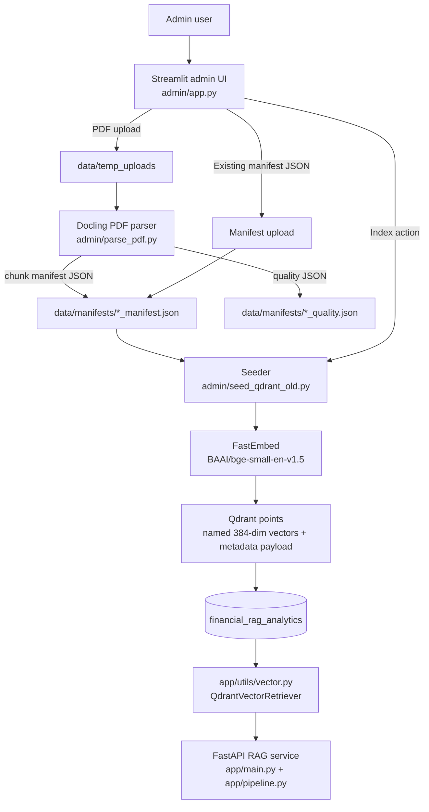

# Admin Ingestion Flow — Technical Report

## 1. Scope and purpose

The `admin/` directory contains the document-ingestion side of the financial RAG
application. It provides a Streamlit interface for either:

1. parsing uploaded financial PDFs into searchable chunks and then indexing them,
   or
2. indexing a pre-generated JSON chunk manifest directly.

The admin pipeline writes vectors to the Qdrant collection consumed by the
separate FastAPI/RAG application. It is not itself the chat or query API.

## 2. High-level architecture



The diagram describes the ingestion pipeline and its current storage
integration.

## 3. Main components and responsibilities

| Component | Responsibility |
| --- | --- |
| [`app.py`](./app.py) | Streamlit controls, uploads, document IDs, temporary PDF persistence, parsing/indexing actions, and user-visible status. |
| [`parse_pdf.py`](./parse_pdf.py) | Docling conversion, OCR fallback, text/table extraction, chunk generation, and manifest/quality-report persistence. |
| [`seed_qdrant_old.py`](./seed_qdrant_old.py) | Manifest validation/loading, embedding generation, Qdrant collection/index setup, deterministic point IDs, payload creation, upsert, and stale-point cleanup. |
| [`old/`](./old) | Older versions of parser/seeder code currently present in the working tree. The active UI does not import from this folder explicitly. |

The app configuration in [`app/config.py`](../app/config.py) and retrieval code
in [`app/utils/vector.py`](../app/utils/vector.py) define the consumer side of
the indexing contract.

## 4. End-to-end flow A: PDF upload, parse, and index

1. **Upload and identity**
   - The Streamlit interface accepts multiple PDF files.
   - It reads the upload bytes, computes a SHA-256 digest, and uses the digest
     plus the sanitized filename to form a default document ID.
   - The document ID is normalized to letters, digits, `_`, and `-`.
   - The PDF bytes are persisted under `data/temp_uploads/<hash>_<index>/`.

2. **Parse**
   - Selecting **Parse Document via Docling** calls
     `run_pipeline(pdf_path, doc_id, out_dir=data/manifests)`.
   - `FastDoclingChunker` configures Docling's PDF converter with accurate
     table-structure extraction and cell matching.
   - OCR is selected according to `ocr_mode`: automatic mode first converts
     without OCR, then retries with OCR when more than 20% of pages appear to
     have no text/table content. An OCR retry failure is logged and the
     non-OCR result is retained.
   - The `HybridChunker` iterates document content. Short text fragments are
     merged; long content is split to stay within the 500-token embedding
     budget. Boilerplate and glyph-only text can be excluded.
   - Tables are converted into both:
     - `table` chunks containing header plus bounded row blocks; and
     - `table_fact` chunks representing individual financial metric rows and
       their period/value pairs.
   - Tables that cannot be structured are retained as Markdown chunks where
     possible. A fallback pass handles tables the chunker did not surface.
   - Chunk metadata carries source filename, page, headings, table/metric
     context, row labels, columns, and fiscal years where extracted.

3. **Persist parse outputs**
   - The parser writes `<doc_id>_manifest.json`, a JSON array of serialized
     `DocumentChunk` values.
   - It also writes `<doc_id>_quality.json`, containing page/chunk counts,
     OCR use, token-budget measurements, missed/fallback table information,
     and extraction statistics.
   - The Streamlit UI stores parse information in session state so the user can
     review chunk totals and continue to indexing.

4. **Index**
   - Selecting **Index into Qdrant** sends the manifest path, configured local
     storage path, and collection-recreation option to `seed_database`.
   - The seeder filters out chunks with empty content and embeds each chunk's
     `embedding_text` (falling back to `content`) using
     `BAAI/bge-small-en-v1.5`.
   - Each point has a deterministic UUID v5 derived from
     `<document_id>:<chunk_id>`. Re-running the same manifest therefore
     upserts the same point IDs.
   - The payload stores searchable text and metadata, including
     `document_id`, `chunk_id`, source/page, `chunk_type`, company, fiscal
     year(s), headings, columns, row labels, financial metric, and the original
     metadata object.
   - Points are upserted into collection `financial_rag_analytics`; then
     obsolete points for document IDs represented in the manifest are deleted.
   - The UI reports the number of indexed points.

## 5. End-to-end flow B: pre-parsed manifest

1. The user uploads a JSON file in the second Streamlit tab.
2. The UI parses the JSON for a preview and counts `text`, `table`, and
   `table_fact` chunk types.
3. On the seed action, the uploaded bytes are saved to
   `data/manifests/<uploaded filename>`.
4. The same `seed_database` path performs embedding and Qdrant upsert.

The UI's **Target Document Identifier** is normalized and applied to every
uploaded chunk before the manifest is saved and indexed. This retargets all
chunks in that upload to the selected document ID.

## 6. Data and storage contracts

### Manifest chunk shape

The active parser serializes the `DocumentChunk` model with these principal
fields:

```json
{
  "chunk_id": "stable-content-derived-id",
  "document_id": "document-id",
  "content": "retrievable chunk text",
  "embedding_text": "context-enriched embedding input",
  "chunk_type": "text | table | table_fact",
  "page_number": 1,
  "headings": ["section"],
  "table_caption": "optional table title",
  "source_file": "source.pdf",
  "metadata": {}
}
```

`metadata` can include columns, row labels, page numbers, fiscal years, table
references, structured/fallback flags, row groups, financial metrics, and
table-fact values. The seeder also recognizes some metadata fields at the
top-level for manifests produced by other sources.

### Qdrant contract

- Collection: `financial_rag_analytics`
- Named vector: `fastembed-BAAI/bge-small-en-v1.5`
- Dimensions: 384
- Distance: cosine
- Payload indexes created for `document_id`, `chunk_type`, `company`,
  `fiscal_year`, and `fiscal_years`

The retrieval implementation queries this collection by the configured
collection/vector names and applies document, company, and year filters. Admin
indexing and the API must point to the same Qdrant instance/path for newly
indexed documents to be visible to chat requests.

## 7. Operational behavior and dependencies

- Main libraries: Streamlit, Docling, Transformers, FastEmbed, Qdrant client,
  and Logfire.
- Admin local paths default to:
  - PDFs: `data/temp_uploads/`
  - manifests and parser quality reports: `data/manifests/`
  - Qdrant local storage: `data/qdrant_storage/`
- Logfire spans cover UI actions, parsing, manifest loading, embedding, and
  Qdrant writes. Remote Logfire delivery is enabled when `LOGFIRE_TOKEN` is
  configured.
- The UI seeder has a `--manifest`, `--all`, and `--recreate` CLI path.
  `--all` iterates JSON files in `data/manifests/` while excluding names
  marked old/cache/backup.
- Recreate-collection mode deletes the entire existing collection before
  indexing. It is a collection-wide destructive operation, not a
  document-scoped replacement.

## 8. Resolved implementation gaps and safety behavior

The following items were rechecked against the current source and addressed
without changing the PDF parsing, chunking, or retrieval algorithms.

1. **Seeder import and parser return.**  
   The UI imports the existing root-level
   [`seed_qdrant_old.py`](./seed_qdrant_old.py). The current
   [`parse_pdf.py`](./parse_pdf.py) returns `(chunks, manifest_path)` after
   writing its manifest and quality report, matching both the UI and CLI
   callers.

2. **Manifest validation and target ID.**  
   The UI and seeder reject invalid root shapes, non-object chunks, invalid
   string fields, and non-object metadata. The UI applies its normalized target
   ID to each uploaded chunk before saving it, so that ID is reflected in
   Qdrant point IDs and payloads. Empty-content chunks continue to be skipped.

3. **Consistent Qdrant connection mode.**  
   When `QDRANT_URL` is configured, the seeder connects remotely and uses
   `QDRANT_API_KEY`; otherwise, it uses the UI's local storage path. The remote
   URL takes precedence over the local path, matching
   [`app/utils/vector.py`](../app/utils/vector.py).

4. **Explicit confirmation for collection deletion.**  
   The recreate option remains available, but the UI requires a second
   confirmation and warns that it deletes every document in the collection.
   The CLI's `--recreate` flag remains an explicit opt-in.

## 9. Source map

- Admin UI and flow orchestration: [`app.py`](./app.py)
- PDF parsing and chunk schema: [`parse_pdf.py`](./parse_pdf.py)
- Manifest-to-Qdrant implementation used by the UI: [`seed_qdrant_old.py`](./seed_qdrant_old.py)
- Alternate seeder retained under the archive folder: [`old/seed_qdrant.py`](./old/seed_qdrant.py)
- Runtime settings: [`app/config.py`](../app/config.py)
- Qdrant retrieval and payload consumption: [`app/utils/vector.py`](../app/utils/vector.py)
- FastAPI lifecycle and chat endpoint: [`app/main.py`](../app/main.py)
