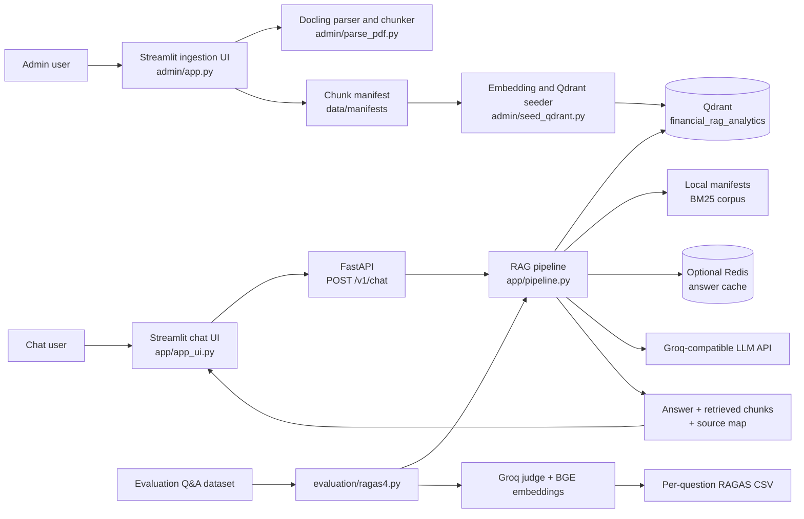

# Financial RAG Chatbot — End-to-End Architecture

## 1. Purpose and scope

This document describes the repository's financial-filings question-answering
system from document ingestion through retrieval, answer generation, guardrails,
and offline evaluation. It focuses on the current implementation and calls out
known gaps so that implemented behavior is not confused with a target design.

The primary runtime components are:

- `admin/`: Streamlit-based document ingestion, Docling parsing, and Qdrant indexing.
- `app/`: Streamlit chat UI, FastAPI service, RAG request pipeline, retrieval,
  model integrations, cache, privacy handling, and guardrails.
- `evaluation/`: Offline RAGAS dataset runner and report generation.
- `data/`: Local manifests, uploaded documents, and local Qdrant persistence.

This is a repository architecture, not a deployment guarantee. External model
providers, Qdrant, Redis, and Logfire are environment-dependent. Current
implementation caveats are listed in [Section 12](#12-current-limitations-and-operational-risks).

## 2. System context

The chatbot answers questions grounded in indexed company filings. It does not
ingest documents during a chat request: ingestion is an administrative workflow
that produces a manifest and indexed vectors, which the app later retrieves.



### Main data flow

1. An administrator parses a filing PDF or uploads an already-built manifest.
2. The parser creates normalized text/table chunks and a JSON manifest.
3. The seeder embeds each chunk and upserts payload + vector points into Qdrant.
4. On chat, the API validates the request and runs input checks and query routing.
5. Dense and lexical retrievers search the indexed corpus; candidates are fused
   and reranked.
6. The LLM drafts an answer from a bounded, source-tagged context.
7. Output checks run before the answer and source chunks are returned.
8. Offline evaluation calls the same pipeline with a curated set of questions,
   then scores collected answers and evidence against reference answers.

## 3. Components and ownership

| Component | Responsibility |
|---|---|
| `admin/app.py` | Admin Streamlit UI; PDF and manifest upload, parse/index actions, document IDs, and collection-recreation confirmation. |
| `admin/parse_pdf.py` | Docling PDF conversion, scanned-page OCR fallback, text and structured-table extraction, chunk formation, manifest and quality-report output. |
| `admin/seed_qdrant.py` | Manifest validation, FastEmbed vector generation, Qdrant collection/payload-index setup, point upsert, and document-scoped stale-point cleanup. |
| `app/main.py` | FastAPI app lifecycle, warmup/readiness, health routes, `/v1/chat`, request deadline, and HTTP error mapping. |
| `app/schemas.py` | Pydantic request, turn, session state, retrieved chunk, and response contracts. |
| `app/pipeline.py` | Orchestration: intent fast paths, guardrails, planning, cache, hybrid retrieval, fusion, reranking, context packing, generation, and response assembly. |
| `app/utils/router.py` | Query intent, company/year/metric and follow-up resolution, standalone query decomposition, and search filters. |
| `app/utils/vector.py` | Query embedding and dense Qdrant retrieval. |
| `app/utils/bm25.py` | Local-manifest lexical index and metadata-aware BM25 retrieval. |
| `app/utils/flashrank_reranker.py` | FlashRank relevance reranking and company-balanced selection. |
| `app/utils/guardrails.py`, `guard_rules.py`, `pii.py` | NeMo policy checks, deterministic fallback rules, PII detection/masking, and numeric-grounding checks. |
| `app/utils/cache.py` | Scoped exact and semantic/lexical verified answer caching backed by Redis when configured. |
| `app/app_ui.py` | Streamlit chat client for the FastAPI service. |
| `evaluation/ragas4.py` | Offline question collection, optional sample-cache reuse, RAGAS scoring, and CSV output. |

The API does not parse or embed filings. The admin seeder and app retriever must
use the same Qdrant collection, vector name, embedding model, and Qdrant
instance/storage path.

## 4. Ingestion and indexing lifecycle

### 4.1 Input paths

The admin UI supports two paths:

1. **PDF path:** upload one or more PDFs, assign a document ID, parse with
   Docling, review the parse summary, then index the generated manifest.
2. **Manifest path:** upload a JSON manifest that already contains chunks and
   send it directly to the seeder. This bypasses PDF conversion.

PDF uploads are written under `data/temp_uploads/`. The UI derives a stable
upload key and default document ID from the file content hash and sanitized
filename. The parsed manifest is stored under `data/manifests/`.

### 4.2 PDF conversion, extraction, and chunking

`FastDoclingChunker` in `admin/parse_pdf.py` converts the PDF through Docling.
The parser uses layout-aware conversion, table structure extraction, and an
OCR fallback for pages with insufficient extracted text. It produces:

- **Text chunks:** Docling hybrid chunks retaining section headings, source
  page, and document context. Short fragments are merged rather than blindly
  discarded.
- **Table chunks/facts:** structured table cells, row/column headers and spans
  are reconstructed into searchable, human-readable facts. Captions, table
  headings, fiscal years, row groups, and table metadata are preserved where
  detected.
- **Embedding text:** a search-oriented representation separate from the
  display content, kept within the configured embedding token budget (500
  tokens for BGE-small).

The parser writes a manifest plus a quality JSON report and a lossless Docling
JSON artifact. The quality report is intended to expose extraction counts and
table/fragment issues for human review; it is not itself an automated release
gate.

### 4.3 Manifest contract

Each manifest is a JSON array of chunk objects. Core fields used across the
system include:

| Field | Purpose |
|---|---|
| `document_id`, `chunk_id` | Stable identity; the seeder derives a deterministic Qdrant point UUID from the pair. |
| `content` | Retrieved text placed in the LLM context and shown as evidence. |
| `embedding_text` | Text embedded for dense similarity search; falls back to `content`. |
| `source_file`, `page_number` | Citation and UI provenance. |
| `chunk_type`, `headings`, `table_caption` | Chunk kind and document structure. |
| `metadata` | Additive extraction details, including columns, row labels, fiscal years, financial metric, company, and table-row information. |
| `company`, `fiscal_year`, `fiscal_years` | Optional top-level filter fields; the seeder can infer some company/year values as a fallback. |

The seeder rejects a non-array manifest, non-object chunks, invalid types for
core text/ID fields, empty supplied IDs, and non-object `metadata`. Chunks with
empty `content` are excluded from indexing.

### 4.4 Embedding and Qdrant writes

`admin/seed_qdrant.py` uses FastEmbed with `BAAI/bge-small-en-v1.5` and creates
384-dimensional cosine vectors. The collection is
`financial_rag_analytics`; the named vector is
`fastembed-BAAI/bge-small-en-v1.5`. Payloads retain chunk text and metadata
required by retrieval, filtering, and citations. Payload indexes are created
for document, company, chunk type, and fiscal-year fields.

The seeder can connect to remote Qdrant using `QDRANT_URL` and
`QDRANT_API_KEY`, or use local storage. Deterministic point IDs make a repeat
index an upsert rather than a new unrelated set of points. Re-indexing deletes
stale points for each document represented in the manifest. Collection
recreation is a separate, destructive operation guarded by UI confirmation.

### 4.5 Retrieval corpus synchronization

The dense retriever reads Qdrant. The BM25 retriever reads JSON manifests from
the local `data/manifests/` corpus. These are separate stores; adding a vector
to Qdrant does not automatically make BM25 see it unless its manifest is also
present in the expected local path. Their document IDs and metadata must agree
for hybrid retrieval and filtering to behave consistently.

## 5. Chat API and request contract

`POST /v1/chat` accepts a `ChatRequest`:

- `session_id`: caller-provided session identifier.
- `query`: required string, 1–2000 characters.
- `history`: prior user/assistant turns (optional).
- `state`: prior company, fiscal year, target metric, and/or document ID
  (optional).

The `ChatResponse` contains `session_id`, answer text, intent, standalone
`search_query`, updated state, retrieved chunks, and a source map. Each
retrieved chunk includes content and provenance such as document, file, page,
type, headings, and retrieval/reranking scores.

The FastAPI lifespan warms up the retrievers, reranker, cache, guardrails, PII
detector, intent router, model clients, and document catalog before marking
the app ready. `/health` is a liveness check; `/health/ready` and `/v1/chat`
return 503 while startup is incomplete. Chat execution has a server-side
deadline (`REQUEST_TIMEOUT_S`, default 40 seconds); timeout maps to HTTP 504
and unexpected processing errors map to HTTP 500.

## 6. Online request lifecycle

```mermaid
flowchart TD
    Request[ChatRequest] --> Validate[Pydantic validation]
    Validate --> Ready{Service ready?}
    Ready -->|No| Unavailable[503]
    Ready -->|Yes| Intent[Embedding intent fast path]
    Intent --> Fast{Confident greeting or<br/>out-of-scope?}
    Fast -->|Greeting| Greeting[Greeting handler / exact cache]
    Fast -->|Out of scope| Refuse[Scope refusal]
    Fast -->|No / uncertain| Input[Input rails and PII masking]
    Input --> Allowed{Allowed?}
    Allowed -->|No| Block[Input refusal]
    Allowed -->|Yes| Plan[Catalog + query planner]
    Plan --> Kind{Intent}
    Kind -->|General chat| Chat[Brief response + free-text output check]
    Kind -->|Summary| Summary[Summarize sanitized conversation + output check]
    Kind -->|Out of scope| Refuse
    Kind -->|Filing question| Cache[Scoped answer-cache lookup]
    Cache -->|Hit| Cached[Cached answer/chunks]
    Cache -->|Miss| Filters[Resolve documents, companies, years]
    Filters --> Search[Dense Qdrant + local BM25 concurrently]
    Search --> Fusion[Entity-balanced reciprocal-rank fusion]
    Fusion --> Rerank[FlashRank]
    Rerank --> Pack[Token-budgeted [S#] context + source map]
    Pack --> HasEvidence{Evidence available?}
    HasEvidence -->|No| NoEvidence[Insufficient-evidence response]
    HasEvidence -->|Yes| Generate[Groq answer generation]
    Generate --> Output[Output rails]
    Output --> Numeric{Numeric-grounding failure?}
    Numeric -->|First attempt| Strict[One strict-prompt retry]
    Strict --> Output
    Numeric -->|Blocked or still failing| Verify[Verification refusal]
    Numeric -->|Pass| Store[Async cache write]
    Store --> Reply[ChatResponse with evidence]
    Greeting --> Reply
    Refuse --> Reply
    Block --> Reply
    Chat --> Reply
    Summary --> Reply
    Cached --> Reply
    NoEvidence --> Reply
    Verify --> Reply
```

### 6.1 Intent, context, and query planning

The embedding-based intent router can identify high-confidence small talk or
out-of-scope requests. Uncertain queries continue through the full policy
path. If the intent model is unavailable, an anchored greeting regex is used
only for the small-talk fallback. PII-containing input does not take that
fast path.

After input checks, the query planner uses conversation history, current
session state, and the indexed company catalog to classify the request and
resolve follow-ups. A plan includes a standalone search query, entities,
years, metrics, subqueries, and a follow-up type (`none`, `reference`, or
`elaboration`). The router uses an LLM with deterministic/regex fallbacks for
some parsing and follow-up cases.

### 6.2 Hybrid retrieval and ranking

For each subquery and target entity:

1. Dense retrieval embeds the query and searches the configured named Qdrant
   vector, optionally filtering by document ID, company, and fiscal year.
2. BM25 searches tokens from local manifests, including content, headings,
   years, metrics, columns, and row labels.
3. Both retrievers run concurrently. If strict company/year filters yield too
   few results, the pipeline can retry with softer filters while retaining
   document ID restrictions.
4. Reciprocal-rank fusion combines duplicate and independent rankings,
   balancing candidate quotas among entities.
5. FlashRank reorders candidates and selects a final context set, with a
   minimum per-company allocation for multi-company questions.

Retriever errors are logged and represented as empty results by the current
search helper. If there is no usable context, the pipeline returns an
insufficient-evidence answer rather than asking the answer model to invent
filing details.

### 6.3 Context construction and citations

The selected chunks are packed up to `MAX_CONTEXT_TOKENS` (default 4096).
Each context passage is tagged `[S1]`, `[S2]`, etc., and includes source file,
page, section, chunk type, and content. A source map links those tags to
human-readable source locations. The answer prompt directs the LLM to use only
the supplied context, preserve units, and cite relevant passages. Retrieved
chunks and the source map are included in the response for inspection.

### 6.4 Answer generation and cache

Groq-compatible clients are used for query routing and answer generation.
Generation is temperature zero for RAG answers. Elaboration follow-ups include
a bounded amount of prior conversation; other RAG answers use the standalone
question and retrieved evidence. Greeting/general-chat and summary paths do
not use the RAG corpus in the same way and are not cached as filing answers.

The answer cache is scoped by intent, entities, years, corpus version, and
follow-up context where applicable. It has an exact L1 lookup and an optional
semantic L2 candidate verified by lexical overlap. Elaboration caching is
restricted to exact matching because it depends on the previous answer. Cache
writes are asynchronous. Redis is configured through `REDIS_URL`; cache
availability and behavior depend on its runtime setup.

## 7. Guardrails, privacy, and answer safety

### 7.1 Input controls

Before normal query planning, the input path:

- Enforces the API schema's 2000-character query limit.
- Uses the embedding-router fast path only for confident eligible intents.
- Calls NeMo input rails when enabled. The configured flows combine policy
  checks and custom deterministic actions.
- Detects common prompt-injection/jailbreak patterns (including requests to
  reveal system prompts and instruction-override language).
- Uses Presidio/spaCy for PII masking, with a regex fallback when configured
  detection dependencies are unavailable.
- Masks PII in conversation history before it is sent to any LLM.

Blocked requests receive a refusal response. Sanitized input, rather than raw
PII, is used downstream and in query tracing where possible.

### 7.2 Output controls

For generated answers, the output path checks NeMo output rails, prompt-leak
markers, PII, and (when enabled) whether material numeric values appear in
retrieved evidence. The deterministic numeric check permits a 1% tolerance
and common thousand/million scale conversions. If numeric grounding fails on
the first draft, the pipeline retries once with a stricter prompt; if the
answer remains blocked, it returns a verification refusal.

Free-text responses such as small talk and summaries also receive output
checks, but have no retrieved evidence for numeric grounding. Citations are
prompted and exposed in the response; the current checks do not prove that
each citation semantically entails its associated claim.

### 7.3 Guardrail failure behavior

NeMo checks have a configurable timeout. With `GUARDRAILS_FAIL_OPEN=true`
(the current default), a NeMo error or timeout falls back to deterministic
checks rather than automatically failing the request. This preserves
availability but weakens policy coverage during provider/runtime failures.
When fail-open is disabled, errors block processing with a temporary-failure
response. Guardrail degradation is logged to traces.

### 7.4 Sensitive configuration and logging

Credentials are supplied through environment settings / `.env`; do not commit
secrets. Groq, Qdrant, Redis, and Logfire credentials must be protected as
deployment secrets. Logfire spans include request and pipeline metadata; avoid
logging raw user PII and review trace contents/retention before enabling remote
telemetry. The current request span includes query-related attributes, so
tracing configuration and data handling deserve explicit operational review.

## 8. Persistence, configuration, and dependencies

| Concern | Current mechanism |
|---|---|
| Parsed chunks | JSON manifest in `data/manifests/`. |
| Temporary PDFs | `data/temp_uploads/`. |
| Dense index | Qdrant collection `financial_rag_analytics`, remote or local. |
| Lexical index | In-memory BM25 built from local JSON manifests on process initialization. |
| Answer cache | Redis-backed exact/semantic cache when available/configured. |
| Session state | Sent by the client in each request; no server-side durable session store is defined in the request pipeline. |
| Models | Groq-compatible chat/router clients; FastEmbed BGE-small document/query embeddings; FlashRank reranker; optional local PII/intent/guardrail models. |
| Observability | Logfire spans and application logging. |

Important settings are defined in `app/config.py` and environment variables:
`GROQ_API_KEY`, optional fallback key, `QDRANT_URL`, `QDRANT_API_KEY`,
`QDRANT_STORAGE_PATH`, `COLLECTION_NAME`, `VECTOR_NAME`, `REDIS_URL`,
`MAX_CONTEXT_TOKENS`, retrieval/reranking limits, guardrail flags/timeouts,
intent-router thresholds, and PII engine settings.

Local Qdrant paths must resolve consistently for admin indexing and API
retrieval. BM25 loads manifests separately, so a deployment that uses remote
Qdrant still needs the local manifest corpus if lexical search is expected.

## 9. Evaluation and testing strategy

Evaluation is offline and separate from the serving request path. It is not a
test suite and a successful RAGAS run does not certify ingestion correctness,
security, or production readiness.

### 9.1 Current RAGAS evaluation

`evaluation/ragas4.py` reads the configured cleaned question/reference dataset
(`evaluation/dataset/ragas_dataset_cleaned_all.json`). For answerable items, it
calls `run_rag_pipeline_async` directly with up to two concurrent collection
tasks. It saves generated responses and up to five retrieved contexts
(truncated to 1500 characters each) in `evaluation/ragas_samples_cache.json`.
Unless `--refresh` is passed, a nonempty valid cache may be reused.

Four metrics are scored per sample:

- `context_precision`: relevance/ordering quality of retrieved evidence.
- `context_recall`: evidence coverage against the reference.
- `faithfulness`: answer claims grounded in retrieved context.
- `answer_relevancy`: relevance of the response to the question.

The evaluator uses a Groq-backed judge with key/model failover and BGE-small
embeddings where required. It writes one row per sample to
`evaluation/report/ragas_evaluation_report.csv`; per-metric failures are
logged and represented as `NaN`. The summary of numeric means is logged.

Because cached samples may have been produced by older code, data, settings,
or model versions, refresh the sample cache when measuring current behavior.
For reproducible comparisons, record the dataset revision, application commit,
corpus/index version, model names, evaluation date, and whether samples were
collected live or loaded from cache.

### 9.2 Test layers required for a reliable change

The repository currently has no dedicated `tests/` directory or conventional
automated unit/API test suite visible in the source tree. Use the following
layers when establishing or extending validation:

1. **Parser/unit tests:** text cleanup, table/header reconstruction, fiscal
   year and metric extraction, chunk bounds, and preservation of row values.
2. **Manifest contract tests:** valid/invalid JSON shapes, required IDs, empty
   content handling, metadata preservation, and deterministic point IDs.
3. **Ingestion integration test:** parse a small representative born-digital
   PDF and scanned PDF, inspect quality artifacts, seed a disposable Qdrant
   collection, and verify point counts/payloads. Avoid destructive tests on a
   shared production collection.
4. **Retrieval tests:** known-company/year filters, sparse/missing metadata,
   dense-only and BM25-only behavior, hybrid fusion, duplicate removal,
   reranking balance, context token ceiling, and source-map references.
5. **API tests:** schema rejection, readiness behavior, successful response
   shape, timeout/error mapping, and independent health routes.
6. **Guardrail tests:** PII masking in input/history/output, prompt-injection
   blocks, out-of-scope refusals, prompt-leak blocks, numeric pass/fail and
   strict retry, plus explicit tests for fail-open and fail-closed behavior.
7. **End-to-end regression:** representative supported questions,
   follow-ups, cross-company comparisons, absent-data queries, citations, and
   refusal cases against a stable local corpus.
8. **RAGAS evaluation:** collect fresh samples and compare per-item and
   aggregate metrics against a reviewed baseline; investigate failed items,
   not only averages.

Keep fast deterministic unit and contract tests in the normal change gate.
Run model/provider-dependent evaluation as a separate, cost-aware job with
explicit credentials and a disposable or fixed test corpus.

### 9.3 Commands

Typical local entry points (from repository root, with dependencies and
environment configured):

```powershell
uvicorn app.main:app --reload
streamlit run app/app_ui.py
streamlit run admin/app.py
python -m evaluation.ragas4 --refresh
```

The evaluation runner makes live model and retrieval calls when refreshing.
The first three commands start services/UIs and should be run in separate
terminals. Indexing and app serving should target the same Qdrant instance.

## 10. Operations and failure handling

- **Startup fails:** warmup exceptions prevent readiness; inspect model assets,
  Qdrant access, Redis/cache, guardrails, PII model, and Groq configuration.
- **No documents in Qdrant:** the catalog may use a manifest-derived fallback,
  but dense retrieval still requires correctly indexed Qdrant points.
- **No BM25 results:** confirm manifests exist in the local configured path
  and that their IDs/metadata match the indexed corpus.
- **No evidence:** the pipeline returns an insufficient-evidence response
  rather than normal grounded generation.
- **Provider timeouts/rate limits:** Groq clients apply retry/key rotation
  where configured; the API still has an overall request deadline.
- **Cache miss/outage:** requests can proceed uncached if cache initialization
  and lookup behavior permit; verify configured Redis service and logs.
- **Index replacement:** prefer document-scoped re-indexing. Collection
  recreation removes the entire collection and must be treated as destructive.
- **Evaluation failures:** collection failures are reported as item problems;
  metric failures produce `NaN`. Review logs and coverage before interpreting
  a report as complete.

## 11. Change and release workflow

For a change that touches ingestion, retrieval, generation, guardrails, or
evaluation:

1. Update the implementation and the relevant contract together (especially
   manifest/payload fields and `ChatResponse` fields).
2. Add or update targeted tests at the layer that owns the behavior.
3. Run focused tests first, then the end-to-end checks relevant to the change.
4. For retrieval/generation changes, collect fresh RAGAS samples; do not rely
   on an old sample cache.
5. Inspect per-question failures and citations, not only mean scores.
6. Verify operational settings and failure modes, including provider outage
   and guardrail degradation.
7. Update this document when the system boundaries, data contracts, or
   deployment assumptions change.

## 12. Current limitations and operational risks

These are implementation observations, not intended architecture:

1. **PDF parsing UI integration return contract is corrected, but end-to-end
   ingestion remains unverified.** `admin/parse_pdf.py` now unpacks the
   `(chunks, markdown)` returned by `FastDoclingChunker.process_pdf()` before
   writing the manifest, and persists the Markdown export. A real PDF parse
   and Qdrant indexing run is still needed to verify the complete UI path.
2. **No dedicated automated test suite is present in the repository tree.**
   RAGAS is an evaluation runner, not a replacement for parser, retrieval,
   guardrail, or API tests.
3. **BM25 and Qdrant can diverge.** They are built from different persistence
   paths and do not share an atomic indexing transaction.
4. **Some failure fallbacks reduce coverage.** Retriever exceptions become
   empty results, and NeMo may fall back to deterministic checks under the
   default fail-open setting. Monitoring must distinguish a clean refusal or
   empty corpus from a dependency failure.
5. **Numeric grounding is heuristic.** Presence of a similar number in
   context does not establish correct units, calculations, attribution, or
   citation entailment.
6. **Evaluation reproducibility depends on fresh samples and pinned inputs.**
   The sample cache can bypass the current pipeline; model-provider outputs
   and judge scores can vary over time.
7. **Runtime components are process-local.** In-memory retriever/reranker and
   model objects are initialized per worker; local-file Qdrant deployments
   must account for multiple-process access and storage compatibility before
   scaling worker count.

## 13. Source map

- Ingestion UI: `admin/app.py`
- PDF parsing/chunking: `admin/parse_pdf.py`
- Qdrant seeding: `admin/seed_qdrant.py`
- FastAPI lifecycle and endpoint: `app/main.py`
- API schemas and settings: `app/schemas.py`, `app/config.py`
- Request orchestration: `app/pipeline.py`
- Query planning: `app/utils/router.py`, `app/utils/intent_router.py`
- Dense/lexical retrieval and reranking: `app/utils/vector.py`,
  `app/utils/bm25.py`, `app/utils/flashrank_reranker.py`
- Guardrails and PII: `app/utils/guardrails.py`,
  `app/utils/guard_rules.py`, `app/utils/pii.py`,
  `app/guardrails_config/`
- Chat UI: `app/app_ui.py`
- Offline evaluation: `evaluation/ragas4.py`
- Dependency manifests: `requirements.txt`, `requirements-eval.txt`
