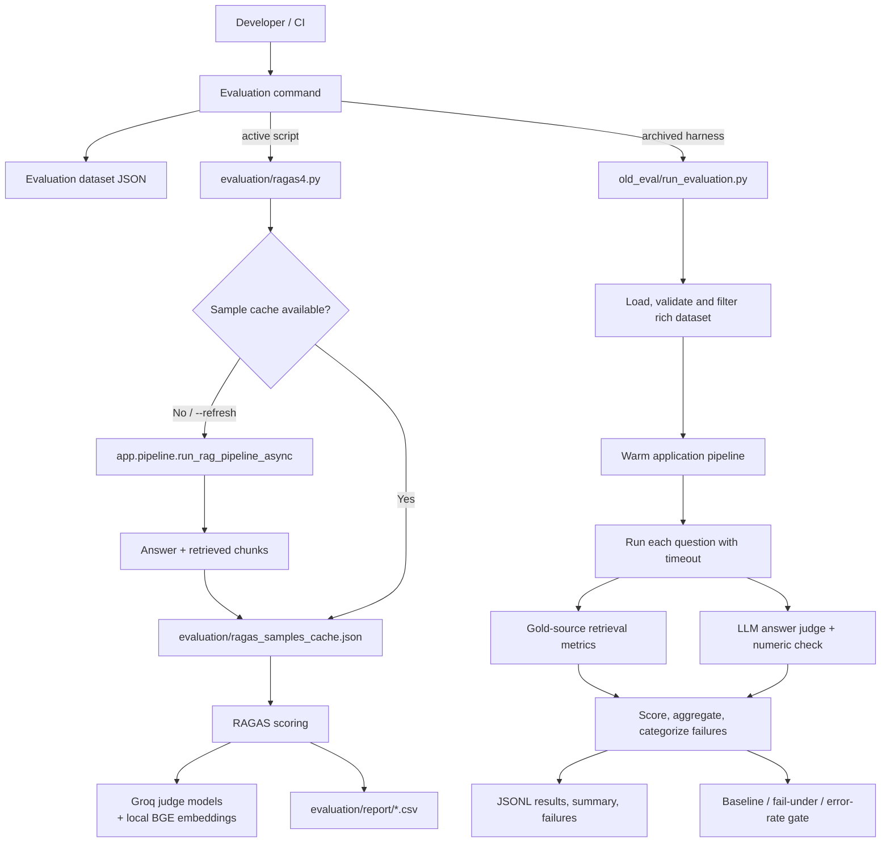

# Evaluation Framework — Technical Report

## 1. Purpose and scope

This report documents the evaluation tooling currently present under
`evaluation/`. It describes the active RAGAS workflow, the archived
end-to-end regression harness, evaluation data formats, metrics, result
artifacts, and operational considerations. It is written as a technical
handoff and presentation reference.

The evaluation directory contains two generations of evaluation:

1. **Current RAGAS workflow:** [`ragas4.py`](./ragas4.py) executes the real
   financial RAG pipeline for answerable examples, caches the generated
   question/answer/context samples, and scores them using four RAGAS metrics.
2. **Archived end-to-end regression harness:** [`old_eval/`](./old_eval)
   contains a broader per-question runner with source-grounded retrieval
   metrics, an LLM answer judge, latency/error reporting, resumable runs, and
   baseline/quality gates.

The two systems do not consume identical dataset schemas, compute identical
scores, or currently have an integrated common CLI. Their reports must not be
treated as a single trend line without normalizing data, code version, model
configuration, and metric coverage.

## 2. Executive summary

The current top-level evaluation script is `evaluation.ragas4`. Its basic
experiment is:

1. Load an evaluation dataset.
2. Run each answerable sample through `app.pipeline.run_rag_pipeline_async`.
3. Save the generated response and up to five retrieved context chunks in a
   sample cache.
4. Attach a Groq-backed judge and BGE-small embeddings to RAGAS metrics.
5. Score context precision, context recall, faithfulness, and answer
   relevancy, then write a CSV report.

The archived `old_eval` system extends this pattern with:

- typed question categories, answerable/unanswerable cases, expected facts,
  gold sources, conversational history, and session state;
- source/page/section-aware hit, recall, precision, nDCG, MRR, and entity
  coverage;
- LLM-as-judge correctness, faithfulness, relevancy, and abstention measures;
- a deterministic numeric-fact cross-check;
- latency percentiles, failure categories, per-type summaries, resume/retry,
  baseline comparisons, and exit-code quality gates.

The archived harness is conceptually more complete as a release/regression
framework, but its checked-in CLI imports and default dataset path do not match
the current filesystem layout. It should be treated as reference code until
those integration points are reconciled.

## 3. High-level architecture



The current top-level command recorded in [`cmd.txt`](./cmd.txt) is:

```powershell
python -m evaluation.ragas4 --refresh
```

The `--refresh` flag bypasses the sample cache and re-executes the application
pipeline before scoring.

## 4. Current workflow: `ragas4.py`

### 4.1 Configuration

The script defines these defaults:

| Setting | Current default | Purpose |
| --- | --- | --- |
| Dataset | `evaluation/dataset/ragas_dataset_cleaned_all.json` | RAGAS-style inputs with question, reference, and existing answer/context fields. |
| Sample cache | `evaluation/ragas_samples_cache.json` | Reuses generated pipeline samples unless refreshed. |
| Score report | `evaluation/report/ragas_evaluation_report.csv` | Per-sample metric scores. |
| Judge model order | `qwen/qwen3.8-27b`, then `openai/gpt-oss-20b` | Model alternatives handled by the custom Groq transport. |
| Embedding model | `BAAI/bge-small-en-v1.5` | Embedding-based metric support. |
| Max contexts | 5 | Maximum retrieved context strings retained for RAGAS. |
| Context character cap | 1,500 chars per context | Bounds context passed to metric scoring. |
| Pipeline concurrency | 2 | Maximum concurrent application-pipeline questions. |
| Judge timeout | 60 seconds | Async judge HTTP client timeout. |

`datasets.arrow_dataset.generate_fingerprint` is monkey-patched at module
import time to a constant. This is a compatibility workaround for dataset
fingerprinting; it also means fingerprint values are not meaningful in this
process. Dataset identity should instead be tracked by the input file version
or a separately recorded hash.

### 4.2 Dataset loading and sample validation

`load_json()` fails explicitly for missing files and parses UTF-8 JSON.
`validate_samples()` accepts only records containing `id`, `user_input`,
`retrieved_contexts`, `response`, and `reference`. It drops records missing
non-empty text fields, filters empty contexts, and truncates contexts to five.

The current dataset file is RAGAS-shaped and already includes fields named
`user_input`, `reference`, `response`, and `retrieved_contexts`. When the cache
is missing or `--refresh` is passed, `process_single_item()` also expects the
dataset records to include `user_input` and `reference`. It skips records with
`answerable: false`; a non-answerable record is not scored by this script.

Pipeline collection calls `run_rag_pipeline_async()` with a generated session
ID and query. It captures the answer and at most five returned chunks, truncates
each chunk's content to the configured character limit, and records failures
as `problems`. A missing answer or missing retrieved context is treated as a
sample-collection failure.

`get_samples()` reuses the cache when it exists and contains valid samples.
Otherwise it recollects samples and overwrites the cache with `samples` and
`problems`. Cache-write failure is logged but does not prevent scoring in that
run. Cached samples are not keyed by dataset hash or application-code version;
use `--refresh` when either changes.

### 4.3 Metric evaluation

`evaluate_samples_robust()` initializes:

- a `LangchainLLMWrapper` around `ChatOpenAI` configured for the Groq
  OpenAI-compatible endpoint and the first judge model; and
- `HuggingFaceEmbeddings` using `BAAI/bge-small-en-v1.5`.

It evaluates four RAGAS metrics:

| Metric | What it estimates |
| --- | --- |
| `context_precision` | Whether retrieved contexts are relevant/useful relative to the reference. |
| `context_recall` | Whether the retrieved contexts contain information needed by the reference. |
| `faithfulness` | Whether the generated answer's claims are supported by retrieved contexts. |
| `answer_relevancy` | Whether the generated answer addresses the user's question. |

Scoring is sequential by sample and metric. Each individual asynchronous metric
call is executed inside `asyncio.run()` in a worker thread. This isolation
avoids reusing one event loop for each metric call; a 0.2-second pause follows
each metric. Metric exceptions are logged and represented as `NaN`, which
appears as a blank in CSV output and is excluded from Pandas' numeric mean.
Therefore, each reported average should be read with its valid score count.

The CSV stores `id` and one column per metric. The script logs the arithmetic
mean of each numeric column. It does not currently write a structured JSON
summary, per-question failure file, dataset hash, run identifier, judge
configuration snapshot, or CI gate result.

## 5. Judge failover implementation and concerns

`GroqFailoverTransport` is intended to attempt combinations of configured API
keys and judge models, react to HTTP 429 responses with retry delays, and retry
several times. It is an evaluation-specific transport rather than the
application's normal `chat_with_retry()` wrapper.

The current source contains two apparent configuration/transport defects that
should be addressed before relying on this failover behavior:

1. **The transport overwrites the authorization header with a literal mask.**  
   In `handle_async_request()`, the attempted request sets the
   `authorization` header to the literal masked value `******` instead of
   constructing a bearer-token value from the configured API key. This
   prevents a legitimate API key from being sent by the constructed request
   and is likely to cause authorization failures rather than successful
   failover.
2. **Fallback key setting name does not match application settings.**
   `build_judge_llm()` reads `GROQ_API_KEY_FALLBACK`; the application settings
   define `FALLBACK_GROQ_API_KEY`. Unless another dynamic setting exists, the
   configured fallback credential is not discovered by this code.

The transport logs only the last four characters of keys on rate limits, but
the authorization-header issue should be corrected and tested with a mocked
transport before any live evaluation relying on multiple keys/models.

## 6. Archived workflow: `old_eval`

### 6.1 Intended runner behavior

[`old_eval/run_evaluation.py`](./old_eval/run_evaluation.py) is a CLI wrapper
for [`old_eval/evaluator.py`](./old_eval/evaluator.py). It exposes dataset and
results paths, run name/resume, pipeline and judge concurrency, retry passes,
timeouts, question-type filters, retrieval-only mode, baseline comparison,
regression tolerance, minimum score, and maximum error rate.

The intended evaluation lifecycle is:

1. `load_dataset()` validates unique IDs and non-empty questions, normalizes
   gold sources, classifies answerability/type, and hashes the raw dataset.
2. `run_evaluation_async()` optionally resumes successful JSONL records,
   warms the application pipeline, and evaluates remaining questions with
   bounded concurrency.
3. `evaluate_one()` creates a `ChatRequest` with history/state, imposes a
   per-question timeout, runs the real pipeline, captures answer/chunks/source
   map/latency, and calculates deterministic retrieval/numeric checks.
4. When enabled, `judge_answer()` evaluates correctness, faithfulness,
   relevancy, unsupported claims, and abstention using a JSON-only rubric.
5. `score_result()` and `build_summary()` aggregate overall scores, pass rate,
   per-type metrics, latency, abstention, retrieval and failure categories.
6. The harness writes resumable and human-readable artifacts, then applies
   score, error-rate, and optional baseline regression gates.

### 6.2 Gold-source retrieval scoring

[`old_eval/metrics.py`](./old_eval/metrics.py) normalizes document identities,
page references, and section headings. A retrieved chunk matches a gold source
when:

- the document matches, if specified; and
- a page number matches or the section heading matches (or document-only gold
  was supplied).

Multiple gold sources are supported. Recall at a cutoff measures the fraction
of required sources found, rather than simply whether any chunk matched.

Metrics include hit, recall, precision, and nDCG at 1, 3, 5, and 10; the same
metrics at `ctx` (the full retrieved context supplied to generation); and
mean reciprocal rank (MRR). `entity_coverage()` separately measures the
fraction of expected companies present in retrieved chunks.

`numeric_fact_recall()` cross-checks expected numeric facts against generated
answer values, allowing selected scale conversions. `is_abstention()` is a
regex fallback; when the judge is available, its explicit abstention flag is
primary.

### 6.3 Answer judge

[`answer_judge.py`](./answer_judge.py) is a blocking LLM-as-judge helper used
by the archived harness. It asks for structured JSON covering:

- expected-fact coverage and contradiction;
- total and unsupported claim counts;
- abstention and partial abstention;
- answer relevancy on a 0–2 scale; and
- a short reason.

Correctness is the share of expected facts covered, halved when a contradiction
is reported. Faithfulness is estimated as one minus unsupported-claims divided
by total claims. Relevancy is normalized to 0–1. Judge failures are marked
`judge_failed=True` and their quality scores are `None`, not zero, so service
failures do not masquerade as answer-quality regressions.

The default judge model is `EVAL_JUDGE_MODEL` or `settings.LLM_MODEL`. Since
that default may equal the application generator, configure a distinct
`EVAL_JUDGE_MODEL` to reduce self-preference bias. The archived evaluator emits
a warning when judge and generator model names match.

### 6.4 Combined score and quality gate

For answerable questions with both judged quality and retrieval recall, the
archived harness combines:

```text
score = 0.30 × retrieval recall + 0.70 ×
        mean(correctness, faithfulness, relevancy)
```

If only answer quality or retrieval recall is available, it uses the available
component. For unanswerable questions, a correct abstention receives 1.0 and
an answer receives 0.0. Judge failures are excluded from the score and marked
as judge failures.

The default pass thresholds are 0.8 correctness and 0.8 faithfulness, with no
abstention for answerable questions. Retrieval-only mode uses near-perfect
configured recall as its pass condition. Optional gates can fail the run when
overall score is below `--fail-under`, error rate exceeds `--max-error-rate`,
or selected baseline metrics regress beyond tolerance.

### 6.5 Intended output artifacts

The archived evaluator documents and writes a run folder with:

- `results.jsonl`: append-as-completed, crash-resumable per-question records;
- `results.json`: complete results in dataset order;
- `summary.json`: aggregate metrics, types, latency, failures, and config;
- `failures.json`: failing questions and diagnostic fields; and
- `evaluation/results/latest_summary.json`: baseline convenience copy.

These are the intended outputs of the archived harness. The current checkout
does not contain the default `evaluation/results/` data or the root-level
evaluator module imported by its CLI, so this should not be presented as a
currently runnable command without repair.

## 7. Datasets and stored result evidence

### 7.1 Dataset inventory

The current dataset directory contains both evaluation inputs and
RAGAS-formatted cached samples:

| File | Observed records | Contents / role |
| --- | ---: | --- |
| `dataset/ragas_dataset_cleaned_all.json` | 25 | Main RAGAS-style set: numerical (7), comparison (5), multi-year (5), table-based (5), definition (2), multi-hop (1). |
| `dataset/ragas_dataset_cleaned_1_to12.json` | 12 | Earlier RAGAS subset; stored rows include `user_input`, `reference`, response, contexts, and legacy source fields. |
| `dataset/ragas_dataset_cleaned_13_to_22.json` | 10 | Later subset, mainly multi-year (5) and table-based (5). |
| `dataset/old/evaluation_questions_60.json` | 63 | Archived question set; numerical (15), comparison (10), multi-year (10), table-based (10), definition (5), multi-hop (5), unanswerable (8). |
| `dataset/old/ragas_dataset_cleaned.json` | 12 | Earlier converted RAGAS-style data. |

The file name `evaluation_questions_60.json` does not match its observed
63 records. The subsets and cleaned RAGAS datasets use different schemas and
may be samples from related but non-identical evaluation runs.

### 7.2 Stored RAGAS score files

The local CSV files contain historical measurements; the directory does not
provide one canonical current-run summary or complete provenance for every
file. The following are descriptive arithmetic means over nonblank values:

| Stored report | Rows | Context precision | Context recall | Faithfulness | Answer relevancy |
| --- | ---: | ---: | ---: | ---: | ---: |
| `report/ragas_evaluation_report.csv` | 25 | 0.9800 (15 scored) | 0.9444 (18) | 0.9227 (16) | 0.9673 (17) |
| `report/ragas_evaluation_report_v3.csv` | 17 | 0.7977 (17) | 0.9412 (17) | 0.9031 (16) | 0.9743 (17) |
| `report/ragas_eval_report_12_quns/ragas_evaluation_report_v2.csv` | 12 | 0.6597 (12) | 0.7500 (12) | 0.8819 (12) | 0.8733 (12) |
| `report/ragas_eval_report_12_quns/ragas_evaluation_report_v3.csv` | 10 | 0.7900 (10) | 0.9333 (10) | 0.9222 (9) | 0.9534 (10) |

These numbers are **not an apples-to-apples trend**: reports have different row
counts, metric coverage, sample caches, and potentially different prompts,
models, or code versions. A 25-row file with only 15 context-precision values
must be described as “15 scored samples,” not as complete 25-sample coverage.
Blank cells are not evidence of zero quality.

The stored sample cache currently reports 25 samples and no collection
problems in `ragas_samples_cache.json` and `ragas_samples_cache1.json`. The
cache under `report/ragas_samples_cache_v3.json` contains 17 samples and nine
collection problems. Its associated CSV uses tab delimiters despite the `.csv`
extension. This format inconsistency can confuse standard CSV readers.

The archived 12-question reports are separate historical batches. Their
`context_precision` and `context_recall` scores should not be compared directly
to the 25-row report without confirming that the samples, pipeline revision,
and metric implementation are identical.

## 8. Current integration gaps and reliability caveats

These are observations from the current tree, not claims that evaluation has
been run during this report task.

1. **Archived CLI import path does not match current file layout.**  
   `old_eval/run_evaluation.py` imports `evaluation.evaluator`, but the
   corresponding source is located at `evaluation/old_eval/evaluator.py`.
   There is no `evaluation/evaluator.py` in the current tree.
2. **Archived runner's default dataset is absent.**  
   `old_eval/evaluator.py` defaults to
   `evaluation/dataset/evaluation_questions.json`, which is not present. The
   current dataset files are named `ragas_dataset_cleaned_all.json`,
   `ragas_dataset_cleaned_1_to12.json`, `ragas_dataset_cleaned_13_to_22.json`,
   and files under `dataset/old/`.
3. **Current RAGAS result reports are incomplete.**  
   Several CSV metric columns have fewer valid values than rows. The script
   stores `NaN` on metric exceptions, but the current score CSV does not have a
   corresponding error-detail column, so consumers cannot distinguish metric
   failure from other missing-score causes by CSV alone.
4. **Sample cache can become stale.**  
   The current cache is reused without checking dataset hash, pipeline source
   version, or model settings. `--refresh` is required to force a fresh pipeline
   pass.
5. **Dataset and evaluation-set alignment need review.**  
   Collection in `ragas4.py` reads `user_input` / `reference`, while
   `old_eval/evaluator.py` expects `question`, `expected_facts`, and
   `gold_sources` (with legacy-field support). The two datasets and workflows
   are not directly interchangeable.
6. **Judge credentials and transport need repair.**  
   The RAGAS transport constructs requests with an authorization value of
   `"******"` rather than using the active key, and the fallback key setting
   spelling differs from `app/config.py`. This likely prevents intended
   failover from authenticating.
7. **Judge-model choice affects independence.**  
   `answer_judge.py` defaults to the same configured model as answer
   generation. Results from that setup are not independent judge measurements;
   pin a separate judge model and record it in run metadata.
8. **Metric values have different semantics.**  
   RAGAS faithfulness/relevancy and the archived judge's claim-count
   faithfulness/relevancy are distinct operationalizations. Similar names
   do not make these scores interchangeable.
9. **RAGAS scoring is expensive and serial.**  
   Pipeline collection permits two concurrent requests, but metric scoring
   iterates samples and metrics serially. Judge API limits, local embedding
   initialization, retries, and timeout behavior affect total runtime.
10. **Dataset fingerprint workaround is constant.**  
    The monkey-patched fingerprint function returns the same constant and
    should not be interpreted as a reliable dataset version.
11. **Current code version is in a dirty worktree.**  
    During report generation, evaluation source files `evaluation/deepeval.py`
    and `evaluation/ragas3.py` were already marked deleted in Git status.
    This report describes files present in the current tree and does not
    restore or modify those unrelated changes. The separate `unused/` folder
    contains other historical evaluation material and is outside this report's
    scope.

## 9. Recommended presentation and future operating model

### Short explanation for a presentation

> “Evaluation has two generations. The current RAGAS script replays
> answerable financial questions through the production RAG pipeline, stores
> the generated answers and retrieved contexts, and scores retrieval
> usefulness, context coverage, answer grounding, and relevance. An older
> regression harness adds gold-source retrieval metrics, expected-fact judging,
> abstention, latency, failure analysis, resumable execution, and baseline
> gates. The saved CSVs show promising scores on the samples they successfully
> scored, but coverage and provenance vary, so they are historical snapshots
> rather than a single benchmark trend.”

### Recommended standard run record

For future comparable evaluations, store and report:

- immutable dataset path, SHA-256 hash, question count, categories, and
  answerable/unanswerable counts;
- application Git commit and dirty-worktree indicator;
- generator, query-router, guardrail, and judge model names;
- embedding and reranker model names and retrieval/context limits;
- cache policy, concurrency, retry policy, and timeout values;
- all per-question outputs, retrieved source IDs/pages, metric values, and
  explicit metric/judge failure reasons;
- run duration, latency distribution, error rate, and rate-limit count; and
- overall and per-category scores plus baseline comparison/gate decision.

Use one canonical runner and schema for CI. Preserve separate metric names for
RAGAS metrics and judge-based metrics, and compare only runs with the same
dataset hash, scoring semantics, and scoring coverage.

## 10. Source map

- Current RAGAS runner: [`ragas4.py`](./ragas4.py)
- Current run command: [`cmd.txt`](./cmd.txt)
- Current RAGAS dataset: [`dataset/ragas_dataset_cleaned_all.json`](./dataset/ragas_dataset_cleaned_all.json)
- Sample caches: [`ragas_samples_cache.json`](./ragas_samples_cache.json),
  [`ragas_samples_cache1.json`](./ragas_samples_cache1.json)
- Current-style reports: [`report/ragas_evaluation_report.csv`](./report/ragas_evaluation_report.csv),
  [`report/ragas_evaluation_report_v3.csv`](./report/ragas_evaluation_report_v3.csv)
- Archived runner CLI: [`old_eval/run_evaluation.py`](./old_eval/run_evaluation.py)
- Archived end-to-end evaluator: [`old_eval/evaluator.py`](./old_eval/evaluator.py)
- Archived deterministic metrics: [`old_eval/metrics.py`](./old_eval/metrics.py)
- Archived LLM answer judge: [`answer_judge.py`](./answer_judge.py)
- Earlier RAGAS reports and datasets: [`report/ragas_eval_report_12_quns/`](./report/ragas_eval_report_12_quns),
  [`dataset/old/`](./dataset/old)
