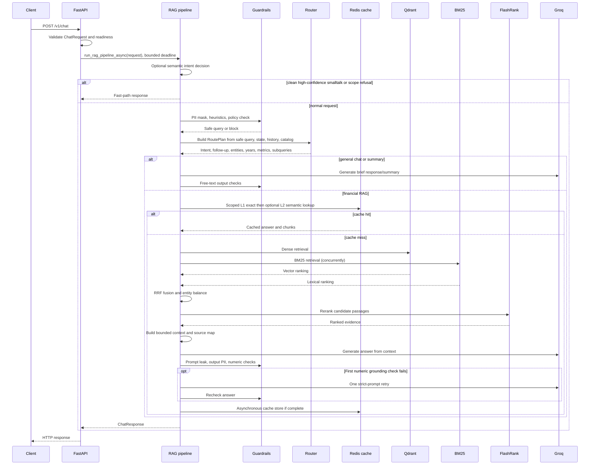

# Financial RAG Application — System Design and Execution Guide

## 1. Purpose, scope, and evidence boundary

This document describes the application runtime under [`app/`](../app/): the
HTTP API, React web client, request/response contracts, query planning,
retrieval, answer generation, cache, guardrails, privacy handling, logging,
configuration, startup, error behavior, and connections to the ingestion
system.

The application is a financial-filings question-answering service. It accepts a
chat request, determines whether the message is in scope, resolves context and
search constraints, retrieves filing passages, generates an answer, checks the
answer, and returns both the answer and supporting chunks.

### Scope boundary

- [`app/main.py`](../app/main.py) owns FastAPI startup, readiness, health, and
  the `/v1/chat` endpoint.
- [`app/pipeline.py`](../app/pipeline.py) coordinates the request lifecycle.
- [`app/utils/`](../app/utils/) contains specialized routing, retrieval,
  caching, reranking, guardrail, PII, LLM, token, and logging code.
- [`app/guardrails_config/`](../app/guardrails_config/) defines NeMo flows,
  prompts, and custom actions.
- [`web/`](../web/) contains the React + TypeScript user-facing chat client.
- The administrative ingestion UI is separate under [`admin/`](../admin/).
- Document parsing and Qdrant seeding are performed separately by
  [`admin/`](../admin/), documented in
  [`ADMIN_INGESTION_REPORT.md`](./ADMIN_INGESTION_REPORT.md).

This is an implementation guide, not a claim that external services or every
configured feature are available in every environment. Behaviors below are
based on the current source tree. Implementation limitations are called out
explicitly in [Current implementation caveats](#16-current-implementation-caveats).

## 2. Executive architecture

The system has four broad runtime concerns:

1. **Request boundary:** validate typed chat input, enforce service readiness
   and a server-side deadline, and serialize a typed response.
2. **Policy and query understanding:** detect high-confidence fast paths,
   mask PII/secrets, reject unsafe/out-of-scope messages, resolve follow-ups,
   and produce company/year/metric-specific search tasks.
3. **Evidence acquisition and answer construction:** use dense Qdrant and
   lexical BM25 retrieval in parallel, combine and rerank candidates, pack
   source-tagged evidence within a token budget, then ask Groq to answer from
   that evidence.
4. **Verification and observability:** apply output rails, optionally retry a
   numerically ungrounded draft once, record the resulting sources and scores,
   and return a `ChatResponse`. Redis caching reduces repeated work within a
   query/corpus scope.

```mermaid
flowchart TD
    CLIENT[React web client<br/>web/ or API caller] -->|POST /v1/chat| API[FastAPI<br/>app/main.py]
    API --> VALIDATE[Pydantic validation<br/>ChatRequest]
    VALIDATE --> READY{ready?}
    READY -->|No| SERVICE503[HTTP 503]
    READY -->|Yes| PIPE[run_rag_pipeline_async]

    PIPE --> SEM[Embedding intent classifier<br/>if available]
    SEM --> FAST{clean high-confidence<br/>smalltalk / out-of-scope?}
    FAST -->|smalltalk| GREET[Greeting exact-cache / Groq]
    FAST -->|out of scope| REFUSE[Scope refusal]
    FAST -->|normal or uncertain| IN[NeMo input rails<br/>PII → heuristics → policy]
    IN -->|blocked| BLOCK[Input refusal]
    IN -->|allowed| PLAN[Query planner<br/>intent, follow-up, entities,<br/>years, metrics, subqueries]
    PLAN --> INTENT{intent}
    INTENT -->|out_of_scope| REFUSE
    INTENT -->|general_chat| CHAT[Short Groq response<br/>free-text output rails]
    INTENT -->|chat_summary| SUMMARY[History summary<br/>free-text output rails]
    INTENT -->|rag_search| CACHE[Scoped Redis cache<br/>L1 exact then optional L2 semantic]
    CACHE -->|hit| CACHED[Cached answer/chunks]
    CACHE -->|miss| DOCS[Catalog → document IDs<br/>and query filters]
    DOCS --> SEARCH[Concurrent Qdrant + BM25<br/>for each subquery]
    SEARCH --> FUSE[Entity-bucketed RRF fusion]
    FUSE --> RERANK[FlashRank<br/>entity-balanced]
    RERANK --> PACK[Token-budgeted context<br/>and [S#] source map]
    PACK --> GEN[Groq answer generation]
    GEN --> OUT[NeMo output rails<br/>prompt leak → PII → numeric]
    OUT -->|numeric failure, attempt 1| STRICT[One strict-prompt retry]
    STRICT --> OUT
    OUT -->|blocked| VERIFY[Verification/refusal response]
    OUT -->|allowed| CACHEWRITE[Cache complete answer<br/>asynchronously]
    CACHEWRITE --> RESPONSE[ChatResponse with state,<br/>chunks, source map]
    GREET --> RESPONSE
    CHAT --> RESPONSE
    SUMMARY --> RESPONSE
    REFUSE --> RESPONSE
    BLOCK --> RESPONSE
    CACHED --> RESPONSE
    VERIFY --> RESPONSE
    RESPONSE --> CLIENT
```

### Non-goals

- The API does not parse PDFs or create vector embeddings for documents.
- The model does not receive arbitrary Qdrant data: the answer prompt includes
  the selected retrieval context and explicitly directs generation to rely on
  that context.
- Numeric grounding is a deterministic plausibility check, not a proof of
  arithmetic correctness, comprehensive factual verification, or citation
  entailment.

## 3. Runtime components and responsibilities

| Component | Responsibility |
|---|---|
| [`main.py`](../app/main.py) | FastAPI app, Logfire setup/instrumentation, lifespan warmup, readiness state, HTTP health routes, timeout and exception mapping. |
| [`schemas.py`](../app/schemas.py) | Pydantic request, turn, session-state, context-chunk, and response schemas. |
| [`pipeline.py`](../app/pipeline.py) | Intent fast path, input/output checks, query planning, answer cache, reranking, generation, and response assembly. |
| [`services/retrieval.py`](../app/services/retrieval.py) | Process-local retrieval instances, catalog refresh, document resolution, dense/BM25 hybrid search with RRF, and context packing. |
| [`config.py`](../app/config.py) | Pydantic Settings defaults and `.env` loading. |
| [`utils/router.py`](../app/utils/router.py) | Groq JSON-mode routing, company/year/metric parsing, follow-up handling, state update, filter/subquery construction. |
| [`utils/intent_router.py`](../app/utils/intent_router.py) | Optional embedding-based classifier for high-confidence shortcuts and follow-up hints. |
| [`utils/vector.py`](../app/utils/vector.py) | Dense query embedding, Qdrant document catalog enumeration, filtered named-vector search, payload normalization. |
| [`utils/bm25.py`](../app/utils/bm25.py) | Local manifest loading, lexical index creation, metadata-aware query filtering and BM25 ranking. |
| [`utils/flashrank_reranker.py`](../app/utils/flashrank_reranker.py) | Relevance reranking, financial metadata enrichment, per-company rerank/interleave. |
| [`utils/cache.py`](../app/utils/cache.py) | Exact Redis L1 and scoped semantic RedisVL L2 answer cache. |
| [`utils/guardrails.py`](../app/utils/guardrails.py) | Async NeMo rails wrapper, timeouts, deterministic fail-open fallback, user-facing refusal selection. |
| [`utils/guard_rules.py`](../app/utils/guard_rules.py) | Dependency-light injection, prompt-leak, and numeric-grounding checks. |
| [`utils/pii.py`](../app/utils/pii.py) | Presidio/spaCy PII analysis, API-key pattern removal, regex fallback. |
| [`utils/llm.py`](../app/utils/llm.py) | Groq client reuse, rate-limit-aware retry, API-key rotation, bounded retry wait. |
| [`utils/tokens.py`](../app/utils/tokens.py) | Token estimates/provider usage attributes and history slicing helper. |
| [`utils/logger.py`](../app/utils/logger.py) | JSON-formatted stdout logger for the named application logger. |
| [`guardrails_config/`](../app/guardrails_config/) | NeMo input/output flows, policy prompt, and action bindings. |
| [`web/`](../web/) | React + TypeScript chat client for the readiness and chat endpoints. |

Most expensive backend components are process-local lazy singletons. Creating
one FastAPI worker creates its own vector/BM25/reranker/LLM/cache/guardrail
objects and in-memory indexes; workers do not share Python process memory.

## 4. External systems and data ownership

### External/runtime dependencies

- **Groq:** JSON-mode query router, NeMo policy self-check, and answer
  generation. Primary and optional fallback API keys are configured through
  settings.
- **Qdrant:** dense vector collection and document catalog.
- **FastEmbed / BGE-small:** dense query embeddings and the embedding model
  used by semantic cache.
- **Local manifests / rank-bm25:** lexical retrieval index, loaded into memory
  when the BM25 retriever is created.
- **FlashRank:** local candidate reranking model.
- **Redis / RedisVL:** answer cache, including semantic vector search.
- **NeMo Guardrails / LangChain Groq:** prompt-policy and output rails.
- **Presidio / spaCy:** configurable PII entity recognition.
- **Logfire:** spans, attributes, events, and instrumentation.
- **FastAPI / Pydantic:** HTTP service and typed API boundary.
- **React / TypeScript / Vite:** user-facing chat client, built and served separately from the API.

### Data ownership and consistency

- Qdrant owns the vectors and payloads used by dense retrieval.
- The service’s BM25 index is built from local JSON manifests. Configuring
  remote Qdrant does **not** make BM25 remote.
- The admin ingestion process must make the manifest directory visible to the
  API process and must index into the same Qdrant collection/deployment used by
  the API.
- The configured collection is `financial_rag_analytics`; the configured
  named vector is `fastembed-BAAI/bge-small-en-v1.5`; its expected size is 384
  with cosine distance.
- Catalog entries are grouped by `(document_id, source_file)`. A corpus
  fingerprint is then built from sorted document IDs and chunk counts.

## 5. HTTP API and data contracts

### 5.1 Request contract

[`ChatRequest`](../app/schemas.py) contains:

| Field | Type/validation | Role |
|---|---|---|
| `session_id` | Required string | Caller-provided conversation identifier; echoed in the response and used for trace context. |
| `query` | Required string, 1–2000 characters | Current user message. The pipeline strips surrounding whitespace. |
| `history` | Optional list of `ChatTurn`, default empty list | Prior user/assistant turns supplied by the caller; this service does not persist the conversation itself. |
| `state` | Optional `SessionState`, defaults to an empty state | Carries company, fiscal year, target metric, and document ID between turns. |

`ChatTurn` has a free-form `role` string and `content` string. The schema does
not constrain roles to only `user` and `assistant`.

`SessionState` fields are optional strings:

- `company`
- `fiscal_year`
- `target_metric`
- `document_id`

### 5.2 Response contract

`ChatResponse` includes:

- `session_id`
- `answer`
- normalized `intent`
- `search_query` used as the standalone retrieval focus
- updated `state`
- `retrieved_chunks`
- `source_map`, where keys are source tags such as `S1` and values describe
  source file, page, and section

Each `ContextChunk` includes chunk ID and content, document ID, filename,
page, type, headings, reciprocal-rank-fusion score, and final reranker score.
`page_number` is typed as `Any` because the retrieval path can return a number
or a fallback label such as `"N/A"`.

### 5.3 HTTP routes

| Route | Behavior |
|---|---|
| `GET /health` | Returns `{"status": "healthy"}`. This is a process liveness response; it does not assert model/cache readiness. |
| `GET /health/ready` | Returns `{"status": "ready"}` only after startup warmup; otherwise HTTP 503. |
| `POST /v1/chat` | Rejects before readiness with HTTP 503; validates the request; waits up to `REQUEST_TIMEOUT_S`; returns a `ChatResponse`, HTTP 504 for server timeout, and HTTP 500 for an unexpected exception. |

Pydantic validation failures use FastAPI’s standard request-validation
response. Explicit `HTTPException`s are re-raised unchanged by the chat
handler.

## 6. Startup, readiness, and shutdown

### Startup sequence

1. `main.py` configures Logfire as service `financial-rag-engine` and
   instruments FastAPI and HTTPX.
2. `lifespan()` sets `app.state.ready = False` and logs initialization.
3. In a Logfire startup span, `warmup_pipeline()` runs warmups concurrently in
   worker threads for:
   - Qdrant/vector embeddings (a small warmup retrieval);
   - BM25 loading and retrieval;
   - FlashRank initialization and a sample rerank;
   - answer-cache Redis/vectorizer/L2-index setup;
   - NeMo guardrail construction;
   - Presidio/spaCy initialization;
   - intent-example loading and embedding;
   - Groq clients.
4. The pipeline forces a catalog refresh after these tasks.
5. The lifespan then calls `init_financial_cache()` again, also in a worker
   thread. This is an additional cache initialization call after the cache
   warmup call.
6. Only after both warmup and the second cache initialization succeed is
   `app.state.ready` set true.
7. Startup errors are logged with a stack trace and re-raised. The API does not
   claim readiness after a required warmup failure.

`warmup_pipeline()` uses `asyncio.gather()` without `return_exceptions=True`.
An exception from a required warmup therefore prevents startup from finishing.
Some helpers (notably semantic intent setup and NeMo action internals) catch
their own initialization errors and degrade; other model/cache initialization
errors can fail the application startup.

### Request concurrency and blocking work

- The endpoint is asynchronous and wraps the pipeline in `asyncio.wait_for`.
- Sync model, retrieval, and cache operations are commonly run via
  `asyncio.to_thread`.
- Vector and BM25 retrieval are run concurrently per target query.
- A process-local semaphore limits active search targets to
  `MAX_CONCURRENT_SEARCHES`.
- Answer cache writes are scheduled as background thread tasks so the client
  need not wait for them. The pipeline retains task references until
  completion.

### Shutdown

The lifespan clears readiness and calls `shutdown_pipeline()`. That function
is currently a no-op; singleton clients and resources are not explicitly
closed there.

## 7. End-to-end request lifecycle

### 7.1 High-level request sequence



### 7.2 Detailed stage-by-stage execution

#### Stage 0 — Boundary, readiness, and deadline

1. Client sends `POST /v1/chat`.
2. FastAPI/Pydantic validates `ChatRequest`.
3. If readiness is false, return HTTP 503 with a warmup message.
4. The endpoint starts a Logfire span and awaits
   `run_rag_pipeline_async()` under `REQUEST_TIMEOUT_S`, default 40 seconds.
5. An asyncio timeout becomes HTTP 504. Other unhandled exceptions are logged
   and mapped to HTTP 500.

#### Stage 1 — Optional embedding-intent fast path

1. Strip whitespace from the current query.
2. Retrieve the semantic `IntentRouter` singleton if enabled and initialized.
3. If available, embed/classify the query and record its top label, score, and
   selected fast-path label on the root span.
4. Only `smalltalk` and `out_of_scope` labels can immediately short-circuit
   here. A shortcut is permitted only if PII masking would not change the
   query.
5. A high-confidence smalltalk response checks the exact greeting cache and,
   on miss, calls the chat LLM. This shortcut does not go through the full
   NeMo input/policy path.
6. A high-confidence out-of-scope label returns a scope refusal without the
   full NeMo input/policy path.
7. If the semantic classifier is unavailable, an anchored greeting regex
   allows a greeting shortcut. Otherwise, processing continues to NeMo and
   the Groq router.

The embedding router’s `elaboration`, `reference`, and `summary` labels are
hints used later in planning; they are not direct endpoint responses.

#### Stage 2 — Input rails and history privacy

1. `check_input()` runs NeMo input rails when guardrails are enabled.
2. The configured NeMo order is:
   1. PII/secrets masking;
   2. deterministic empty/length/injection heuristics;
   3. LLM policy self-check.
3. If blocked, the pipeline records the blocking rail and returns a user-facing
   refusal. It masks the query again before placing it in the pipeline root
   span, so blocked query text is not copied there in its raw form.
4. If allowed, use the possibly modified/masked text as the safe query.
5. The pipeline masks PII in all supplied prior turns before those turns are
   passed to routing or generation.
6. Guardrail status, rail name, degraded-mode flag, and estimated token/call
   attributes are attached to a Logfire span. A compact list of guardrail
   events is attached to the request root span.

If NeMo errors or times out, `GUARDRAILS_FAIL_OPEN=true` uses deterministic
injection checks and PII masking only. If fail-open is false, the request
returns a temporary-unavailability refusal. The deterministic fallback does
not run the LLM policy classifier.

#### Stage 3 — Catalog and query planning

1. `get_catalog()` refreshes after `CATALOG_TTL_S` (default 300 seconds) or
   when forced.
2. It first enumerates Qdrant payloads, grouping points into documents by
   document ID and source file. Company names may be inferred from payload or
   known filename/document-ID tokens.
3. If Qdrant returns no catalog rows, it derives a catalog from loaded BM25
   chunks. If refresh throws, it logs the failure and continues with the last
   cached catalog.
4. The pipeline supplies the safe query, masked history, session state, known
   company names, and any semantic hint to `plan_query()`.
5. The router calls the Groq JSON-mode model in a worker thread to produce
   intent, follow-up type, entities, metrics, fiscal years, standalone query,
   elaboration aspects, and updated state.
6. Deterministic processing canonicalizes entities, detects indexed company
   names explicitly mentioned in the current query, parses years, carries
   eligible state, derives fallback metrics, ensures a standalone query, and
   creates subqueries.
7. Query planning emits a Logfire span with intent, follow-up type, entities,
   and standalone search query.

If the router LLM call or JSON decode fails, the router returns an empty
object. `plan_query()` defaults intent to financial RAG and fills in entity,
year, metric, follow-up, state, and query data using deterministic logic.

#### Stage 4 — Intent-specific non-retrieval responses

- `out_of_scope`: return a fixed scope message; no retrieval or cache.
- `general_chat`: send a short capability/greeting prompt plus recent history
  to Groq; pass the response through free-text output rails; do not cache.
- `chat_summary`: summarize the supplied conversation history using Groq and
  free-text output rails; if there is no history, return a fixed empty-history
  response. Do not cache.

The planner currently accepts `document_inventory` as a valid intent string,
but the pipeline has no dedicated `document_inventory` branch. Such a value
falls through to the RAG/cache/retrieval path rather than invoking a separate
inventory operation.

#### Stage 5 — Scoped cache lookup (financial RAG only)

1. Build `CacheScope` from intent, normalized entities, requested years,
   corpus version, and optional elaboration-context hash.
2. Normal queries use the current safe query as cache text. Reference
   follow-ups use the standalone rewritten query. Elaboration uses the current
   query plus a hash of the previous assistant answer in scope.
3. Check Redis exact cache (L1) first.
4. For non-elaboration requests only, if L1 misses, query semantic L2 and
   validate the candidate before accepting it.
5. On a hit, return the cached answer and cached retrieved chunks immediately.
6. On a miss, continue to document resolution and retrieval.

Cache lookup failures are logged and treated as misses, not user-facing
request failures.

#### Stage 6 — Document resolution and filter construction

For each planned entity (or `None` when there is no entity):

1. If a document ID is in session state and the query is not a multi-company
   request, that explicit ID takes precedence.
2. Otherwise, resolve the company against the catalog using normalized
   company/document/file names.
3. If a company was requested but no matching document IDs exist, mark that
   entity missing and do not search it.
4. If IDs are available, build filters using document IDs and years; company
   filter is generally omitted when document IDs already scope the search.
5. If IDs are not resolved but a company was requested, retain a company
   filter. If no entity filters remain, return a “couldn’t find documents”
   response.

When only some entities are missing, search the remaining entities and later
prefix the answer with a missing-document note. The answer is considered
incomplete and will not be cached.

#### Stage 7 — Hybrid dense and lexical retrieval

For each subquery:

1. Acquire the process-local search semaphore.
2. Run Qdrant and BM25 retrieval in parallel via worker threads.
3. `_safe_call()` logs a retriever exception and returns an empty list, allowing
   the other retriever to contribute.
4. Count distinct `(document_id, chunk_id)` values across both strict
   rankings.
5. If fewer than `MIN_STRICT_YIELD` (default 5) distinct chunks are found and
   year/company filters were present, repeat both retrievers without those
   filters but retain document-ID restrictions.
6. Return all strict and relaxed rankings to fusion.

The pipeline creates up to `RERANK_CANDIDATES` candidates (default 30), with a
per-entity retrieval depth of at least `MIN_STRICT_YIELD`.

#### Stage 8 — RRF fusion and entity balancing

1. Group results into per-entity candidate buckets.
2. Identify a candidate by `document_id:chunk_id`.
3. Within each ranking, count a candidate ID at most once.
4. Add reciprocal rank contribution `1 / (RRF_K + rank)` (default
   `RRF_K=60`) for each ranking in which the candidate appears.
5. Keep the subquery IDs associated with each fused candidate.
6. Select a quota from each entity bucket, then fill remaining capacity from
   the highest-scoring leftovers.

This fusion combines rankings; raw Qdrant cosine scores and raw BM25 values do
not directly share a common scale and are not directly averaged.

#### Stage 9 — FlashRank reranking and final candidate count

- Each candidate passage is augmented for reranking with available company,
  filename, section, metric, years, columns, and row-label information.
- For a single entity, use standard reranking. For multiple entities, rerank
  each entity’s candidate group separately and interleave results
  round-robin.
- Multi-entity questions receive at least three final chunks per entity,
  subject to the actual candidate supply; the final selection may exceed the
  ordinary top-k setting to preserve entity coverage.
- Elaboration follow-ups request a wider base result set.
- If FlashRank raises, log the failure and fall back to the original candidate
  ordering with fallback scores.

#### Stage 10 — Context packing and citation map

`build_context()` iterates reranked chunks in order:

1. Drop chunks with empty content.
2. Assign source tags `[S1]`, `[S2]`, etc.
3. Format each source with filename, page, section, chunk type (when not plain
   text), and content.
4. Count tokens using `tiktoken` `cl100k_base`.
5. Skip any individual source that would exceed `MAX_CONTEXT_TOKENS`
   (default 4096) after accounting for a separator. Continue checking later,
   smaller chunks rather than stopping at the first one that does not fit.
6. Return the concatenated context, tag-to-source map, and selected chunks.

If no usable context is produced, return a fixed no-support response without
answer generation or caching.

#### Stage 11 — Answer generation, output checks, response/cache

1. Compose a system prompt that requires evidence-only answers, exact financial
   values and units, citations, and explicit acknowledgement when requested
   data is missing.
2. For elaboration only, include up to the last four history turns in the
   answer call; truncate each supplied history content to 1,500 characters.
3. Call Groq at temperature `0.0` for RAG answers.
4. Run output rails with the original safe query, draft answer, and retrieved
   context.
5. If the only blocking rail is numeric grounding on the first attempt, retry
   once with a stricter prompt requiring all figures to be quoted verbatim or
   shown as simple calculations. Other blocking rails do not trigger retry.
6. If still blocked, return the configured refusal and do not cache.
7. If output PII masking changed the text, record an output-masked guardrail
   event.
8. Check evidence completeness: every requested entity must be represented in
   final chunks, and no requested entity may be missing. Add a missing-company
   note if applicable. Incomplete answers are not cached.
9. Convert final chunks to `ContextChunk` models and construct the response.
10. For complete results only, schedule a Redis cache write in a background
    task. Return the response without waiting for the cache write.

## 8. Query planning, follow-ups, and state

### 8.1 Router input/output

`plan_query()` combines:

- safe current query;
- at most the most recent four conversation turns, bounded by
  `MAX_HISTORY_TURNS` (default 6); user turns are supplied in full and
  assistant turns are truncated to 600 characters for the router prompt;
- current session state;
- catalog company names;
- embedding-router label and availability;
- Groq model output requested in JSON mode.

The router requests:

- intent: `rag_search`, `chat_summary`, `general_chat`, or `out_of_scope`;
- follow-up type: `none`, `reference`, or `elaboration`;
- entities (companies);
- metrics/topics;
- requested fiscal years;
- standalone `search_query`;
- optional new aspects for elaborations;
- updated state fields.

The code also accepts `document_inventory` as a valid intent, though no
dedicated execution branch currently exists for it.

### 8.2 Entity/year/metric normalization

- Company names are normalized by lowercase alphanumeric tokenization and
  removing common trailing legal suffixes such as `Inc`, `Corp`, `Ltd`, and
  `Company`.
- LLM entities are canonicalized against known catalog companies.
- A separate deterministic entity detector searches the current query for
  known indexed companies.
- Entities are de-duplicated by normalized company key.
- Query years are extracted for 2010–2039 by the router regex; model-provided
  years are accepted in 1990–2100. If no year is found, the state fiscal year
  may be used for retrieval.
- If the LLM does not provide metrics, deterministic phrase splitting removes
  query verbs, years, company names, and simple leading prepositions. For a
  follow-up without detected metrics, the prior target metric may be reused.

### 8.3 Follow-up classes

| Type | Meaning and behavior |
|---|---|
| `none` | Standalone question; use user wording as cache/search text unless model has a rewritten search query. |
| `reference` | New question whose company/year/metric depends on prior context. Use the rewritten standalone query for cache and retrieval; include resolved entities/years. |
| `elaboration` | Requests new details about an already answered topic. Create subqueries for additional aspects, include limited prior history in generation, request a wider candidate set, and disable semantic cache lookup. |

Follow-ups are not classified as such without history. A confident embedding
hint and LLM verdict are reconciled by `classify_followup()`. Regex fallbacks
for reference/elaboration are used only when the embedding router is
unavailable.

Default elaboration aspects are:

- breakdown by segment, product, or region;
- key drivers and management commentary;
- year-over-year change.

The model may provide up to four alternate aspects. The full plan is capped at
`MAX_SUB_QUERIES=12`.

### 8.4 State updates

- Multiple entities clear single-company and document-ID locks.
- A single entity becomes the new company. Existing document ID is retained
  only when company is unchanged, unless the model provides a new one.
- If no entity is found, company/document state can be carried forward.
- A single year explicitly present in the current query can update
  `fiscal_year`; otherwise, model/current state can persist.
- `target_metric` is carried or updated from model output.
- Retrieval entities use explicitly found companies first; otherwise they use
  the carried state company when available.

The service does not store session state server-side; the client must send the
returned state on the next request.

## 9. Retrieval and ranking internals

### 9.1 Dense retrieval — Qdrant

[`QdrantVectorRetriever`](../app/utils/vector.py):

- initializes `TextEmbedding` with `EMBEDDING_MODEL` (default BGE-small);
- reads `FASTEMBED_CACHE_DIR` and `FASTEMBED_LOCAL_FILES_ONLY` environment
  variables for local model behavior;
- connects to remote Qdrant when `QDRANT_URL` is configured, passing
  `QDRANT_API_KEY`; otherwise uses `QDRANT_STORAGE_PATH`;
- returns empty results when the configured collection does not exist;
- embeds the query, calls Qdrant `query_points()` with the configured named
  vector and `RETRIEVAL_K` default 30;
- applies document ID filters and, when requested, year/company filters.
  Year and company matching allow missing fiscal-year/company fields in the
  Qdrant filter expressions;
- normalizes point payload into a chunk dictionary and propagates selected
  metadata fields into its metadata object when absent there.

`list_documents()` scrolls the collection in pages of 1,000 payloads, groups
by document and source file, infers Nike/Duolingo names only when company
metadata is absent, and returns a sorted document catalog.

### 9.2 Lexical retrieval — local BM25

[`BM25Retriever`](../app/utils/bm25.py):

- checks `data/manifests/*.json` first; if that directory has no JSON files, it
  recursively scans the data directory; it may use `BM25_MANIFEST_PATH` as a
  fallback;
- skips manifest files with names beginning `old_`, containing `_old`,
  ending `.bak`, or containing `cache` or `evaluation`;
- accepts only JSON arrays and logs unreadable files;
- filters empty content and sentinel values;
- precomputes each chunk’s document ID, fiscal-year set, and company;
- builds searchable text from document/file/company, years, financial metric,
  headings, columns, row labels, embedding text, and content;
- tokenizes while retaining digits, percentages, punctuation in numbers, and
  hyphenated filing terminology;
- filters by document ID exactly; year/company filters retain chunks whose
  corresponding metadata is missing, avoiding accidental over-filtering.

BM25 is process-local and built when the singleton is first initialized. It
does not automatically reload manifests after initialization.

### 9.3 RRF fusion

Given rankings `r` and candidate rank `k`, a candidate receives
`sum(1 / (RRF_K + k))` over ranking occurrences. Duplicate IDs within a single
ranking are ignored. Fusion happens inside the subquery’s entity bucket, which
allows a subsequent per-entity quota before filling from the global leftovers.

### 9.4 FlashRank

[`FlashRankReranker`](../app/utils/flashrank_reranker.py) packages each passage
with its text plus selected metadata before reranking. For multi-company
questions, each entity group gets an entity-specific rerank query and ranked
lists are interleaved round-robin. The fallback path returns the incoming order
if FlashRank fails.

### 9.5 Evidence and source attribution

Citation markers are assigned during context construction, not during
retrieval. The source map is generated from the same selected chunks used in
the context. Returned `retrieved_chunks` also expose the chunks, page and
ranking values for clients such as the React web client.

Cached responses currently store chunks but do not store or restore `source_map`;
see [Cache behavior and caveats](#11-cache-behavior-and-caveats).

## 10. Guardrails, PII, and grounding

NeMo is a **policy layer**, not the RAG answer generator. The pipeline remains
responsible for query routing, evidence retrieval, and answer generation.

### 10.1 Configured NeMo order

[`guardrails_config/config.yml`](../app/guardrails_config/config.yml) configures:

**Input**

1. `mask pii input`
2. `check input heuristics`
3. `self check input`

**Output**

1. `check prompt leak`
2. `mask pii output`
3. `check numeric grounding`

The optional NeMo `self check facts` output flow is not enabled. The output
checks in the configured flows are deterministic custom actions; they do not
make another policy-model call.

### 10.2 Input checks

- Empty message is rejected.
- Messages longer than 2,000 characters are rejected by deterministic
  heuristics (the API schema also limits the raw query to 2,000 characters).
- Configured prompt-injection phrases are rejected, including instruction
  override, system-prompt disclosure, and common jailbreak language.
- A Groq-backed self-check classifies supported filing Q&A, conversational
  follow-ups, greetings/capability questions, and conversation summaries as in
  scope. Other requests—including unrelated work and investment advice—are
  blocked.
- PII masking occurs before the router LLM sees the message in the regular
  guardrail path.
- `rails.co` provides specific refusal text for empty, oversized, injection,
  prompt-leak, and unverified-figure cases.

The policy prompt asks the checker whether the request should be blocked and
contains in-scope/out-of-scope examples. Its prompt text is in
[`prompts.yml`](../app/guardrails_config/prompts.yml).

### 10.3 PII and secret masking

[`utils/pii.py`](../app/utils/pii.py):

- masks API-key/secret-like patterns independently of Presidio;
- uses Presidio Analyzer with spaCy model `en_core_web_sm` by default;
- registers India Aadhaar/PAN recognizers when importable;
- applies configurable entity lists and confidence threshold `0.4`;
- replaces entities from right to left to preserve offsets;
- falls back to structured regexes for SSNs, email, phones, and Luhn-valid
  payment cards when Presidio is missing or fails.

Input entity types include phone, email, payment card, SSN, IBAN, IP address,
bank number, passport, driver license, Aadhaar, and PAN. Output masking omits
phone-number masking to preserve legitimate investor-relations numbers in
filing excerpts. Secrets remain masked in both directions.

### 10.4 Output checks and strict retry

- **Prompt leakage:** reject answers containing configured markers associated
  with internal instructions/retrieval scaffolding.
- **PII:** mask configured sensitive entities and secrets from the answer.
- **Numeric grounding:** extract material numeric candidates from the answer,
  ignore citation tags and ordinary years (1900–2100), and compare figures
  against numbers in retrieved evidence. It allows unit scaling by 1,000 and
  1,000,000 (and their inverse) with 1% tolerance.
- If more than half of material numeric values cannot be matched, block the
  answer with a “couldn’t verify the figures” message.
- A numeric block on the first RAG generation attempt causes exactly one
  second generation using a strict prompt. Non-numeric blocks do not retry.
- The retry’s final blocked response is not cached.

This validation does not test all non-numeric claims, arithmetic logic,
whether a citation tag points to the exact supporting passage, or whether
figures have been interpreted with the correct accounting meaning.

### 10.5 Fail-open mode and fast paths

- With `GUARDRAILS_FAIL_OPEN=true`, a NeMo error or timeout falls back to
  deterministic injection/length heuristics and PII masking. It does not run
  the LLM policy self-check.
- With fail-open disabled, input/output rail errors return a temporary
  refusal.
- Clean, high-confidence semantic smalltalk/out-of-scope paths bypass the
  regular NeMo input flow by design. Smalltalk fast-path generation also
  returns directly without calling `_guard_free_text()`; this path therefore
  does not run the configured output rails.
- General chat and summary responses do call free-text output rails, but
  numeric grounding has no evidence string for those responses.

## 11. Cache behavior and caveats

[`utils/cache.py`](../app/utils/cache.py) implements a two-tier Redis cache.

### 11.1 Scope

`CacheScope` fingerprint contains:

- intent;
- normalized, sorted entity set (or `global`);
- sorted fiscal-year set (or `any`);
- corpus version;
- optional prior-answer hash for elaborations.

The corpus version is the first eight characters of SHA-1 over sorted
`document_id:chunk_count` pairs. It makes old cache entries unreachable when
catalog document IDs or counts change; a same-ID/same-count content replacement
may not change it.

### 11.2 L1 exact cache

- Redis key includes a SHA-256 digest of scope and normalized query text.
- Query normalization lowercases and retains alphanumeric tokens.
- Answer TTL defaults to 86,400 seconds (24 hours).
- Greeting TTL defaults to 604,800 seconds (7 days).

### 11.3 L2 semantic cache

- RedisVL vector index uses 384-dimensional BGE-small embeddings.
- Filter fields: entity, year, intent, corpus.
- Only the closest candidate is considered.
- Reject candidates with cosine distance greater than `CACHE_MAX_DISTANCE`
  (default `0.04`).
- Reject unless content terms have Jaccard overlap at least
  `CACHE_MIN_TERM_OVERLAP` (default `0.7`) and numeric token sets match.
- L2 hits are promoted into L1 for the answer TTL.
- L2 lookup is disabled for elaborations because their answer depends on prior
  answer context.

Read/write exceptions are logged and swallowed so the RAG request can continue.
The cache does not include a source map in its payload. On a cache hit, the
pipeline restores `retrieved_chunks` but `_reply()` is called without a
`source_map`, so cached responses have an empty source map even if the original
response was source-mapped.

Answers are stored only after successful output checks and only if all
requested entities are represented in final evidence. General chat and
summaries are not cached by the normal RAG path; the separate smalltalk helper
uses the greeting cache.

## 12. LLM calls, retries, and token tracking

### Groq client setup

- Primary required key: `GROQ_API_KEY`.
- Optional secondary key: `FALLBACK_GROQ_API_KEY`.
- Clients are cached by timeout value. Router clients use a 20-second timeout;
  pipeline answer clients use 30 seconds; each client disables SDK-level
  retries so the application wrapper controls retry behavior.

### Retry behavior

[`utils/llm.py`](../app/utils/llm.py):

- defaults to four attempts (`LLM_MAX_ATTEMPTS=4`);
- defaults to a cumulative retry sleep budget of 10 seconds
  (`LLM_MAX_WAIT_S=10`);
- retries rate limits, connection errors, and internal server errors;
- rotates to another configured key after a rate limit, before sleeping;
- parses Groq’s “try again in …” duration or `Retry-After` header when
  available;
- otherwise uses bounded exponential delay plus jitter;
- optionally passes `LLM_REASONING_EFFORT` for models whose name includes
  `gpt-oss`.

### Token telemetry

- Local estimates use `tiktoken` `cl100k_base`.
- `count_message_tokens()` concatenates role/content strings before counting.
- When Groq usage is available, provider prompt/completion counts are preferred;
  otherwise estimated input and output counts are attached.
- LLM Logfire spans include input/output/total token values, call count, and
  whether counts came from provider data or estimates.
- Guardrail spans separately record estimated input/output counts for policy
  checks; deterministic output rails record zero LLM calls.
- The pipeline’s `_llm()` records usage for router-independent generation
  calls. The router records its own Groq usage span.

## 13. Logging and observability

### Logfire

`main.py` configures Logfire as `financial-rag-engine`; remote sending is
enabled when `LOGFIRE_TOKEN` is configured. FastAPI and HTTPX are instrumented.
The code adds spans for startup, request execution, semantic intent,
input/output guardrails, routing, hybrid search, reranking, Groq calls, and
token usage. Attributes include selected intent, cache tier, entities,
subquery count, candidate count/files, selected chunk IDs, blocking rail, and
duration for the completed RAG path.

Not every return path records every attribute. Early exits can omit duration,
retrieved evidence, or cache-storage attributes.

### Python logger

[`utils/logger.py`](../app/utils/logger.py) defines a JSON formatter writing
to stdout for logger `docling_rag`, with timestamp, severity, message, module,
and optional `extra` data. Routing code uses that logger. Other modules use
standard module loggers or Logfire.

### Query data in traces

The FastAPI request span in `main.py` is created with
`query=request.query` before the pipeline’s PII masking. That means the raw
request query can be attached to a trace even though the pipeline subsequently
masks PII before routing. Operators should account for this when configuring
trace retention, access, and export.

The pipeline also records safe/masked query text in its root span after regular
input rails. Smalltalk fast-path traces record their original query after a
PII-equality check; the regex fallback is restricted to anchored greeting
phrases.

## 14. Configuration reference

Settings are defined in [`config.py`](../app/config.py), loaded with Pydantic
Settings and `.env`. Environment variables override the defaults. Additional
controls are read directly from the environment in `main.py`,
`services/retrieval.py`, `cache.py`, `vector.py`, and `llm.py`.

### 14.1 Core service/model/storage settings

| Setting | Default / requirement | Effect |
|---|---|---|
| `APP_NAME` | `Docling Financial Hybrid RAG Service` | FastAPI title. |
| `GROQ_API_KEY` | Required | Primary Groq credential; settings construction requires it. |
| `FALLBACK_GROQ_API_KEY` | None | Optional second Groq credential. |
| `LLM_MODEL` | `openai/gpt-oss-20b` | Router/answer model. |
| `EMBEDDING_MODEL` | `BAAI/bge-small-en-v1.5` | Query embedding model. |
| `VECTOR_NAME` | `fastembed-BAAI/bge-small-en-v1.5` | Qdrant named vector. |
| `COLLECTION_NAME` | `financial_rag_analytics` | Qdrant collection. |
| `RERANKER_MODEL` | `ms-marco-MiniLM-L-12-v2` | FlashRank model. |
| `QDRANT_URL` | None | Select remote Qdrant when set. |
| `QDRANT_API_KEY` | None | Credential for remote Qdrant. |
| `QDRANT_STORAGE_PATH` | `data/qdrant_storage` | Local Qdrant directory when remote URL is absent. |
| `BM25_MANIFEST_PATH` | `data/manifests` | BM25 fallback manifest path. |
| `LOGFIRE_TOKEN` | None | Enables authenticated remote Logfire sending when truthy. |

### 14.2 Retrieval, context, and history

| Setting | Default | Effect |
|---|---:|---|
| `RETRIEVAL_K` | 30 | Default per-retriever top-k. |
| `FINAL_TOP_K` | 5 | Base final result count; retrieval service also reads this directly from the environment. |
| `RRF_K` | 60 | Reciprocal-rank fusion constant. |
| `MAX_HISTORY_TURNS` | 6 | Router history boundary and helper default; individual paths apply their own smaller slices. |
| `MAX_CONTEXT_TOKENS` | 4096 | Maximum packed evidence context. |
| `REQUEST_TIMEOUT_S` | 40 | API request deadline; read directly by `main.py`. |
| `RERANK_CANDIDATES` | 30 | Retrieval candidate target; direct environment variable. |
| `FINAL_TOP_K` | 5 | Final result base; direct environment variable takes precedence in the retrieval service. |
| `MAX_FINAL_TOP_K` | 10 | Cap floor for multi-entity selection; direct environment variable. |
| `MIN_STRICT_YIELD` | 5 | Minimum distinct strict retrieval yield before relaxing year/company filters; direct environment variable. |
| `CATALOG_TTL_S` | 300 | Catalog refresh interval; direct environment variable. |
| `MAX_CONCURRENT_SEARCHES` | 8 | Search semaphore limit; direct environment variable. |

### 14.3 Cache settings

| Setting | Default | Effect |
|---|---:|---|
| `REDIS_URL` | `redis://localhost:6379` | Redis connection. |
| `CACHE_TTL` | 86400 seconds | Normal response cache TTL. |
| `CACHE_GREETING_TTL` | 604800 seconds | Greeting cache TTL. |
| `CACHE_MAX_DISTANCE` | 0.04 | Maximum semantic-cache vector distance. |
| `CACHE_MIN_TERM_OVERLAP` | 0.7 | Required term Jaccard overlap for semantic hit. |
| `REDIS_URL` (direct environment read) | Falls back to Settings value | Used by cache Redis client. |

### 14.4 Guardrail and privacy settings

| Setting | Default | Effect |
|---|---|---|
| `GUARDRAILS_ENABLED` | true | Enables NeMo input/output rails. |
| `GUARDRAILS_PATH` | `app/guardrails_config` | NeMo config directory. |
| `GUARDRAIL_LLM_MODEL` | `openai/gpt-oss-20b` | NeMo policy model. |
| `GUARDRAILS_TIMEOUT_S` | 8 seconds | Timeout per NeMo check. |
| `GUARDRAILS_FAIL_OPEN` | true | Use deterministic fallback on rail failure. |
| `GUARDRAILS_NUMERIC_CHECK` | true | Enable numeric evidence check. |
| `PII_ENGINE` | `presidio` | `presidio` or regex-only mode. |
| `PII_SPACY_MODEL` | `en_core_web_sm` | Presidio NLP model. |
| `PII_SCORE_THRESHOLD` | 0.4 | Presidio entity threshold. |
| `PII_INPUT_ENTITIES` | Sensitive entity list in `config.py` | Input masking types. |
| `PII_OUTPUT_ENTITIES` | Sensitive entity list excluding phone | Output masking types. |

### 14.5 Intent and direct LLM retry settings

| Setting | Default | Effect |
|---|---|---|
| `INTENT_ROUTER_ENABLED` | true | Enables the embedding intent classifier when examples load. |
| `INTENT_EXAMPLES_PATH` | `app/data/intent_examples.yml` | YAML labels/examples for semantic classification. |
| `INTENT_MIN_SCORE` | 0.85 | Minimum cosine score for a classifier label. |
| `INTENT_MIN_MARGIN` | 0.03 | Required lead over second-best label. |
| `LLM_MAX_ATTEMPTS` | 4 | Groq wrapper attempt count. |
| `LLM_MAX_WAIT_S` | 10 | Maximum cumulative retry sleep. |
| `LLM_REASONING_EFFORT` | unset | Optional `gpt-oss` reasoning setting. |
| `FASTEMBED_CACHE_DIR` | unset | Optional FastEmbed model cache override. |
| `FASTEMBED_LOCAL_FILES_ONLY` | false | FastEmbed local-only mode when set to `true`. |

Some similarly named values exist both as Pydantic settings and direct
environment reads. For deployment or tuning, inspect both the settings class
and the module-level environment reads rather than assuming one configuration
source covers all controls.

## 15. React web client

The user-facing client lives under [`web/`](../web/) and consumes the FastAPI
service rather than implementing retrieval itself.

1. Checks `/health/ready` and reflects service readiness in the interface.
2. Posts `session_id`, `query`, `history`, and conversational `state` to
   `/v1/chat`.
3. Renders Markdown answers and exposes retrieved source passages when
   returned by the API.
4. Keeps chat state in the browser session; conversation history is not
   persisted across page reloads.
5. Uses the Vite development proxy for `/health` and `/v1`. Production should
   serve the built frontend over HTTPS and proxy those paths to FastAPI on the
   same origin.

See [`web/README.md`](../web/README.md) for development and deployment setup.

## 16. Current implementation caveats

These are source-code observations that materially affect the runtime and
should be considered during maintenance or deployment.

1. **Semantic intent examples are absent from this workspace.** The configured
   default is `app/data/intent_examples.yml`, but that file is not present in
   the checked project tree. `get_intent_router()` catches loading failure,
   logs it, and marks the singleton unavailable for the process. The API then
   uses the greeting regex where applicable and otherwise the Groq query
   router. An external deployment may supply the file at runtime.
2. **`document_inventory` is not a dedicated feature path.** The planner
   accepts that intent, but `run_rag_pipeline_async()` handles only
   out-of-scope, general-chat, summary, and normal RAG branches. Inventory
   intent falls through to the RAG path.
3. **Cache-hit `source_map` is empty.** The cache stores answer/chunks but not
   the source map; on hit, `_reply()` is called without one.
4. **Fast-path smalltalk skips output guardrails.** It checks input PII equality
   before skipping full input rails, but its generated response returns
   directly rather than passing through `_guard_free_text()`.
5. **Disabling guardrails disables masking too.** `check_input()` and
    `check_output()` return immediately when `GUARDRAILS_ENABLED=false`; the
    ordinary query path then does not mask the current input or generated
    answer through these wrappers.
6. **Raw query is attached to the API Logfire span.** `main.py` records
    `request.query` at the HTTP boundary before input masking. Trace access and
    retention therefore matter for user privacy.
7. **Cache initialization is performed twice during startup.** It is invoked
    in `warmup_pipeline()` and again in the FastAPI lifespan.
8. **Shutdown does not close singleton clients.** `shutdown_pipeline()` is
    empty.
9. **Retriever exceptions become empty rankings.** This allows one retrieval
    backend to continue when the other fails, but if both fail the request may
    surface as a no-evidence answer rather than a direct retrieval error.
10. **Qdrant and BM25 consistency is operationally managed.** Remote Qdrant can
    be correctly configured while local BM25 manifests are stale or absent.
    The two retrieval backends may then search different corpora.
11. **BM25 is not refreshed after singleton initialization.** New manifests
    require process restart or explicit future reload support to appear in the
    existing in-memory index.
12. **Catalog fingerprint is approximate.** Same document IDs and chunk
    counts with changed content may not change the cache corpus version.
13. **Cache stores asynchronously.** The response can return before the Redis
    write finishes; write errors are logged and do not alter the already sent
    response.
14. **Numeric grounding is heuristic.** It does not prove all factual claims,
    calculations, or citations; valid figures can be rejected or unsupported
    figures missed depending on numeric overlap and scale.
15. **Router intent allow-list and output path differ.** `document_inventory`
    is accepted by `plan_query()` validation but absent from the model’s
    declared JSON intent list and absent from the pipeline’s special-case
    branches.
16. **Response cache does not rebuild source attribution.** On a cache hit,
    the answer and chunks are reused, but the original `[S#]` source map is
    not returned. Clients should not assume cached and uncached responses have
    identical `source_map` values.
17. **History role validation is loose.** `ChatTurn.role` is any string and is
    later forwarded as a model message role in some code paths.
18. **The `health` route is liveness only.** Use `/health/ready` to determine
    whether initialized models and required startup resources are available.

## 17. Error handling and graceful degradation

| Condition | Current behavior |
|---|---|
| Request schema invalid | FastAPI returns request validation error. |
| Service not ready | `/health/ready` and `/v1/chat` return HTTP 503. |
| Request exceeds server deadline | HTTP 504; timeout recorded in Logfire. |
| Unexpected request exception | Logfire exception and HTTP 500 with generic detail. |
| Semantic intent loading/decision fails | Log and continue with regex greeting fallback or LLM router. |
| Query router LLM fails or returns invalid JSON | Log; return empty routing object and construct a deterministic/default plan. |
| Catalog refresh fails | Log exception, retain prior catalog copy. |
| Vector or BM25 call fails | Log; use empty ranking from that backend and allow the other to contribute. |
| Strict retrieval has too few results | Retry without year/company filters but retain document IDs. |
| FlashRank fails | Log; preserve incoming ranking with fallback score. |
| Cache read/write fails | Log; continue on miss or leave successful response unchanged. |
| NeMo check errors/times out | Deterministic fail-open fallback by default; temporary block when fail-open disabled. |
| Output number check fails once | Retry once with stricter answer prompt. |
| Output still blocked | Return guardrail refusal; do not cache. |
| Requested company not in catalog | Return not-found message, or annotate partial answer if other entities remain. |
| No usable context | Return no-support message; do not generate or cache. |
| Startup warmup/cache initialization fails | Log/re-raise; app remains unready and startup fails. |

## 18. Operational entry points

From the repository root, using the project’s installed environment:

```powershell
uvicorn app.main:app --host 0.0.0.0 --port 8000

# In a second terminal
cd web
npm run dev
```

`python -m app.main` also invokes Uvicorn on `0.0.0.0:8000`. These are
development/operational entry points, not a complete production deployment
recipe. Production should separately define network exposure, authentication,
TLS/reverse proxy, worker count, secrets, Redis/Qdrant availability, model
cache persistence, and trace policy.

Example request shape:

```json
{
  "session_id": "sess_12345",
  "query": "What was Nike's revenue in 2025?",
  "history": [],
  "state": {
    "company": null,
    "fiscal_year": null,
    "target_metric": null,
    "document_id": null
  }
}
```

## 19. Suggested end-to-end walkthrough

1. Start the API and wait for `GET /health/ready` to return 200.
2. Ask a direct company/year/metric question.
3. Inspect the response’s `answer`, `search_query`, state, source map, and
   retrieved chunks.
4. Ask a reference follow-up such as “What about the prior year?” to show
   query rewriting and state carry-forward.
5. Ask a two-company comparison to show per-entity quotas and rerank
   interleaving.
6. Ask for elaboration to show alternate retrieval aspects and strict
   conversation-dependent cache handling.
7. Inspect Logfire for input/output rail outcomes, cache tier, query plan,
   retrieval candidates, selected chunks, token usage, and retry behavior.
8. Compare a cold request and a repeated request while checking cache scope and
   the source-map caveat for cache hits.

## 20. Source map

- API lifecycle and HTTP errors: [`app/main.py`](../app/main.py)
- Request/response types: [`app/schemas.py`](../app/schemas.py)
- Main execution graph: [`app/pipeline.py`](../app/pipeline.py)
- Retrieval, fusion, and context: [`app/services/retrieval.py`](../app/services/retrieval.py)
- Settings and defaults: [`app/config.py`](../app/config.py)
- LLM query planning and state: [`app/utils/router.py`](../app/utils/router.py)
- Embedding intent classifier: [`app/utils/intent_router.py`](../app/utils/intent_router.py)
- Dense Qdrant retrieval: [`app/utils/vector.py`](../app/utils/vector.py)
- Local lexical BM25 retrieval: [`app/utils/bm25.py`](../app/utils/bm25.py)
- Rank fusion and evidence packing: [`app/services/retrieval.py`](../app/services/retrieval.py)
- FlashRank reranking: [`app/utils/flashrank_reranker.py`](../app/utils/flashrank_reranker.py)
- Redis exact/semantic cache: [`app/utils/cache.py`](../app/utils/cache.py)
- NeMo wrapper and policy checks: [`app/utils/guardrails.py`](../app/utils/guardrails.py)
- Deterministic security/grounding rules: [`app/utils/guard_rules.py`](../app/utils/guard_rules.py)
- PII and secret masking: [`app/utils/pii.py`](../app/utils/pii.py)
- NeMo custom actions: [`app/guardrails_config/actions.py`](../app/guardrails_config/actions.py)
- NeMo flow configuration: [`app/guardrails_config/config.yml`](../app/guardrails_config/config.yml)
- NeMo refusal flows: [`app/guardrails_config/rails.co`](../app/guardrails_config/rails.co)
- NeMo input policy prompt: [`app/guardrails_config/prompts.yml`](../app/guardrails_config/prompts.yml)
- Groq retry/key rotation: [`app/utils/llm.py`](../app/utils/llm.py)
- Token usage helpers: [`app/utils/tokens.py`](../app/utils/tokens.py)
- JSON stdout logger: [`app/utils/logger.py`](../app/utils/logger.py)
- User-facing React client: [`web/src/App.tsx`](../web/src/App.tsx)
- Frontend setup: [`web/README.md`](../web/README.md)
- Ingestion-side report: [`Present/ADMIN_INGESTION_REPORT.md`](./ADMIN_INGESTION_REPORT.md)
