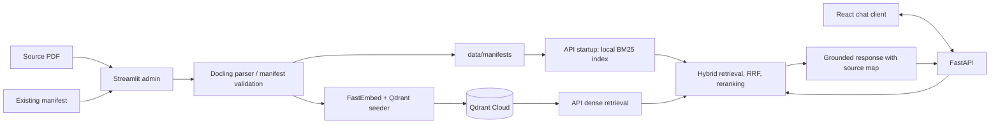

# Financial RAG Application — Technical Report

## 1. Purpose and scope

This report is a repository-wide technical handoff for the financial RAG
chatbot. It covers the user-facing React client, FastAPI serving path, document
ingestion/admin UI, Qdrant and Redis integration, Docker/Nginx deployment,
evaluation assets, tests, current limitations, and operational risks. It is
intended as source material for project demonstrations and later artifact
generation.

The application is a financial-filings question-answering service. It accepts
chat requests, resolves intent and conversational context, searches indexed
filing chunks, ranks evidence, generates a cited answer, applies safeguards,
and returns both the answer and source chunks. The core backend is a FastAPI
service. A React + TypeScript web client is included as a user-facing client of
that API.

### Scope boundary

- `web/` contains the React + TypeScript chat client.
- `app/` contains the FastAPI API, RAG coordinator, retrieval/ranking, routing,
  cache, privacy/guardrails, request security, Redis queue, and configuration.
- `admin/` contains the Streamlit ingestion UI, Docling PDF parser, manifest
  validator, and Qdrant seeder.
- `data/` contains the reviewed filing manifests and local source PDFs. The
  PDFs are local ingestion inputs; the API's lexical BM25 index is built from
  the manifests.
- `compose.yaml`, `Dockerfile`, and `deploy/` define the container build,
  Nginx ingress, TLS/auth mounts, networks, health checks, and runtime limits.
- `evaluation/` contains the RAGAS evaluation script and cached samples/results.
- `tests/` contains backend unit tests. The frontend has build/type-check and
  lint scripts, but no dedicated browser-level test suite was found.

## 2. Executive overview

The system is a hybrid retrieval-augmented generation (RAG) application with
three important design characteristics:

1. **Queries are planned before retrieval.** A semantic intent classifier
   provides confident fast paths; a Groq-backed router then interprets
   financial intent, companies, metrics, years, follow-ups, and search wording.
   Deterministic company/year logic supplements the model's output.
2. **Evidence is found and selected by multiple stages.** Dense Qdrant
   retrieval and local BM25 lexical retrieval run concurrently. Reciprocal
   Rank Fusion (RRF) combines results. Voyage AI reranks them, with an
   entity-balanced strategy for cross-company questions. A token-limited
   context builder adds source tags and citation metadata.
3. **Answers are constrained and verified.** Input PII masking and policy
   checks precede normal RAG processing. The answer prompt requires grounding
   and citations. Output rails check prompt leakage, PII, and numerical
   grounding; a failed numerical check can trigger one stricter generation
   retry.

Document ingestion is a separate path from chat serving: the admin UI parses
PDFs or accepts existing JSON manifests, writes manifests to the shared
`data/manifests` directory, and sends vectors/payloads to Qdrant Cloud. The API
uses the same Cloud collection for dense retrieval and reads those shared
manifests locally to build its BM25 index.

```mermaid
flowchart TD
    UI[React web client<br/>web/] --> API[FastAPI<br/>POST /v1/chat]
    API --> VALID[ChatRequest validation<br/>app/schemas.py]
    VALID --> PIPE[run_rag_pipeline_async<br/>app/pipeline.py]
    PIPE --> FAST[Semantic intent fast path]
    FAST -->|smalltalk / out of scope| FASTRESP[Fast response / refusal]
    FAST -->|normal query| IN[Input guardrails<br/>PII + policy]
    IN --> PLAN[Query planning<br/>intent, follow-up, entities,<br/>years, metrics, state]
    PLAN --> SPECIAL{Intent path}
    SPECIAL -->|chat summary / general chat| CHAT[LLM response + free-text output rails]
    SPECIAL -->|financial RAG| CACHE[Scoped answer cache<br/>Redis L1 exact + L2 semantic]
    CACHE -->|hit| CACHED[Cached answer and sources]
    CACHE -->|miss| FILTER[Catalog resolution<br/>document/company/year filters]
    FILTER --> SEARCH[Parallel dense and BM25 search]
    SEARCH --> FUSE[Entity-balanced RRF fusion]
    FUSE --> RERANK[Voyage AI reranking]
    RERANK --> CONTEXT[Token-budgeted evidence context<br/>with [S1] citations]
    CONTEXT --> GEN[Groq answer generation]
    GEN --> CHECK[Output rails<br/>numeric grounding, prompt leak, PII]
    CHECK -->|numeric failure| RETRY[One strict-prompt retry]
    RETRY --> CHECK
    CHECK -->|allowed| SAVE[Build response and cache if complete]
    CHECK -->|blocked| BLOCK[Refusal / verification message]
    FASTRESP --> API
    CHAT --> API
    CACHED --> API
    SAVE --> API
    BLOCK --> API
    API --> UI
```

The repository-wide data path is:



## 3. Application architecture

### 3.1 API and lifecycle

[`app/main.py`](../app/main.py) owns the HTTP boundary:

- `FastAPI` is configured with a lifespan manager.
- Startup sets readiness false, warms service/model dependencies, initializes
  the financial cache, then sets readiness true.
- `GET /health` reports process health.
- `GET /health/ready` reports whether startup warmup completed.
- `POST /v1/chat` validates a `ChatRequest`, invokes the RAG pipeline, and
  applies `REQUEST_TIMEOUT_S`. The Compose deployment sets this to 120 seconds
  by default; the Python fallback when the variable is unset is 80 seconds. It
  returns a `ChatResponse`, a 504 on timeout, and a 500 for unexpected
  processing failures.
- FastAPI and HTTPX calls are instrumented with Logfire.

`lifespan()` calls `warmup_pipeline()`. Warmup preloads the vector retriever,
BM25 index, reranker, Redis/semantic cache, guardrails, PII analyzer, intent
router, Groq clients, and document catalog. Cache initialization is
best-effort; required warmup exceptions are logged and re-raised, so the API
does not become ready if a required dependency fails.

### 3.2 Request and response contract

[`app/schemas.py`](../app/schemas.py) defines the external data shapes:

- `ChatRequest`: 1–2000 character `query`, optional conversation `history`,
  optional `SessionState`, and an optional internal session field excluded
  from client payloads/serialization. The API derives session identity from
  the signed cookie.
- `ChatTurn`: a `role` and `content` for a prior turn.
- `SessionState`: company, fiscal year, target metric, and document ID carried
  between requests.
- `ContextChunk`: the source chunk plus its document, file, page, type, headings,
  and ranking scores.
- `ChatResponse`: session ID, answer, intent, normalized search query, updated
  state, retrieved chunks, and citation source map.

The response keeps the user-facing answer and machine-readable evidence
together. For financial answers, the `source_map` maps tags such as `[S1]` to
file/page/section descriptions, while `retrieved_chunks` lets a client inspect
the actual retrieved text.

### 3.3 Core coordinator

[`pipeline.py`](../app/pipeline.py) is the main orchestration module. Retrieval
components and evidence preparation are implemented in
[`services/retrieval.py`](../app/services/retrieval.py), which owns the
lazy-initialized, process-local Qdrant, BM25, and Voyage client instances.
Initialization is guarded by a thread lock.
Blocking work (model calls, vector search, cache operations) is moved off the
async event loop using `asyncio.to_thread`; independent retrievals are awaited
concurrently.

Core public/internal entry points:

| Function | Responsibility |
| --- | --- |
| `warmup_pipeline()` | Concurrently initializes expensive models/services and refreshes the catalog before serving requests. |
| `run_rag_pipeline_async(request)` | Executes the end-to-end request path and builds the response. |

Retrieval module entry points:

| Function | Responsibility |
| --- | --- |
| `get_catalog(force=False)` | Caches the indexed document catalog for `CATALOG_TTL_S`; falls back to manifest-derived BM25 documents if Qdrant returns no documents. |
| `resolve_document_ids(entity, document_id, catalog)` | Converts a company/entity into one or more indexed document IDs when possible. |
| `_search_target(text, filters, top_k)` | Runs dense and BM25 retrieval concurrently under a search semaphore; can retry with relaxed company/year filters when strict retrieval yields too little. |
| `hybrid_search_balanced(sub_queries, entity_filters, total)` | Fuses lexical/vector rankings with RRF and distributes candidates by entity. |
| `build_context(results, max_tokens)` | Packs selected chunks into a bounded, citation-tagged context and returns the source map and included chunks. |

## 4. End-to-end request lifecycle

The following sequence describes a normal financial-filings question.

### Stage 1 — Request validation and readiness

1. The client sends `POST /v1/chat`.
2. Pydantic validates the request shape and query length.
3. If startup warmup is incomplete, the endpoint returns HTTP 503.
4. `chat_endpoint()` starts a Logfire span and awaits
   `run_rag_pipeline_async()` with the configured `REQUEST_TIMEOUT_S` (120
   seconds in the checked-in Compose defaults; 80 seconds in `main.py` when
   unset).

### Stage 2 — Semantic fast path

The pipeline calls `get_intent_router()` and, when available, embeds the query
against labelled examples in `app/data/intent_examples.yml`.

- A confident `smalltalk` query uses `_answer_greeting()`: it checks the exact
  greeting cache, generates a short answer if needed, and stores the response
  with a longer greeting TTL.
- A confident `out_of_scope` query returns the configured scope refusal without
  invoking the main RAG path.
- The fast path is not used when PII masking would alter the input.
- If the semantic router is unavailable, an anchored greeting regex can
  provide a degraded greeting fast path. Other uncertain queries continue to
  the LLM router.

The classifier is conservative by design: a result must clear score and
runner-up margin thresholds, and some labels must be short messages. A
low-confidence result incurs extra routing work rather than forcing an
incorrect classification.

### Stage 3 — Input guardrails and privacy

For non-fast-path requests, `check_input()` runs configured NeMo input rails:

1. mask PII/secrets;
2. detect prompt-injection / invalid-length heuristics;
3. ask a policy model whether the query is in scope.

The output of this step is the safe query used from then on. Rejected requests
return a refusal, and the raw request is not echoed as the search query in the
response. Prior turns are passed through `_sanitize_history()` before use in
query planning.

If NeMo fails or times out, deterministic injection checks and PII masking are
used only when `GUARDRAILS_FAIL_OPEN` is explicitly true. The default is
fail-closed, blocking the request with a temporary-unavailability message.

### Stage 4 — Catalog lookup and query planning

`get_catalog()` refreshes its document list when forced or when its TTL expires.
The preferred catalog comes from Qdrant. If the vector collection has no
documents, the application derives a catalog from BM25's loaded manifests.
Company names can be inferred from known indexed metadata or document/file
names for the current corpora.

`plan_query()` combines:

- the latest safe query;
- sanitized recent chat history;
- session state;
- indexed company names;
- the optional semantic-router label; and
- a Groq JSON-mode router result.

The plan contains intent, follow-up type, entities, years, financial metrics,
standalone search wording, per-entity subqueries, and updated session state.
Deterministic logic normalizes company names, detects indexed companies
mentioned explicitly, extracts years from the query, and carries state where
appropriate. Follow-ups are classified as:

- `none`: self-contained query;
- `reference`: a new question that depends on omitted conversational details;
- `elaboration`: requests for additional angles on an already discussed topic.

For an elaboration, the router requests new aspects (for example, segment
breakdown, drivers, or year-over-year change) so retrieval is not limited to
the same evidence used in the previous answer.

If the router LLM fails, its helper returns an empty result and deterministic
fallback logic still constructs a plan. The resulting intent defaults to
financial RAG rather than failing the whole request.

### Stage 5 — Intent-specific paths

Before RAG retrieval, the pipeline handles:

- `out_of_scope`: returns a scope refusal;
- `general_chat`: generates a short capability/greeting response and runs
  free-text output rails;
- `chat_summary`: summarizes the supplied conversation history and runs
  free-text output rails.

These paths do not use filing retrieval. Summaries and the router's
general-chat path are not stored in the RAG answer cache.

### Stage 6 — Scoped cache lookup

RAG cache keys are built from a `CacheScope` containing:

- intent;
- normalized entity set;
- requested year set;
- fingerprint of the resolved document ID set;
- a corpus version derived from catalog document IDs and chunk counts; and
- for elaborations, a hash of the previous assistant answer.

The question text depends on follow-up type: reference questions use the
standalone rewritten question, while normal and elaboration queries use the
current query. Elaboration cache lookup is exact-only because the answer
depends on prior conversation context.

[`app/utils/cache.py`](../app/utils/cache.py) implements:

- **L1 exact cache:** Redis string lookup keyed by scope and normalized text.
- **L2 semantic cache:** RedisVL vector search using BGE-small embeddings,
  filtered by intent/entity/year/document/corpus scope.
- **Lexical verification:** semantic candidates must satisfy a distance
  threshold and sufficient content-term overlap; number sets must match.

L2 hits are promoted into L1. Cache read/write failures are logged and return a
miss or continue processing rather than failing the user request. Complete RAG
answers are stored asynchronously; incomplete multi-entity answers are not
cached.

### Stage 7 — Document resolution and hybrid retrieval

For each planned entity, the coordinator resolves document IDs from the
catalog, then builds filters for years, company, and document IDs. An unknown
requested company is reported rather than silently broadening to all
documents.

`hybrid_search_balanced()` creates subqueries for each entity/metric
combination and searches each one:

1. **Dense retrieval:** `QdrantVectorRetriever.retrieve()` embeds the query with
   `BAAI/bge-small-en-v1.5` and queries the configured named vector in
   `financial_rag_analytics`.
2. **Lexical retrieval:** `BM25Retriever.retrieve()` tokenizes query and
   searchable chunk text, preserving financial numbers, years, percentages,
   hyphenated terms, and metadata terms.
3. **Parallel execution:** vector and BM25 results run concurrently for each
   target; a semaphore caps concurrent search targets.
4. **Soft filter retry:** if strict year/company filtering returns fewer than
   `MIN_STRICT_YIELD` distinct items, the pipeline retries without those
   filters while retaining document-ID restrictions.
5. **RRF fusion:** each ranking contributes `1 / (RRF_K + rank)` to the
   candidate's score; duplicate candidate IDs within a ranking are counted
   once.
6. **Entity balance:** per-entity quotas prevent one company's results from
   dominating a multi-company comparison; remaining capacity is filled from
   the best leftover scores.

The dense path supports metadata filters in Qdrant. BM25 loads manifests from
the local data directory and applies equivalent company/year/document filters
in memory. Because these stores have different sources, successful admin
indexing should update both the Qdrant collection and the local manifest
directory used by BM25.

### Stage 8 — Reranking and evidence packing

`VoyageReranker.rerank_balanced()` reranks candidate groups per entity for
multi-company comparisons and interleaves the best results round-robin. For a
single entity it behaves like ordinary reranking. If Voyage errors, the
reranker logs the failure and returns the initial candidate order with a
fallback score.

`build_context()` then:

- creates source tags `[S1]`, `[S2]`, and so on;
- adds filename, page, section headings, chunk type, and content;
- checks each candidate against the configured context token budget
  (`MAX_CONTEXT_TOKENS`, default 4096);
- excludes chunks that would exceed the budget; and
- returns the final source map and exact set of included chunks.

This source map is the basis for answer citations and the returned source
details.

### Stage 9 — Answer generation and output checks

`_system_prompt()` instructs the model to rely only on retrieved context, cite
sources, preserve monetary scale/units, and state when evidence is absent.
For elaboration it asks for new detail without repeating prior figures. A
strict second-attempt prompt requires every figure to be copied from the
evidence or calculated transparently from it.

`_generate_answer()` sends the system message and user question to the Groq
model. Recent conversation turns are included only for elaboration follow-ups.
`chat_with_retry()` rotates across configured Groq keys on rate limits where
possible and respects retry hints within a bounded wait budget.

`check_output()` invokes configured output rails:

- detect system-prompt leakage;
- mask configured PII in generated text;
- check answer figures against retrieved evidence.

If the output is blocked specifically for a numeric-grounding reason, the
pipeline retries once with the strict prompt. Other blocking failures are
returned without another generation attempt. If guardrails fail technically,
deterministic fallback checks are used when configured to fail open.

### Stage 10 — Completeness, response, and cache store

The pipeline checks whether evidence covers every requested entity. If an
entity lacks documents or retrieved evidence, it adds a note and does not cache
the incomplete result. It builds response `ContextChunk` objects with scores
and provenance, returns updated session state, and asynchronously stores
complete answers.

## 5. Core functionality by source file

### `app/pipeline.py` — request orchestration

This is the central request coordinator. Key functions:

- `run_rag_pipeline_async`: complete branching request flow.
- `_system_prompt` / `_generate_answer` / `_llm`: answer policy and model call.
- `_reply`: consistent `ChatResponse` construction.
- `_answer_greeting`: L1 greeting cache plus short chat generation.
- `_guard_free_text`: applies output rails to non-RAG generated answers.
- `corpus_version`: makes cached results depend on a catalog-derived corpus
  fingerprint.

### `app/services/retrieval.py` — retrieval and evidence preparation

This module owns the retrieval service instances and retrieval-related helpers:

- `get_catalog` / `resolve_document_ids`: map company language to indexed
  document scope.
- `_search_target` / `hybrid_search_balanced`: combine retrieval backends and
  maintain entity coverage.
- `build_context`: citation-aware evidence construction.

### `app/utils/router.py` — language-to-search plan

- `RoutePlan` is the structured intermediate plan.
- `plan_query()` combines LLM routing and deterministic correction/fallback.
- `detect_known_entities()` matches indexed companies deterministically.
- `company_key()` normalizes common legal suffixes for matching.
- `classify_followup()` determines whether history is required to interpret a
  query.
- `build_filters()` constructs typed retrieval filters.

This separation lets user language (including pronouns and conversational
follow-ups) be converted into explicit search targets and constraints.

### `app/retrieval/qdrant.py` — dense Qdrant search

- `QdrantVectorRetriever.__init__()` initializes the BGE-small embedding model
  and chooses remote Qdrant when `QDRANT_URL` is set. Its code also attempts a
  local-storage fallback, but the referenced `Settings.QDRANT_STORAGE_PATH`
  field is not defined; see the findings in Section 12.
- `list_documents()` scans collection payloads and groups points by document
  and source file to provide the planning catalog.
- `retrieve()` embeds a query, applies supported metadata filters, requests
  top-k named-vector results, ensures required document/company/year payload
  indexes exist, and normalizes payload data for downstream use. Existing
  collection indexes are checked during startup warmup to avoid charging this
  one-time setup to a chat request.

### `app/retrieval/bm25.py` — local lexical search

- `load_index()` reads local manifest JSON and builds an in-memory BM25 index.
- `searchable_text()` enriches chunk text with company, year, metric, headings,
  columns, and row labels.
- `retrieve()` scores lexical matches and returns ranked source chunks after
  optional filter checks.

BM25 is complementary to dense retrieval: it can strongly match exact numeric,
metric, and filing terminology that semantic similarity alone may rank lower.

### `app/retrieval/voyage_reranker.py` — candidate relevance and fairness

- `rerank()` enriches each passage with company/source/section and financial
  table metadata before sending it to Voyage AI for scoring.
- `rerank_balanced()` reranks per entity and interleaves results to retain
  coverage in cross-company questions.
- A reranker failure falls back to the initial ranking; it does not discard all
  retrieved evidence.

### `app/utils/cache.py` — answer reuse with scope safety

- `CacheScope` and `build_scope()` prevent unrelated companies, years, intents,
  corpus versions, or elaboration contexts from sharing cache entries.
- `cache_lookup()` checks exact Redis L1 before optional semantic L2.
- `terms_compatible()` guards semantic hits against lexical and numeric
  mismatches.
- `cache_store()` serializes response chunks and writes L1/L2 entries with
  configured TTLs.

### `app/utils/guardrails.py`, `guard_rules.py`, and `pii.py`

- `check_input()` and `check_output()` wrap NeMo input/output rails with
  timeouts and deterministic fallback behavior.
- `guard_rules.py` supplies injection heuristics, prompt-leak checks, and
  numeric-grounding calculations.
- `pii.py` uses Presidio when available and falls back to targeted regexes for
  common sensitive patterns/secrets.
- `guardrails_config/config.yml`, `prompts/guardrails.yaml`, `rails.co`, and
  `guardrails_config/actions.py` define policy flows and custom actions.

The numeric check is a guardrail, not a formal proof of semantic correctness:
it tests whether material figures appear in the evidence (with configured
scale tolerance), not whether the answer's arithmetic or interpretation is
otherwise correct.

### `app/utils/intent_router.py` and `app/utils/llm.py`

- `IntentRouter.decide()` scores labelled examples using normalized embeddings
  and confidence/margin thresholds.
- `get_intent_router()` lazily builds a singleton and marks it unavailable
  after initialization failure so the main LLM router can take over.
- `get_groq_clients()` caches clients for primary/fallback credentials.
- `chat_with_retry()` handles retryable Groq failures with key rotation,
  rate-limit hints, and bounded delay.

### `app/config.py`, `schemas.py`, and `main.py`

These files provide configuration, API data structures, and HTTP lifecycle.
The separate React client in `web/` checks `/health/ready`, sends chat history
and current state to `/v1/chat`, and displays returned answers and source
passages.

## 6. Key configuration and defaults

Settings are loaded through Pydantic Settings and `.env`; environment values
can override defaults. Important settings include:

| Area | Settings / defaults | Effect |
| --- | --- | --- |
| LLM | `GROQ_API_KEY` (required), optional `FALLBACK_GROQ_API_KEY`, `LLM_MODEL=openai/gpt-oss-20b` | Routing and answer generation. |
| Reranking | `VOYAGE_API_KEY` (required by Compose), `RERANKER_MODEL=rerank-3-lite` | Voyage API candidate reranking; query and retrieved passages are sent to Voyage AI. |
| Vector search | `EMBEDDING_MODEL=BAAI/bge-small-en-v1.5`, `VECTOR_NAME=fastembed-BAAI-bge-small-en-v1-5`, `COLLECTION_NAME=financial_rag_analytics` | The vector name and collection must match the ingestion seeder. |
| Qdrant | Compose requires `QDRANT_URL` and `QDRANT_API_KEY`; the admin UI additionally requires an HTTPS URL. | The deployed Compose path uses Qdrant Cloud only. The API code has a local fallback branch, but its storage setting is undefined. |
| Retrieval | `RETRIEVAL_K=30`, `RRF_K=60`, `FINAL_TOP_K=5`, pipeline candidate defaults are environment-driven | Search depth and rank fusion. |
| Context/history | `MAX_CONTEXT_TOKENS=4096`, `MAX_HISTORY_TURNS=6` | Controls prompt context and retained conversation. |
| Cache | Code default `redis://localhost:6379`; Compose supplies password-protected Redis Stack; answer TTL 24 hours, greeting TTL 7 days | Exact and semantic answer caching. |
| Guardrails | Enabled by default; code timeout 8 seconds, Compose default 15 seconds; fail-closed by default; numeric grounding enabled | Request policy, PII, and numeric checks. |
| Intent routing | Enabled; min score 0.85 and margin 0.03 | Confidence threshold for fast paths. |
| API / queue | Compose defaults: request deadline 120 seconds, max active RAG tasks 2, max waiters 15, queue wait 45 seconds, lease 90 seconds. | Distributed admission and execution bound; values differ from Python defaults. |
| API timeout | `REQUEST_TIMEOUT_S=120` in Compose; `80` in `app/main.py` when unset. | Maximum backend chat execution time, including queue wait. |

Some pipeline controls are read directly from environment variables rather than
`Settings`, including rerank candidate count, final top-k, catalog TTL,
concurrency, and LLM retry budgets. Deployment documentation should therefore
include both settings-based and direct environment configuration.

## 7. Runtime dependencies and data flow

### Main external systems and libraries

- **Groq:** query planner, guardrail policy checks, and answer generation.
- **Qdrant:** dense vector collection and document catalog.
- **FastEmbed / BGE-small:** query and cache embeddings.
- **BM25 / rank-bm25:** local lexical index built from manifest chunks.
- **Voyage AI:** hosted candidate reranking.
- **Redis / RedisVL:** exact and semantic answer cache.
- **NeMo Guardrails / LangChain Groq:** policy rails.
- **Presidio / spaCy:** PII recognition, with regex fallback.
- **Logfire:** request traces, spans, and operational events.
- **FastAPI / Pydantic:** service boundary and request/response validation.

### Retrieval and answer data path

```text
ChatRequest
  -> safe query + sanitized history
  -> RoutePlan (intent, entities, years, metrics, follow-up, subqueries)
  -> cache scope + lookup
  -> document filters
  -> Qdrant dense results + local BM25 results
  -> RRF candidate list (entity-aware)
  -> Voyage AI final chunks (entity-balanced)
  -> token-limited context + citation source map
  -> Groq answer
  -> output guardrails / optional strict retry
  -> ChatResponse(answer, state, retrieved_chunks, source_map)
```

## 8. Error handling and graceful degradation

| Failure or condition | Current behavior |
| --- | --- |
| API not warmed up | `/health/ready` returns 503; chat endpoint also rejects while not ready. |
| Request deadline exceeded | API returns HTTP 504. |
| Unexpected pipeline exception | Logged with Logfire and returned as HTTP 500. |
| Semantic intent router unavailable | Falls through to LLM routing; regex greeting fallback is available. |
| Query router LLM fails | Returns an empty routing object; deterministic/default planning continues. |
| BM25 retriever fails | `_safe_call()` logs the failure and supplies an empty ranking; Qdrant failures are propagated and returned as HTTP 503 rather than misreported as empty results. |
| Strict metadata retrieval yields too few results | Retries without year/company constraints while preserving document IDs. |
| Voyage API fails or times out | Returns initial candidate order with fallback scores. |
| Cache read/write fails | Logs the failure; request continues without a cache hit/store. |
| Primary NeMo provider fails or times out | Try the distinct configured fallback Groq key; if both fail, the default is fail-closed with a temporary refusal. Deterministic fallback remains opt-in. |
| Numeric output check blocks | One stricter generation retry; if still blocked, return a verification refusal and do not cache. |
| Incomplete multi-entity retrieval | Answer may include a missing-company note; it is not cached. |
| Startup warmup fails | Startup error is logged and re-raised; readiness is not set true. Cache initialization failures are logged, and the API starts without cache. |

## 9. Operational notes and current limitations

1. **Cache initialization is best-effort.** Startup calls
   `init_financial_cache()` during warmup, but catches cache initialization
   errors and logs that requests will use the fallback. Other required warmup
   failures still prevent readiness.
2. **The API enforces a request deadline.** The React client does not set a
   shorter client timeout, so the server's 504 response is the effective
   request deadline.
3. **BM25 is local-manifest based.** It builds an in-memory index at
   initialization. Qdrant remote configuration does not make BM25 remote; the
   local manifest directory must remain available to the application.
4. **Catalog cache invalidation is approximate.** The corpus fingerprint uses
   document IDs and chunk counts. Replacing content with the same IDs and
   counts may not change the fingerprint immediately; the catalog itself is
   also refreshed on a TTL.
5. **Retriever failure behavior is asymmetric.** Ordinary BM25 failures are
   logged and become an empty ranking, allowing dense retrieval to continue.
   `VectorStoreError` is deliberately propagated and surfaced as HTTP 503;
   it is not converted into an empty result.
6. **`shutdown_pipeline()` is currently a no-op.** The lifecycle hook calls it,
   but it does not explicitly close singleton clients or background resources.
7. **Grounding checks are limited.** The generation prompt and numeric rail
   reduce unsupported figures, but they are not a guarantee against every
   unsupported non-numeric claim or incorrect calculation.
8. **Config values are split.** Some important limits are in `Settings`, while
   others are direct environment reads in `services/retrieval.py` and `llm.py`;
   operators should audit both locations when tuning.

## 10. Presentation narrative

### Suggested 60–90 second explanation

> “The application is a FastAPI financial-filings assistant with a React
> client. Each request first passes through intent and privacy checks, then a
> query planner resolves companies, years, metrics, and conversational
> follow-ups. For financial questions, the system runs vector search in Qdrant
> and lexical BM25 search in parallel. It fuses those results, reranks them
> with Voyage AI while preserving company balance for comparisons, and packs
> the best evidence into a source-tagged context. Groq generates the answer
> from that context, and output rails check for sensitive data, prompt leakage,
> and unsupported numbers before the response returns with source chunks and
> citations. A scope-aware Redis cache reduces repeated work without mixing
> answers across companies, years, or corpus versions.”

### Demo walkthrough

1. Ask a direct metric question with a company and year.
2. Show the returned answer, source tags, and retrieved chunk details.
3. Ask a reference follow-up such as “What about the prior year?” to show
   session-state resolution and query rewriting.
4. Ask for a comparison across companies to show entity-balanced retrieval and
   reranking.
5. Ask for more detail to show elaboration subqueries and new evidence angles.
6. Contrast cache and guardrail events in Logfire to explain speed and answer
   quality controls.

## 11. Repository-wide component inventory

| Component | Location | Role and boundary |
| --- | --- | --- |
| Chat frontend | `web/` | React 19 + TypeScript + Vite. Sends same-origin requests to `/health/ready` and `/v1/chat`, includes cookie credentials, and renders answers and retrieved source passages. Conversation state is held in browser memory and is lost on reload. |
| API | `app/main.py`, `app/pipeline.py` | FastAPI entry point, signed browser sessions, request limits, distributed RAG admission, retrieval/generation orchestration, and response construction. |
| Retrieval and safety | `app/services/`, `app/utils/`, `app/guardrails_config/` | Qdrant dense search, local BM25, RRF, Voyage AI reranking, Redis cache, query routing, PII handling, NeMo Guardrails, model retries, and logging. |
| Admin / ingestion UI | `admin/app.py` | Streamlit UI protected by Nginx Basic Auth and a separate in-app login. It accepts PDFs or existing JSON manifests and is configured for Qdrant Cloud only. |
| PDF processing | `admin/parse_pdf.py` | Docling conversion, text/table extraction, financial chunk construction, quality reporting, and manifest/document persistence. |
| Qdrant seeding | `admin/seed_qdrant.py` | Validates manifest chunks, generates 384-dimensional BGE-small vectors, creates the collection/indexes, and upserts Qdrant points. The active UI requires Cloud credentials; the CLI/seeder code still contains a local-storage fallback. |
| Source corpus | `data/raw/`, `data/manifests/` | The current workspace has source filing PDFs and manifests. Required manifests stay at the manifest directory root; parser Markdown and auxiliary JSON are written under its configured metadata subdirectory. Manifests support both Cloud indexing and the API's local BM25 index. |
| Deployment | `compose.yaml`, `Dockerfile`, `deploy/` | Multi-stage web/Python/Nginx build, Redis Stack, API, Streamlit admin, TLS termination, Basic Auth, private Docker networks, persistent model/cache/upload volumes, health checks, and resource limits. |
| Qdrant migration | `scripts/migrate_qdrant_to_cloud.py` | Copies points from a local Qdrant collection to Cloud in retryable batches and renames the old slash-containing vector name while preserving point IDs, vectors, and payloads. |
| Evaluation | `evaluation/` | RAGAS pipeline, a 25-sample cached input file, and saved evaluation output. It is not part of the production container or base dependency manifest. |
| Tests | `tests/` | Backend `unittest` cases for security, request tracking, resilience, and queue behavior. No dedicated admin-ingestion, live-provider, or browser end-to-end tests were found. |
| Operational material | `deploy/README.md`, `z-Present/`, `cmnds.txt` | Deployment instructions, architecture/ingestion reports, presentations, and local operational notes. Some deployment instructions and one ingestion report are stale relative to current code. |

## 12. End-to-end data lifecycle

### 12.1 Ingestion

The admin app has two paths:

1. **PDF path:** upload to Streamlit, persist the upload under the configured
   temporary-upload directory, parse via Docling, write the required manifest
   at the configured manifest directory root and Markdown/quality/Docling
   artifacts under its configured metadata subdirectory, then index the manifest.
2. **Manifest path:** upload JSON, validate the chunk list, preview chunk
   types, normalize the target document ID, persist the rewritten manifest,
   then index it.

The active parser's `run_pipeline()` unpacks the `process_pdf()` result as
`(chunks, markdown_text)` and returns `(chunks, manifest_path)`, matching the
UI call site. Its auxiliary files are stored under the shared
`MANIFEST_METADATA_SUBDIR`, separate from files discovered by the seeder and
BM25. PDF parsing was not executed as part of this review, so this is a
source-level contract check, not an end-to-end Docling verification.

The seeder uses BGE-small to create 384-dimensional cosine vectors with the
named vector `fastembed-BAAI-bge-small-en-v1-5`. It stores searchable chunk
text and metadata in Qdrant payloads, including document ID, source file,
page, company, fiscal year(s), chunk type, headings, and table metadata. The
deployed API reads dense vectors from Qdrant Cloud and separately builds its
BM25 index from the shared local manifest directory.

### 12.2 Chat serving

The React client first polls readiness, then sends a query, prior turns, and
current session state to FastAPI. The API derives session identity from a
signed HttpOnly cookie rather than trusting a client-supplied ID. Redis enforces
per-session/per-IP rate windows and a distributed FIFO-style RAG queue. The
pipeline runs intent/privacy checks, plans entities and time periods, checks
the scoped cache, retrieves dense and lexical candidates, fuses/reranks them,
constructs source-tagged evidence, generates a grounded answer, applies
output checks, and returns both the answer and source chunks.

### 12.3 Data and external-service boundary

- Qdrant Cloud stores document vectors and payloads; the Compose deployment
  does not run or publish a local Qdrant container.
- Redis Stack is private to the API network and stores cache/queue/rate-limit
  state. Redis data is persisted through `redis_data`.
- The host manifest directory is mounted into both API and admin containers.
  The API's BM25 index is initialized in memory; restart the API after changing
  manifests so it reloads them.
- Groq handles query planning, guardrail policy checks, and answer generation.
  Prompts/evidence sent to Groq and indexed content sent to Qdrant are external
  data flows and should be covered by the deployment's data-handling policy.
- Model downloads use the shared `model_cache` volume. Admin temporary uploads
  use `admin_uploads`.

## 13. Deployment profile as implemented

The checked-in Compose topology has four services:

- **`api`:** one Uvicorn worker, Python runtime image, Cloud Qdrant credentials,
  internal Redis URL, shared manifests, and `/health/ready` health check.
- **`redis`:** Redis Stack with password authentication and append-only
  persistence on the private `api_backend` network.
- **`admin`:** Streamlit on port 8501, reachable only on `proxy_admin`; no
  host-published port. Compose requires `QDRANT_URL`, `QDRANT_API_KEY`,
  `ADMIN_USERNAME`, and `ADMIN_PASSWORD`.
- **`nginx`:** the only service publishing host ports 80/443. It serves the
  built React client, proxies chat to FastAPI, and protects `/admin/` with
  HTTP Basic Auth before proxying to Streamlit.

The API and admin share the external Qdrant endpoint and manifest directory but
use separate networks. Redis is not attached to the admin network. Compose
requires the Qdrant Cloud URL/key, while the admin app additionally refuses a
missing key or a non-HTTPS URL. In contrast, the API's Python configuration
still permits omitted Qdrant settings and intends to use local storage; that
fallback is currently incomplete as described in Section 15.

The effective Compose defaults differ from Python defaults:

| Setting | Compose default | Python fallback / note |
| --- | --- | --- |
| `REQUEST_TIMEOUT_S` | 120 seconds | 80 seconds in `app/main.py` |
| `MAX_CONCURRENT_RAG` | 2 | 1 |
| `MAX_QUEUE_WAITERS` | 15 | 10 |
| `RAG_QUEUE_MAX_WAIT_SECONDS` | 45 seconds | 15 seconds |
| `RAG_CONCURRENCY_LEASE_SECONDS` | 90 seconds | 60 seconds |
| `GUARDRAILS_TIMEOUT_S` | 15 seconds | 8 seconds |
| `REDIS_URL` | Password-protected `redis:6379/0` | `redis://localhost:6379` |

The current Nginx configuration uses a 145-second chat proxy timeout, 15-second
connect timeout, upload-specific 32 MB limit under `/admin/`, Nginx Basic Auth,
per-IP request/concurrency controls, and lazy admin DNS resolution. Streamlit
static assets are excluded from both Nginx rate and concurrency accounting so
their normal parallel load does not return 429/503 responses. Other admin paths
remain protected and limited.

## 14. Evaluation, test coverage, and review validation

### Evaluation status

`evaluation/ragas.py` collects (or loads cached) pipeline samples and computes
RAGAS context precision, context recall, faithfulness, and answer relevancy.
The current cache contains 25 samples and no recorded collection problems.
However:

- The configured refresh dataset
  `evaluation/dataset/ragas_dataset_cleaned_all.json` is absent from the
  current workspace, so a cache refresh cannot load that dataset.
- The base `requirements.in` does not declare the evaluation stack used by the
  script (`ragas`, `datasets`, `pandas`, `langchain-openai`, and
  `langchain-huggingface`).
- No active `requirements-eval.in` or lock file is present in the current
  root, although the deployment guide gives commands that expect those files.
- The evaluator reads `GROQ_API_KEY_FALLBACK`; runtime settings define
  `FALLBACK_GROQ_API_KEY`. As written, the evaluator's advertised fallback key
  path does not read the configured runtime fallback setting.

The checked-in evaluation cache can support a cached run if the evaluation
dependencies are installed, but this review did not execute RAGAS or make live
Groq/Qdrant evaluation calls.

### Validation run for this report

On 2026-11-18:

- Backend: `python -m unittest discover -s tests -v` — **23 tests passed**.
- Frontend: `npm run build` — **passed**, including TypeScript project build.
- Frontend: `npm run lint` — **passed**.
- Docker Compose: `docker compose --env-file .env.production config --quiet`
  — **passed**.
- Nginx: rendered configuration test (`nginx -t`) — **passed**.
- Nginx deployment: the rebuilt Nginx container started successfully.
- Live external model/vector-provider behavior and PDF parsing were not
  exercised by these checks.

The first attempted pytest invocation could not run because `pytest` is not
installed in the local Python environment; the repository's tests are standard
`unittest` tests and were run successfully with the standard library runner.

## 15. Final findings and prioritized actions

| Priority | Finding | Impact and recommended action |
| --- | --- | --- |
| **Critical** | Tracked credential material exists in the repository: `cmnds.txt` contains a plaintext Qdrant Cloud API credential; `deploy/certs/privkey.pem` and `deploy/secrets/admin.htpasswd` are also Git-tracked despite ignore rules. | Treat the Qdrant key as compromised: revoke/rotate it. Reissue the TLS certificate/key and replace the admin Basic Auth credential. Remove these files from Git tracking, purge them from repository history and downstream copies, and exclude them from artifact uploads. Secret values are intentionally not reproduced here. |
| **High** | API local-Qdrant fallback references `settings.QDRANT_STORAGE_PATH`, but `Settings` does not define that setting. | Local API mode raises during retriever construction. Either remove the fallback and require Cloud everywhere, or add/validate a storage setting and a regression test. The current Compose Cloud requirements avoid this branch. |
| **High** | Admin seeder hard-codes collection and vector names; API collection/vector names are configurable. | Defaults currently match, but overriding `COLLECTION_NAME` or `VECTOR_NAME` for the API can make it search a different collection/vector than the admin writes. Centralize these values or pass the same environment variables to both services and seeder. |
| **High** | Deployment instructions are stale or refer to missing files. | `deploy/README.md` describes named Qdrant/manifests volumes, a Qdrant volume backup, 40/55-second chat timeouts, an `.env.production.example`, and evaluation lock inputs. Current Compose uses Cloud Qdrant, a host bind mount for manifests, a 120/145-second timeout pair, and the current worktree lacks the example and evaluation lock inputs. Update the runbook before using it as deployment guidance. |
| **High** | Secret files are tracked even though `.gitignore` now matches their paths. | Ignore rules do not untrack files already in Git. Remove the tracked copies/history after rotation; verify the ignore rules with `git ls-files` and `git check-ignore` during cleanup. |
| **Medium** | Evaluation refresh is not reproducible from the current checkout. | The refresh dataset and evaluation dependency manifest are missing, and the fallback-key setting name is wrong. Add a dedicated, pinned evaluation requirements file, restore/provide the dataset through an approved data path, and correct the setting name. |
| **Medium** | Documentation contains stale technical claims. | `ADMIN_INGESTION_REPORT.md` still reports a parser tuple-unpacking bug, while current `run_pipeline()` unpacks `(chunks, markdown_text)` correctly. The deployment guide also conflicts with current Compose and Nginx timeout/storage settings. Reconcile adjacent reports with source before publishing. |
| **Medium** | The admin UI can intentionally delete the entire Qdrant collection. | The UI requires a second confirmation, but recreation remains collection-wide. Keep the warning, restrict admin access, and use backups/Cloud snapshots before invoking it. |
| **Medium** | Admin/browser behavior has limited automated coverage. | The 23 backend tests do not test PDF conversion, Cloud writes, Nginx/Streamlit WebSocket behavior, or a full browser chat/admin flow. Add safe mocked admin tests and an authenticated browser smoke test before release. |
| **Resolved / verify** | The empty admin page was caused by Nginx limits rejecting Streamlit's parallel static assets. | Logs showed static asset 429 responses and then 503 responses from `connections_per_ip`. The final config excludes `/admin/static/` from both limit zones; `nginx -t` passed and Nginx was rebuilt/restarted. A browser refresh after the final restart was not available during this review, so confirm visually and inspect for new 429/503 responses. |
| **Low** | `admin/seed_qdrant_new.py` is an empty source file and is not the active seeder. | Remove it or document its intended purpose to reduce ambiguity. |

## 16. Release and artifact preparation checklist

Before sharing this report or generating artifacts from the repository:

1. Rotate the exposed Qdrant API key, regenerate the TLS private key/certificate,
   and replace the Nginx Basic Auth password.
2. Remove tracked secrets from the repository and purge them from Git history.
   Do not include `.env.production`, private TLS material, Basic Auth files, or
   operational notes containing credentials in the artifact.
3. Restore a placeholder-only environment example and make deployment
   documentation match the current Compose services, bind mounts, Cloud-only
   Qdrant setup, and timeout values.
4. Add reproducible Python dependency locks, including a separate evaluation
   dependency set; do not rely on unpinned package resolution for release
   builds.
5. Centralize Qdrant collection/vector configuration between API and seeder;
   decide whether API local storage is supported or Cloud-only and enforce the
   decision consistently.
6. Confirm the admin page in a browser after the Nginx static-asset fix, then
   verify a successful manifest indexing run and a chat query that cites the
   newly indexed document.
7. Back up Cloud Qdrant data before enabling collection recreation or applying
   any migration.

## 17. Overall project assessment

The project has a coherent prototype architecture: a conversational,
source-citing RAG client; an independently deployable ingestion UI; hybrid
dense/lexical retrieval; ranking and context controls; scoped caching; request
security; distributed rate/concurrency control; and a containerized TLS
ingress. The checked-in backend suite and frontend build/lint currently pass.

The service should be described as a **production-oriented prototype, not a
release-ready production system**. The highest release blockers are the
tracked credential material, inconsistent operational documentation, the
unusable local API fallback, and non-reproducible evaluation/dependency
inputs. External-service behavior, PDF ingestion, and the final post-fix admin
browser rendering still require end-to-end verification.

## 18. Source map for future maintenance

- API lifecycle/endpoints: [`app/main.py`](../app/main.py)
- Request and response models: [`app/schemas.py`](../app/schemas.py)
- Main control flow: [`app/pipeline.py`](../app/pipeline.py)
- Retrieval/fusion/context: [`app/services/retrieval.py`](../app/services/retrieval.py)
- Runtime settings: [`app/config.py`](../app/config.py)
- Query routing/state: [`app/utils/router.py`](../app/utils/router.py)
- Dense retrieval: [`app/retrieval/qdrant.py`](../app/retrieval/qdrant.py)
- Lexical retrieval: [`app/retrieval/bm25.py`](../app/retrieval/bm25.py)
- Answer generation: [`app/pipeline.py`](../app/pipeline.py)
- Reranking: [`app/retrieval/voyage_reranker.py`](../app/retrieval/voyage_reranker.py)
- Exact/semantic cache: [`app/utils/cache.py`](../app/utils/cache.py)
- Guardrails: [`app/utils/guardrails.py`](../app/utils/guardrails.py),
  [`app/utils/guard_rules.py`](../app/utils/guard_rules.py),
  [`app/guardrails_config/config.yml`](../app/guardrails_config/config.yml),
  [`app/guardrails_config/actions.py`](../app/guardrails_config/actions.py)
- PII masking: [`app/utils/pii.py`](../app/utils/pii.py)
- Intent classification: [`app/utils/intent_router.py`](../app/utils/intent_router.py)
- LLM retries/client setup: [`app/utils/llm.py`](../app/utils/llm.py)
- Token counting/history: [`app/utils/tokens.py`](../app/utils/tokens.py)
- Logging: [`app/utils/logger.py`](../app/utils/logger.py)
- User-facing chat UI: [`web/src/App.tsx`](../web/src/App.tsx)
- Admin UI and Cloud-only enforcement: [`admin/app.py`](../admin/app.py)
- PDF parsing and manifest creation: [`admin/parse_pdf.py`](../admin/parse_pdf.py)
- Qdrant manifest seeder: [`admin/seed_qdrant.py`](../admin/seed_qdrant.py)
- Runtime topology: [`compose.yaml`](../compose.yaml)
- Container build: [`Dockerfile`](../Dockerfile)
- Nginx ingress/TLS/auth: [`deploy/nginx/default.conf`](../deploy/nginx/default.conf)
- Deployment guide: [`deploy/README.md`](../deploy/README.md)
- Evaluation runner: [`evaluation/ragas.py`](../evaluation/ragas.py)
- Local-to-Cloud Qdrant migration: [`scripts/migrate_qdrant_to_cloud.py`](../scripts/migrate_qdrant_to_cloud.py)
- Backend tests: [`tests/`](../tests/)
- System design reference: [`APP_SYSTEM_DESIGN.md`](./APP_SYSTEM_DESIGN.md)
- Ingestion reference: [`ADMIN_INGESTION_REPORT.md`](./ADMIN_INGESTION_REPORT.md)
